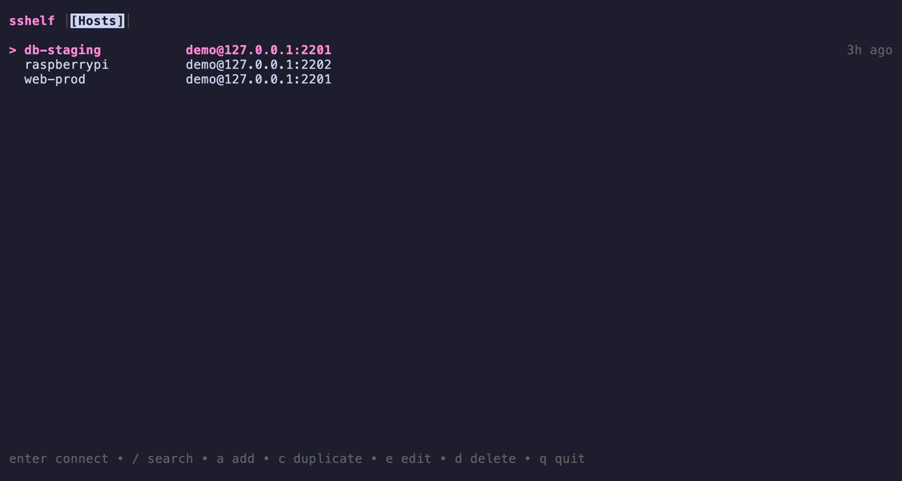

# sshelf

A terminal UI for your SSH hosts, inspired by Termius.



- Fuzzy-searchable host list
- Passwords and keys stored in the macOS Keychain or Linux Secret Service, with no master password
- Several sessions at once, as tabs
- Mouse support
- Imports `~/.ssh/config`

macOS and Linux only. ssh-agent, jump hosts, port forwarding and snippets are not implemented yet.

## Build

Requires Go (version in `go.mod`).

```sh
go build -o sshelf ./cmd/sshelf
./sshelf
```

To try it without a real server, start the demo server in another terminal. It prints a key you can use:

```sh
go run ./internal/testutil/sshtest/cmd/sshtestd -port 2201 -password demo
```

## Usage

On first launch, press `I` to import `~/.ssh/config` or `a` to add a host. The footer always lists the available keys.

### Host list

| Key | Action |
|---|---|
| `enter` or double-click | connect |
| `/` | search |
| `a` / `e` / `d` | add / edit / delete |
| `i` | identities (saved credentials) |
| `I` | import `~/.ssh/config` |
| `q` | quit |

In forms, `tab` moves between fields, `ctrl+s` saves and `esc` cancels. You can also click fields and buttons.

### Sessions

Each connection opens in a tab. While a session has focus, all keys go to the remote. To control sshelf, press `ctrl+]`, release it, then press:

| Key | Action |
|---|---|
| `1`–`9` | switch to that tab |
| `n` / `p` | next / previous tab |
| `h` | back to the host list (sessions keep running) |
| `[` | scrollback (`esc` to leave) |
| `q` | disconnect |
| `?` | help |
| `ctrl+]` | send `ctrl+]` to the remote |

When a session ends, press `r` to reconnect or `x` to close the tab.

Inside a session, the mouse is left to your terminal, so selecting and copying text works normally. Programs that ask for the mouse (vim with `set mouse=a`, htop, tmux with `mouse on`) receive it.

The first time you connect to a server, sshelf asks you to trust its host key. If the key later changes, the connection is blocked.

## Where things are stored

| What | macOS | Linux |
|---|---|---|
| Hosts and settings (`config.json`), trusted host keys | `~/Library/Application Support/sshelf/` | `~/.config/sshelf/` |
| Passwords, private keys, passphrases | Keychain, service `sshelf` | Secret Service, service `sshelf` |
| Debug log (`SSHELF_DEBUG=1`) and crash reports | `~/Library/Logs/sshelf/` | `~/.local/state/sshelf/` |

sshelf reads `~/.ssh/config` and `~/.ssh/known_hosts` but never writes to them. Secrets are not synced between machines.

## Development

The project is spec-driven: requirements, design decisions and the task plan are in [`specs/`](specs/README.md). Read [`CONTRIBUTING.md`](CONTRIBUTING.md) before making changes.

## License

MIT
