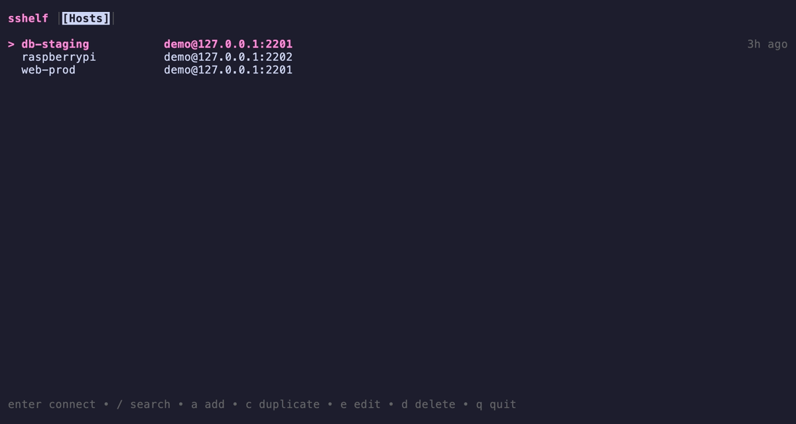

# sshelf

A terminal UI for your SSH hosts, inspired by Termius.



- Fuzzy-searchable host list
- Passwords and keys stored in the macOS Keychain or Linux Secret Service, with no master password
- Several sessions at once, as tabs
- SFTP file browser with a transfer queue, resume and edit-locally
- Mouse support
- Imports `~/.ssh/config`

macOS and Linux only. ssh-agent, jump hosts, port forwarding and snippets are not implemented yet.

## Build

Requires Go (version in `go.mod`).

```sh
go build -o sshelf ./cmd/sshelf
./sshelf
```

To try it without a real server, start the demo server in another terminal. It prints a key you can use. Add `-sftp DIR` to serve `DIR` over SFTP, with `DIR/home/pi` as the remote home:

```sh
go run ./internal/testutil/sshtest/cmd/sshtestd -port 2201 -password demo -sftp /tmp/sshelf-demo
```

## Usage

On first launch, press `I` to import `~/.ssh/config` or `a` to add a host. The footer lists the main keys that fit; `?` lists them all.

### Host list

| Key | Action |
|---|---|
| `enter` or double-click | connect |
| `/` | search |
| `a` / `e` / `d` | add / edit / delete |
| `c` | duplicate (credentials are copied; nothing is saved until you save the form) |
| `s` | open an SFTP tab |
| `i` | identities (saved credentials) |
| `I` | import `~/.ssh/config` |
| `?` | every host-list key |
| `q` | quit |

Right-click a host for a menu: Connect (SSH), Open SFTP, Edit, Duplicate, Delete (arrows or `j`/`k`, `enter`, `esc`).

In forms, `tab` moves between fields, `ctrl+s` saves and `esc` cancels. You can also click fields and buttons.

### Sessions

Each connection opens in a tab. While a session has focus, all keys go to the remote. To control sshelf, press `ctrl+]`, release it, then press:

| Key | Action |
|---|---|
| `1`–`9` | switch to the Nth tab from the left (closing a tab renumbers the ones after it) |
| `n` / `p` | next / previous tab |
| `h` | back to the host list (sessions keep running) |
| `[` | scrollback (`esc` to leave) |
| `s` | SFTP tab on this session's connection |
| `q` | disconnect, or close an SFTP tab |
| `?` | help |
| `ctrl+]` | send `ctrl+]` to the remote |

When a session ends, press `r` to reconnect or `x` to close the tab.

Tabs are clickable at any time, including the Hosts tab while a session is focused. Inside a session, sshelf does its own text selection: drag to select, double-click a word, triple-click a line. When you release the button, the selection is copied to your clipboard through the terminal (OSC 52) and the status bar shows how many characters were copied. Any key or click clears the selection. The mouse wheel scrolls back through the session's history. Programs that ask for the mouse (vim with `set mouse=a`, htop, tmux with `mouse on`) receive it instead.

Copying needs a terminal that supports OSC 52 clipboard writes, such as iTerm2, WezTerm, kitty, Ghostty, Alacritty or Windows Terminal (in tmux, `set -g set-clipboard on`). In a terminal without it, such as macOS Terminal.app, hold Option (macOS) or Shift (most other terminals) while dragging to use the terminal's own selection.

The first time you connect to a server, sshelf asks you to trust its host key. If the key later changes, the connection is blocked.

### SFTP

Press `s` on a host to open an SFTP tab, or `ctrl+]` `s` in a session to open one on the same connection without logging in again. The tab shows local files on the left (starting in the directory you ran sshelf from) and remote files on the right (starting in your remote home).

| Key | Action |
|---|---|
| `tab` | switch pane |
| `enter` / `h` / `~` | open directory / parent / home |
| `space` | mark |
| `c` | copy the marked entries, or the one under the cursor, to the other pane |
| `r` / `d` / `m` | rename / delete / new directory |
| `e` | edit locally |
| `t` | transfers |
| `/` | filter |
| `.` | show or hide dotfiles |
| `R` | refresh |
| `?` | help |

With the mouse, click to select, double-click to open, and drag entries onto the other pane to copy them.

Copies run in the background; the line above the footer shows the current one. `t` lists every transfer: `x` cancels, `r` retries, `enter` answers an "already exists" question (overwrite, skip or keep both). Files are written to a `.sshelf-part` file first and renamed when complete. If the connection drops, transfers pause; press `r` to reconnect and they continue where they stopped (or start over if the file changed).

`e` downloads a remote file (up to 64 MiB) to a private temporary copy and opens it in `$VISUAL`, `$EDITOR` or `vi`. When the editor exits, a changed file is uploaded back; if the remote file changed meanwhile, sshelf asks whether to overwrite it, keep the remote one, or save yours as `<name>.local-edit`. The temporary copy is always deleted. For a GUI editor, use its wait flag, for example `VISUAL='code -w'`.

## Where things are stored

| What | macOS | Linux |
|---|---|---|
| Hosts and settings (`config.json`), trusted host keys | `~/Library/Application Support/sshelf/` | `~/.config/sshelf/` |
| Passwords, private keys, passphrases | Keychain, service `sshelf` | Secret Service, service `sshelf` |
| Debug log (`SSHELF_DEBUG=1`) and crash reports | `~/Library/Logs/sshelf/` | `~/.local/state/sshelf/` |

sshelf reads `~/.ssh/config` and `~/.ssh/known_hosts` but never writes to them. Secrets are not synced between machines.

## Development

The project is spec-driven: requirements, design decisions and the task plan are in [`specs/`](specs/README.md). Read [`CONTRIBUTING.md`](CONTRIBUTING.md) before making changes.

## License

MIT
