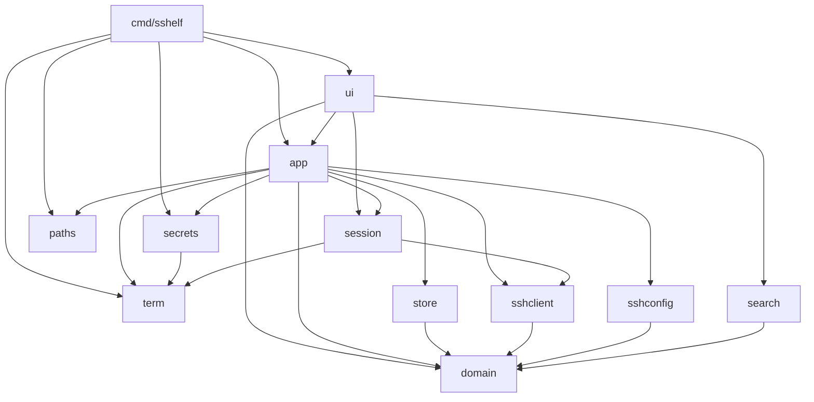
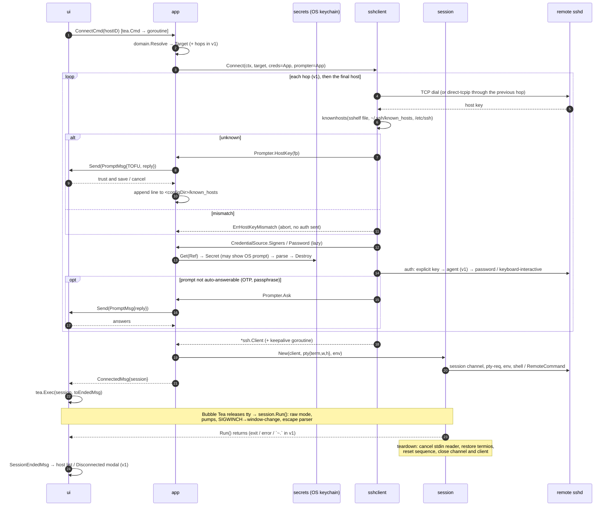
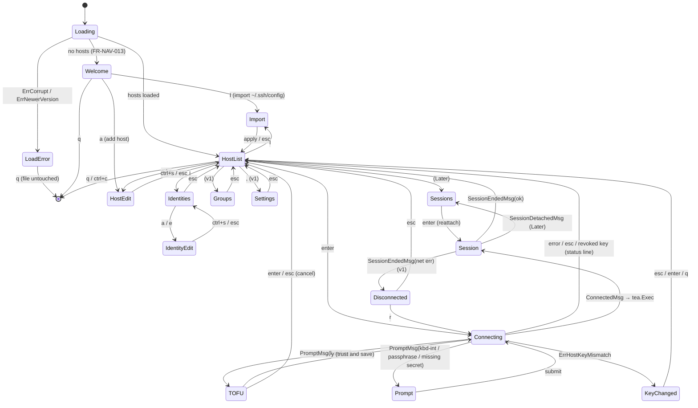

# sshelf architecture design

| | |
|---|---|
| **Owner** | Architecture |
| **Status** | Draft (revision 2: aligned with `decisions.md` D-001…D-008, D-101…D-109) |
| **Requirement prefix** | `ARCH-*` |
| **Depends on** | `decisions.md` (binding), `security/credential-storage.md` (keychain library, item naming), `product/requirements.md` (`FR-*`) |
| **Last updated** | 2026-10-29 |

This document says **how** sshelf is built: the package layout, the domain data
model, the UI state machine, the SSH connection and session lifecycle, and the
testing strategy. `decisions.md` overrides it wherever the two disagree.

---

## 1. Context and goals

### 1.1 Context

sshelf is a **TUI-only** SSH host manager, like Termius but in the terminal
(D-001). The user runs `sshelf`, picks a host and connects. There is **no
master password and no encrypted vault** (D-002). Data lives in two places:

- **Metadata** (hosts, groups, identities without their secrets, snippets,
  forward rules, settings): one plain JSON file with mode `0600` in the config
  directory. It never contains secrets (D-003).
- **Secrets** (passwords, private keys, key passphrases): the OS credential
  store. That is the macOS Keychain on macOS and the Secret Service (GNOME
  Keyring or KWallet) on Linux (D-003, D-004).

Accepted host keys go in sshelf's own `known_hosts` file in the config
directory (D-102). The binary is a single static Go program for macOS and
Linux. Windows comes later.

The current skeleton (`cmd/sshelf`, `internal/hosts`, `internal/ui`) is a
Bubble Tea v1 list of hard-coded hosts. This design replaces `internal/hosts`
with `internal/domain` and grows the UI into a multi-screen app.

### 1.2 Assumed feature scope

| Tier | Features |
|------|----------|
| **MVP** | CRUD for hosts and identities (including credentials entered in the host form); a Welcome screen; a fuzzy-searchable host list; connect with a password or a private key (stored in the keychain or referenced as a file); password auth that also answers keyboard-interactive password prompts; known-hosts verification with a TOFU prompt; import from `~/.ssh/config` |
| **v1** | groups; ssh-agent auth and agent forwarding (D-005); jump hosts (ProxyJump); local, remote and dynamic port forwarding; snippets; the `~.` escape; keepalive and reconnect; themes |
| **Later** | Background sessions (detach and reattach), SFTP browser, Mosh, split panes, Windows, an opt-in plaintext secret fallback (D-101), a system `ssh` fallback (D-104) |

### 1.3 Goals

1. **Secrets never touch disk in plaintext.** Passwords, private keys and
   passphrases go from the OS keychain to the SSH layer in memory only. sshelf
   writes no temporary files, environment variables or command-line arguments
   that contain them.
2. **Native terminal fidelity.** An interactive session behaves exactly like
   `ssh` in the user's terminal.
3. **The TUI always comes back cleanly.** After a session ends or sshelf
   panics, the terminal is usable: no raw mode, no leftover mouse tracking, and
   no stolen keystrokes.
4. **A path to multiple sessions and panes** that does not rewrite the SSH
   layer.
5. **Testable without a network or a real keychain.**
6. **Small (D-007).** Every package, requirement and mechanism here must earn
   its place.

### 1.4 Non-goals

- The keychain library choice and item naming belong to
  `security/credential-storage.md`.
- There is no lock, auto-lock, unlock screen or master password (D-002), and
  sshelf never closes sessions for security reasons (D-006).
- There is no non-interactive CLI (D-001) and no cloud sync.

---

## 2. Research summary: how other projects run sessions

| Project | Stack | Session approach | Notes |
|---|---|---|---|
| **lazyssh** (Adembc/lazyssh) | Go, tview/tcell | Runs the system `ssh` binary | A UI over `~/.ssh/config` that stores no secrets |
| **sshs** (quantumsheep/sshs) | Rust, ratatui | Runs the system `ssh` binary | Reads `~/.ssh/config` only |
| **wishlist** (charmbracelet/wishlist) | Go, Bubble Tea, wish | In-process `x/crypto/ssh` client that hands over the terminal | Local-mode auth tries IdentityFile, then the agent, then default keys. The README says password auth is unsupported. |
| **wish** (charmbracelet/wish) | Go, server side | SSH *server* for Bubble Tea apps | Its `testsession` package is useful for our tests |
| **termview**, **bubble-ssh**, **bubbleterm** | Go, Bubble Tea | Embedded `charmbracelet/x/vt` (or their own) emulator inside a Bubble Tea view | Proves that option (c) works, but the projects are young |

The tools that store no secrets can shell out to `ssh`. sshelf owns
credentials, as Termius does, so it runs SSH in process.

**Verified on 2026-10-29:** `go list -m -versions charm.land/bubbletea/v2`
lists stable releases up to `v2.1.1` (published 2026-10-28; `v2.1.0` came
before it). Companion releases are `charm.land/lipgloss/v2 v2.0.6` and
`charm.land/bubbles/v2 v2.2.1`. In v2, `tea.ExecCommand` is unchanged
(`Run`, `SetStdin`, `SetStdout`, `SetStderr`), as is
`tea.Exec(c ExecCommand, fn ExecCallback) Cmd`. A test program that passes a
custom struct type to `tea.Exec` compiles against v2.1.1. Its `Program.exec`
releases the terminal (restores the cooked state and cancels the input
reader), hands `p.input` and `p.output` to the command, calls `Run()`, and
then calls `RestoreTerminal()` on both the success and the error path. That is
exactly the hook ADR-002 needs. The check covered the API and source only. No
interactive tty run was done; task T-0 must cover that with the PTY test in
§10.

---

## 3. Architecture decisions (ADRs)

### ADR-001: In-process SSH with `golang.org/x/crypto/ssh`, not the system `ssh` binary

**Context.** Shelling out to `ssh` would mean feeding it keychain secrets
through `SSH_ASKPASS` or an ephemeral agent socket. OpenSSH would also run
TOFU itself on the raw tty, outside our UI. Jump hosts with a different
identity per hop would need a nested `ProxyCommand`, and running several
sessions or embedding them later would be impossible.

**Decision.** All SSH runs in process with `golang.org/x/crypto/ssh`,
`.../ssh/knownhosts` and, in v1, `.../ssh/agent`. sshelf never runs the system
`ssh` (D-104).

**Consequences.** Secrets stay in memory, and the TUI owns TOFU and
keyboard-interactive prompts. We implement ProxyJump, forwarding and
keepalives ourselves. OpenSSH-only features (`ProxyCommand`, `Match`,
GSSAPI, ControlMaster, PKCS#11) are not supported, and the importer flags
them.

### ADR-002: Session model, from terminal handover (MVP) to background sessions and embedded panes (Later)

**Context.** We weighed three options: (a) suspend the TUI and give the raw
terminal to an in-process session, (b) shell out to `ssh`, which ADR-001
rejects, and (c) an embedded VT emulator. Option (c) puts every keystroke and
frame through a young emulator and our renderer, so fidelity bugs and latency
would land in the feature users judge first.

**Decision.**
- **MVP, (a) handover.** A connected `session.Session` implements
  `tea.ExecCommand`, and the UI runs it with `tea.Exec`. `Run()` puts the tty
  into raw mode (`golang.org/x/term`), pipes stdin and stdout to the channel,
  maps SIGWINCH to `WindowChange`, and restores everything on return. Dial,
  host-key check and auth all happen **before** `tea.Exec`, so every prompt is
  a TUI modal.
- **Later, background sessions** (FR-TAB-001, D-007). `session.Manager` owns sessions independently
  of the UI. The `~d` escape detaches: `Run()` returns and the connection stays
  open. A headless `charmbracelet/x/vt` emulator per session records the screen
  and is used *only* to repaint on reattach, so a fidelity bug costs at most
  one imperfect repaint.
- **Later, (c) panes.** `Session` already exposes its streams, a resize method
  and the shadow emulator. A `ui/pane` component renders the emulator and
  encodes keys back. Panes are UI work only.

**Consequences.** MVP sessions have full fidelity with little code. While a
session is attached, the TUI is not drawn. The escape parser in the stdin pump
(v1, FR-CONN-014) is the only way back to the TUI other than the remote shell
exiting.

### ADR-003: Secrets go from the OS keychain to the SSH layer in memory, through a `secrets.Store` interface

**Context.** D-003 and D-004 put secrets in the OS credential store. The
security agent owns the keychain library and the item naming. Architecture
owns the boundary.

**Decision.**
- `internal/secrets` exposes the `Store` interface defined in
  `security/credential-storage.md` §5 (summarised in §6.2): the
  `zalando/go-keyring` adapter `NewOSStore` (D-008) and the in-memory
  `MemStore` for tests. Callers address a secret by
  `secrets.Ref{IdentityID, Field}`, and only the OS adapter maps a `Ref` to a
  keychain item name.
- `sshclient` never imports `secrets`. It depends on a `CredentialSource`
  interface that `app` implements on top of `secrets.Store`.
- Secrets load **lazily inside the auth callbacks** on the connect goroutine.
  The keychain can block on an OS prompt such as a keyring unlock dialog, so the UI goroutine never waits on it, and a rejected TOFU prompt
  never reads a secret.
- Private keys are parsed in memory with `ssh.ParsePrivateKey` or
  `ParsePrivateKeyWithPassphrase`. The caller zeroes the `[]byte` buffers right
  after use, as a best effort and without any other memory-hardening machinery
  (D-007). A key *referenced by path* is read from its file the same way and
  never copied.
- If no credential store is available, `Store.Available()` returns
  `ErrUnavailable`. sshelf still runs, hosts that use a key file (or, in v1,
  the agent) still connect, and saving a password or key is refused with an
  explanation (D-101).
- No secret appears in a log line, an error string, a `tea.Msg`, or a panic
  message.

**Consequences.** There is no password to manage, and access is gated by the
OS login. On Linux, any process running as the user can read an unlocked
keyring; D-003 accepts that. Deleting an identity also deletes its keychain
items.

### ADR-004: Known hosts go in sshelf's own OpenSSH-format file, and `~/.ssh/known_hosts` is read-only

**Decision.** Accepted host keys are appended to `<configDir>/known_hosts` in
standard OpenSSH format, using `knownhosts.Line`, with mode `0600` (D-102).
sshelf verifies host keys with `knownhosts.New(<configDir>/known_hosts,
~/.ssh/known_hosts, /etc/ssh/ssh_known_hosts)`, skipping files that do not
exist, and never writes to the OpenSSH files. Hostnames are stored unhashed so
the file stays readable and editable.

**Consequences.** Importing from OpenSSH brings its existing trust along with
no TOFU prompts. A user can inspect, `grep`, or delete lines with any editor.
Replacing a changed key means deleting the stale line whose path and line
number the block screen shows (MVP, FR-KH-002), or using the known-hosts view
(v1, FR-KH-005). Keys that come from `~/.ssh/known_hosts` must be fixed there.

### ADR-005: Directories and the metadata file

**Decision.**

| Item | Linux | macOS |
|---|---|---|
| Config dir (`config.json`, `known_hosts`) | `$XDG_CONFIG_HOME/sshelf/` (default `~/.config/sshelf/`) | `~/Library/Application Support/sshelf/`, or `$XDG_CONFIG_HOME/sshelf/` if that variable is **explicitly** set |
| Log and crash reports | `$XDG_STATE_HOME/sshelf/` (default `~/.local/state/sshelf/`) | `~/Library/Logs/sshelf/` |

`--config <dir>` overrides the config dir, and that flag is the only override
(D-007). Directories are created with mode `0700` and files with mode `0600`.
`internal/paths` is the only code that resolves these paths.

The metadata is a **single `config.json`** with a `"version"` field, read and
written with stdlib `encoding/json` (no new dependency, D-007). Saves are
atomic: write a temp file in the same directory, `fsync`, then `rename`. From v1
(FR-CFG-004), before saving, `store` checks whether the file's modification
time changed since it was loaded. If it did, for example because a second sshelf instance or a
manual edit changed it, the save is refused and the UI offers to reload. That
avoids silent lost updates without locks, lock files or backups (D-007). TOML was rejected because it
adds a dependency, and the UI is the primary editor anyway.

### ADR-006: Command-line flags use stdlib `flag` (replaces "CLI framework is kong")

**Context.** D-001 leaves only `--version`, `--help` and `--config <dir>`.

**Decision.** Use the stdlib `flag` package in `cmd/sshelf/main.go`. There is
no CLI framework, no subcommands and no shell completion.

### ADR-007: Adopt Bubble Tea v2, Bubbles v2 and Lip Gloss v2 now

**Context.** The skeleton pins `bubbletea v1.3.10` and `lipgloss v1.1.0`.
§2 verified that stable v2 releases exist and that `tea.Exec` with a custom
`ExecCommand` keeps the same contract. Migrating now costs about 70 lines of
skeleton code. Migrating after the MVP would touch every screen.

**Decision.** In task T-0, move to `charm.land/bubbletea/v2`,
`charm.land/bubbles/v2` and `charm.land/lipgloss/v2`, pinned to the latest
v2.1.x / v2.x patch available at T-0. That is currently bubbletea `v2.1.1`,
bubbles `v2.2.1` and lipgloss `v2.0.6`. If `v2.1.1` shows a regression,
`v2.1.0` is the fallback. The PTY attach test (§10) is a T-0 exit criterion.

**Consequences.** `View()` returns `tea.View`, and v2 key messages replace
`tea.KeyMsg` (`tea.KeyPressMsg`). The snippets in this document follow the v2
API in spirit, so translate any remaining v1 names.

### ADR-008: Entity IDs are UUIDv7 strings

**Decision.** IDs are lowercase UUIDv7 strings from `github.com/google/uuid`.
They are stable across renames, so a host can reference an identity safely,
and the security spec can use them as stable keychain item keys. Labels are
display names only. They may contain spaces (D-105) and must be unique,
case-insensitively (FR-HOST-003), but nothing references an entity by label.

### ADR-009: Package import rules are enforced by a test

**Decision.** `internal/archtest` runs `go list -deps` and fails on any
forbidden edge in §5.2, and on any import of `os/exec` by an sshelf package,
because sshelf's own code never starts a child process. The only child
process is `/usr/bin/security`, run by `zalando/go-keyring` on macOS, which
D-008 accepts. A single Go test is enough; there is no extra linter
configuration (D-007).

### ADR-010: `~/.ssh/config` import copies data once and references keys by path

**Decision.** Import is a one-way copy with a preview (D-103), parsed by
sshelf's own small parser in `internal/sshconfig` (stdlib only), with `Include` expanded and the
`%h`/`%p`/`%r`/`~` tokens resolved. `Match` blocks are skipped and listed in the
preview, never evaluated. Implemented as an in-house parser instead of
`github.com/kevinburke/ssh_config` (the original choice) because that library
resolves `Include` against the real home directory, which makes fixture tests
impossible, and it evaluates `Match`; the parser takes the home directory as
an option. An `IdentityFile` becomes an identity
**referencing the key file by path**. Import does not copy the key into the
keychain, because it should never silently duplicate secrets. Afterwards the
identity screen offers "Store key in keychain" (D-004), which leaves the
original file untouched. sshelf never writes to
`~/.ssh/config`.

### ADR-011: Own text input instead of Bubbles `textinput`

**Context.** Bubbles v2 `textinput` imports a clipboard package for its paste
binding. SEC-CLIP-005 forbids any clipboard package, and `archtest` fails on
one.

**Decision.** Implemented as sshelf's own `components.TextInput`
(`internal/ui/components/textinput.go`) instead of Bubbles `textinput`,
because the Bubbles component pulls in a clipboard package. Paste arrives
from the terminal as `tea.PasteMsg` and needs no clipboard access. The input
passes typed and pasted text through `domain.Sanitize`, supports plain,
masked and no-echo modes (FR-IDENT-004), zeroes its runes on `Reset` and
never leaves an unzeroed copy behind, so it can hold a secret. Every form and
modal (host form, identity form, prompt modal) uses it. Bubbles packages that
need no clipboard, such as `key`, are still used.

---

## 4. Architecture requirements

Each `MVP` requirement shows its status next to its priority; every other
requirement is **Draft**. "The system" means the sshelf
binary. IDs are never reused, so gaps in the numbering are requirements
removed in revision 2.

### 4.1 Sessions (`ARCH-SESS`)

**ARCH-SESS-001**: The system shall open SSH sessions in process with `golang.org/x/crypto/ssh` and shall start no child process other than the `/usr/bin/security` calls made by `zalando/go-keyring` on macOS (D-008).
- Priority: MVP · Status: Implemented
- Acceptance: `archtest` finds no import of `os/exec` in any sshelf package. A connect test against the in-process server passes on a machine without OpenSSH installed.

**ARCH-SESS-002**: When the user connects to a host, the system shall finish dialling, host-key verification and authentication before it releases the terminal to the session.
- Priority: MVP · Status: Implemented
- Acceptance: A keyboard-interactive prompt appears as a TUI modal (golden file). If auth fails, the user returns to the host list with an error, and `tea.Exec` is never invoked.

**ARCH-SESS-003**: While a session is attached, the system shall put the terminal into raw mode and relay input and output unchanged, except for the escape sequences in ARCH-SESS-006 (v1).
- Priority: MVP · Status: Implemented
- Acceptance: In an integration test, 256 random bytes (excluding the escape character at line start) arrive at the server unchanged, and binary output from the server reaches the writer unchanged.

**ARCH-SESS-004**: When the local terminal is resized while a session is attached, the system shall send an SSH `window-change` request with the new size within 100 ms.
- Priority: MVP · Status: Implemented
- Acceptance: A fake `Terminal` emits a resize event, and the test server records the matching `window-change`. A burst of resize events within 50 ms produces at most 2 requests.

**ARCH-SESS-005**: When an attached session ends for any reason (remote exit, network error, `~.`, or a panic in a session goroutine), the system shall restore the saved terminal state, write the reset sequence in §8.6, and return control to the TUI.
- Priority: MVP · Status: Implemented
- Acceptance: A PTY test (creack/pty) runs each case. Afterwards `stty -a` matches its value before the session, the host list redraws, and the next keystroke reaches the TUI.

**ARCH-SESS-006**: When the user types the escape character (default `~`) at the start of a line, the system shall treat the next character as a command: `.` disconnects, `?` shows help, `~` sends a literal `~`, and `d` detaches (Later).
- Priority: v1 (`d` is Later) · Source: FR-CONN-014
- Acceptance: Unit tests on the parser. "Line start" means the beginning of the session or right after `\r` or `\n`. Any other `~x` sends both characters. `Settings.EscapeChar = "none"` disables the parser.

**ARCH-SESS-007**: While a connection is open, the system shall send `keepalive@openssh.com` requests every `ServerAliveInterval` (default 30 s) and close the connection after `ServerAliveCountMax` (default 3) unanswered requests in a row.
- Priority: v1 · Source: FR-CONN-009
- Acceptance: With a server that stops replying and a fake clock, the session ends with `ErrKeepaliveTimeout`. An interval of 0 disables keepalives.

**ARCH-SESS-008**: If a session ends because of a network or keepalive error, then the system shall show a "Disconnected" modal with the cause and offer `r` to reconnect to the same host.
- Priority: v1 · Source: FR-CONN-010
- Acceptance: Golden file of the modal. Pressing `r` produces a `ConnectRequestMsg` with the same host ID.

**ARCH-SESS-009**: Where agent forwarding is enabled for a host, the system shall forward the local ssh-agent (`SSH_AUTH_SOCK`) to the server, and shall never forward an agent by default.
- Priority: v1
- Acceptance: In an integration test, with forwarding off no `auth-agent@openssh.com` channel opens. With it on, the server can list the local agent's keys.

**ARCH-SESS-010**: The system shall keep sessions in a `session.Manager` that owns connection lifetimes independently of the UI, so that sessions can be detached and reattached.
- Priority: Later · Source: FR-TAB-001
- Acceptance: Open 3 sessions, detach them, then reattach each one: input reaches the right server. Quitting sshelf with sessions open asks for confirmation.

**ARCH-SESS-011**: When a session is reattached, the system shall repaint the screen from that session's headless emulator before it resumes passthrough.
- Priority: Later · Source: FR-TAB-001
- Acceptance: The server writes a known screen while the session is detached. Feeding the bytes emitted on reattach into a reference emulator reproduces that screen.

**ARCH-SESS-012**: Where a host has a jump chain, the system shall connect hop by hop over in-process `direct-tcpip` channels, with each hop's own identity and host-key verification.
- Priority: v1
- Acceptance: An integration test uses 2 in-process servers with different identities. A TOFU prompt fires for each unknown hop.

**ARCH-SESS-013**: The system shall support local, remote and dynamic (SOCKS5) forwarding with in-process listeners that are bound to `127.0.0.1` by default and closed with the connection.
- Priority: v1
- Acceptance: One integration test per kind sends an HTTP request through the forward. The listener is closed after the disconnect.

### 4.2 Connection and authentication (`ARCH-CONN`)

**ARCH-CONN-001**: The system shall offer only the authentication methods that the identity configures, in this order: the identity's explicit key (stored or file), then (v1) the ssh-agent if allowed, then password or keyboard-interactive, whichever the server offers.
- Priority: MVP (the agent step is v1) · Status: Implemented
- Acceptance: A table test over identity configurations checks the `[]ssh.AuthMethod` built. The test server confirms the order of attempts: key before password in the MVP, and key, agent, password in v1.

**ARCH-CONN-002**: When the server sends a keyboard-interactive challenge, the system shall answer a single no-echo prompt matching `/password/i` with the identity's stored password, and show every other prompt, such as an OTP, in a TUI modal.
- Priority: MVP · Status: Implemented · Source: FR-CONN-008
- Acceptance: A server that accepts passwords only through keyboard-interactive connects with the stored password and no modal. A test server with a password plus OTP challenge: the password is filled automatically and the OTP modal appears. Cancelling the modal aborts with `ErrAuthCancelled`.

**ARCH-CONN-003**: When the server presents a host key that no known_hosts file knows, the system shall show a TOFU modal with the key type and SHA256 fingerprint and the two choices "Trust and save" and "Cancel", and continue only after "Trust and save".
- Priority: MVP · Status: Implemented · Source: FR-KH-001 ("Trust once" is v1, FR-KH-007)
- Acceptance: Golden file of the modal. "Trust and save" appends one line to `<configDir>/known_hosts`. Enter, Esc and "Cancel" all fail with `ErrHostKeyRejected` and write nothing. Neither action changes `~/.ssh/known_hosts` (its size and mtime are unchanged).

**ARCH-CONN-004**: If a presented host key does not match a known key for that host, then the system shall abort before authenticating and show the old and new fingerprints, with no "accept" shortcut.
- Priority: MVP · Status: Implemented
- Acceptance: The test server records zero auth attempts. The modal shows the path and line number of the stale entry and how to remove it (FR-KH-002).

**ARCH-CONN-005**: The system shall pass a `context.Context` to every network and keychain operation of a connection attempt so that the user can cancel it with `esc`.
- Priority: MVP · Status: Implemented
- Acceptance: Cancelling during dial and during auth returns to the host list within 200 ms. `goleak` passes.

### 4.3 Secrets and safety (`ARCH-SEC`)

**ARCH-SEC-001**: The system shall not write any secret to the config file, known_hosts, logs, crash reports, environment variables or temporary files.
- Priority: MVP · Status: Draft
- Acceptance: An integration test with `secrets.MemStore` holding a canary password and key does a connect, an edit and a save, then scans the config dir, the log dir, the temp dir and `os.Environ()`. The canary appears zero times.

**ARCH-SEC-002**: The system shall give the SSH layer credentials only through the `CredentialSource` interface, and `internal/sshclient` shall not import `internal/secrets` or `internal/store`.
- Priority: MVP · Status: Implemented
- Acceptance: `archtest` passes.

**ARCH-SEC-006**: If no OS credential store is available, then the system shall still start and connect hosts that use key files, and shall disable saving passwords and keys with a visible explanation.
- Priority: MVP · Status: Implemented
- Acceptance: With a `secrets.Store` that returns `ErrUnavailable`, a key-file host connects, the password field is read-only with an explanatory hint (golden file), and nothing is written anywhere.

**ARCH-SEC-004**: The system shall run a panic handler in `main` and a recovering wrapper around every goroutine it starts, each of which restores the terminal before it writes a crash report that contains no secrets.
- Priority: MVP · Status: Implemented
- Acceptance: A panic forced in a session goroutine and one forced in `Update` (behind the `sshelf_faultinject` build tag) both leave the terminal in cooked mode (PTY test). The canary scan of the crash report is clean.

### 4.4 Packages and data (`ARCH-PKG`, `ARCH-DATA`)

**ARCH-PKG-001**: The system shall follow the package layout and import rules in §5, enforced by `internal/archtest`.
- Priority: MVP · Status: Implemented
- Acceptance: A deliberately forbidden import makes the test fail.

**ARCH-PKG-002**: The system shall resolve file locations only through `internal/paths` (ADR-005), creating directories with mode 0700 and files with mode 0600.
- Priority: MVP · Status: Implemented
- Acceptance: Table tests with an injected environment cover Linux, Linux with XDG set, macOS, macOS with XDG set, and `--config`. A permission check runs after the first save.

**ARCH-DATA-001**: The system shall identify every entity by an immutable UUIDv7 and reference other entities only by ID.
- Priority: MVP · Status: Implemented
- Acceptance: Renaming an identity changes no host record. Deleting an identity that hosts still reference requires confirmation and clears those references.

**ARCH-DATA-005**: If `config.json` changed on disk since it was loaded, then the system shall refuse to save and offer to reload.
- Priority: v1 · Source: FR-CFG-004 (the atomic write itself is MVP: ADR-005, FR-CFG-002, SEC-FILE-003)
- Acceptance: An external modification between load and save produces `ErrConflict` and the reload prompt, and the file is unchanged.

**ARCH-DATA-003**: When importing `~/.ssh/config`, the system shall show a preview of the hosts and identities to create and the directives it does not support, before it saves anything.
- Priority: v1 · Source: FR-IMPORT-004
- Acceptance: Fixture configs cover `Include`, `Host *` defaults, wildcard-only patterns (skipped with a note), `ProxyJump`, `ProxyCommand` and `Match` (both flagged). Golden file of the preview.

**ARCH-DATA-004**: When an identity is deleted, or one of its secrets is cleared, the system shall delete the matching keychain items and show a warning naming any item it could not delete, without tracking it (SEC-CRED-004).
- Priority: MVP · Status: Implemented
- Acceptance: With `secrets.MemStore`, deleting an identity leaves no `Ref` with that identity's ID. With a failing `Delete`, a warning names the item and nothing is written to `config.json`.

### 4.5 UI (`ARCH-UI`)

**ARCH-UI-001**: The system shall run one root Bubble Tea model that routes messages to one active screen and a stack of modal overlays, as defined in §9.
- Priority: MVP · Status: Draft
- Acceptance: A teatest walk-through (start, list, edit, save, connect, TOFU, stub session, back) matches its golden files.

**ARCH-UI-002**: The system shall perform all I/O (config, keychain, SSH, filesystem) in `tea.Cmd` values or goroutines that report back with messages, never inside `Update`.
- Priority: MVP · Status: Implemented
- Acceptance: In UI tests, `app.Service` is a fake that panics if it is called synchronously from `Update` (it checks a goroutine marker).

**ARCH-UI-003**: The system shall filter the host list with fuzzy matching over label, hostname, user, group and tags, within 16 ms for 5,000 hosts.
- Priority: v1 (MVP search covers label, hostname and user, FR-NAV-002)
- Acceptance: `BenchmarkFilter5k` stays under 16 ms per operation on the CI runner.

**ARCH-UI-004**: The system shall define every keybinding in a single `ui/keys` keymap, and the help screen and footer shall be generated from it.
- Priority: MVP · Status: Implemented
- Acceptance: A test checks that every binding has help text and that no two bindings in the same screen share a key.

### 4.6 Testing (`ARCH-TEST`)

**ARCH-TEST-001**: The system shall have an in-process SSH test server (`internal/testutil/sshtest`) that supports password, public key, keyboard-interactive, PTY, window-change and exec requests (and `direct-tcpip`, `tcpip-forward` and agent forwarding in v1), and records every request.
- Priority: MVP · Status: Implemented
- Acceptance: CI runs the integration suite with `-race` on Linux and macOS, using loopback only and no real keychain.

---

## 5. Package layout

### 5.1 Packages and responsibilities

```
cmd/sshelf/                 main: process hardening first (an unexported function: RLIMIT_CORE=0,
                            PR_SET_DUMPABLE=0 on Linux, SEC-MEM-003), stdlib flag parsing (--version,
                            --help, --config), top-level panic handler, debug-log setup, wiring:
                            paths → store → secrets → app → ui.
internal/
  domain/                   Pure types: Host, Group, Identity, Snippet, ForwardRule, Settings, ID.
                            Validation and inheritance resolution. Stdlib plus github.com/google/uuid
                            (ADR-008). (Replaces internal/hosts.)
  store/                    Load/Save of config.json (atomic, 0600, mtime conflict check) ⇄ domain.Data.
  secrets/                  Store interface (Get/Set/Delete/Available by Ref), zalando/go-keyring adapter
                            (item naming per security/credential-storage.md), MemStore for tests.
                            Uses term.SafeGo for the goroutine that bounds each keyring call.
  paths/                    Resolve the config dir and log dir (ADR-005).
  app/                      Use cases: CRUD, import, connect orchestration, TOFU write-back.
                            Implements sshclient.CredentialSource and sshclient.Prompter.
                            Exposes the UI-facing Service interface.
  sshclient/                Dial, jump chain (v1), host-key callback (knownhosts), auth methods,
                            keyboard-interactive bridge, keepalive, agent (v1), forwarding (v1).
  session/                  Session (a channel with a PTY) implementing tea.ExecCommand: raw mode, pumps,
                            SIGWINCH, escape parser (v1). Later: Manager, shadow emulator (x/vt).
  sshconfig/                Parse ~/.ssh/config (Include, tokens) into an import plan. Own parser,
                            stdlib only (ADR-010).
  search/                   Fuzzy matching and ranking (sahilm/fuzzy).
  term/                     Terminal state save/restore, reset sequence, term.SafeGo (panic-safe
                            goroutines, ARCH-SEC-004).
  ui/                       Root model, router, modal stack.
    keys/  theme/  components/        components holds TextInput, Form and the secret field (ADR-011).
    screens/welcome|hostlist|hostedit|identities|identityedit|loaderror|groups(v1)|sessions(Later)|settings|import/
    modals/connecting|tofu|prompt|keychanged|disconnected|confirm|help/
  testutil/sshtest/         In-process SSH server for tests.
  archtest/                 Import rule test (ADR-009).
```

Compared with revision 1, the `vault`, `crypto`, `config`, `cli` and `logx`
packages are gone. Logging is a few lines of `log/slog` setup in `main`
(`cmd/sshelf/log.go`) and needs no package of its own (D-007). It is off unless
the environment variable `SSHELF_DEBUG` is exactly `1` (SEC-LOG-003): then
records go to `<stateDir>/` (ADR-005) in a 0600 file rotated at 5 MiB with one
`.1` backup. Otherwise every record is discarded and no file or state
directory is created.

`screens/import` is the directory; its package is named `importscreen`
because `import` is a Go keyword. `screens/settings`, `modals/help` and
`modals/disconnected` are empty placeholders until their v1 features.

### 5.2 Dependency rules



| Package | May import (internal) | Must NOT import |
|---|---|---|
| `domain` | none (external: stdlib and `google/uuid` only) | any other `internal/` package, `x/crypto/ssh` |
| `store` | `domain` | `ui`, `app`, `sshclient`, `session` |
| `secrets` | `domain`, `term` | `ui`, `app`, `sshclient`, `session` |
| `sshclient` | `domain` | `secrets`, `store`, `ui`, `app`, Bubble Tea |
| `session` | `sshclient`, `term` | `secrets`, `store`, `ui`, `app`. It satisfies `tea.ExecCommand` structurally, so it does not import Bubble Tea. |
| `ui/...` | `app` (interfaces), `domain`, `search`, `session` (the handle type only), `ui/*` | `secrets`, `store`, `sshclient`, `x/crypto/ssh` |
| `app` | everything except `ui` | `ui` |
| `sshconfig`, `search` | `domain` | (no extra rule; not checked by `archtest`) |
| `paths`, `term` | none | (no extra rule; not checked by `archtest`) |
| any sshelf package | | `os/exec` (D-008's `/usr/bin/security` call happens inside `zalando/go-keyring`), any clipboard package (SEC-CLIP-005) |

Implemented with `secrets` allowed to import `term`, because the OS store
runs each keyring call in a goroutine bounded by a timeout, and every goroutine
sshelf starts must go through `term.SafeGo` (ARCH-SEC-004). `term` imports no
other `internal/` package, so the edge cannot create a cycle. `main` wires
`store` through `app`, so it no longer imports `store` directly. `ui` may
import `session` but currently does not: it receives the session handle as
an `app` type. The rows above match the `rules` table in
`internal/archtest/archtest_test.go`.

---

## 6. Storage interfaces

### 6.1 `store`: metadata

```go
package store

// Load reads config.json. A missing file returns an empty Data with FirstRun=true.
func Load(path string) (*Snapshot, error)          // ErrCorrupt (with line/col), ErrNewerVersion

type Snapshot struct {
	Data     domain.Data
	FirstRun bool
	modTime  time.Time // for the conflict check
}

// Save writes atomically (temp + fsync + rename, 0600) and fails with ErrConflict
// if the file's mtime differs from the snapshot's.
func Save(path string, s *Snapshot) error
```

`domain.Data` is `{Version int; Hosts []Host; Groups []Group; Identities
[]Identity; Snippets []Snippet; Forwards []ForwardRule; Settings Settings}`.
`app` holds the one in-memory snapshot and saves after each mutation. A
`config.json` with a newer `Version` is refused, never downgraded.

### 6.2 `secrets`: OS credential store

The `secrets` API is owned by `security/credential-storage.md` §5; this is a
summary. `Store` has `Get`, `Set`, `Delete` and `Available`, all taking a
`context.Context`. Secrets are addressed by `Ref{IdentityID, Field}`, where
`Field` is `password`, `private-key` or `key-passphrase`, and are carried as
`secrets.Secret` (a redacting `[]byte` wrapper with `Destroy()`). The sentinel
errors are `ErrNotFound`, `ErrUnavailable` (D-101), `ErrDenied` and
`ErrTooLarge` (over 2800 bytes, D-008). `NewOSStore(service)` is the
`zalando/go-keyring` adapter and `NewMemStore()` is the test fake.

`ctx` exists because a keychain call can block on an OS dialog.
go-keyring has no context support, so the adapter runs the call in a goroutine
and returns `ctx.Err()` when the context is cancelled.

---

## 7. Domain data model

### 7.1 Type sketches

```go
package domain

type ID string // UUIDv7 (ADR-008)

type Meta struct {
	ID        ID
	CreatedAt time.Time // UTC
	UpdatedAt time.Time // UTC
}

type Host struct {
	Meta
	Label       string   // display name, may contain spaces (D-105)
	Hostname    string   // OpenSSH HostName
	Port        int      // 0 = inherit (group, then 22)
	User        string   // "" = identity username, then group, then $USER
	GroupID     ID       // "" = top level
	Tags        []string
	Notes       string
	IdentityID  ID       // "" = inherit from group; the only link to credentials
	JumpHostIDs []ID     // ordered ProxyJump chain (v1)
	ForwardIDs  []ID     // ForwardRules started with this host (v1)
	Options     HostOptions
	Favorite    bool
	LastConnectedAt *time.Time
	Import      *ImportSource // nil when created in sshelf
}

type HostOptions struct { // zero value = inherit from group, then Settings
	ForwardAgent        bool           // v1; default false
	ServerAliveInterval *time.Duration
	ServerAliveCountMax *int
	ConnectTimeout      *time.Duration
	RemoteCommand       string         // "" = login shell
	SetEnv              map[string]string
	Term                string         // "" = $TERM, else xterm-256color
}

type ImportSource struct {
	File        string    // absolute path of the config file the block came from
	Alias       string    // the concrete alias imported
	Line        int
	ImportedAt  time.Time
	Unsupported []string  // e.g. "ProxyCommand", "Match", "ControlMaster"
}

type Group struct {
	Meta
	Name     string
	ParentID ID // "" = top level; max depth 4
	Defaults GroupDefaults
}

type GroupDefaults struct {
	User        string
	Port        int
	IdentityID  ID
	JumpHostIDs []ID
	Options     HostOptions
}

// Identity holds no secret material. Which secrets exist is recorded as flags,
// so the UI can render "set" / "not set" (SEC-LOG-005) without touching the keychain.
type Identity struct {
	Meta
	Label         string
	Username      string // optional; a host's User wins
	Hidden        bool   // per-host identity created from the host form (FR-HOST-010)
	HasPassword   bool   // secrets.Ref{ID, Password} exists
	HasKey        bool   // secrets.Ref{ID, PrivateKey} exists
	HasPassphrase bool   // secrets.Ref{ID, KeyPassphrase} exists
	KeyPath       string // alternative to HasKey: key file on disk, read but never copied
	PublicKey     string // authorized_keys line, for display and copying
	UseAgent      bool   // v1
}

type ForwardRule struct { // v1
	Meta
	Label     string
	Kind      string // "local" | "remote" | "dynamic"
	BindAddr  string // default "127.0.0.1"
	BindPort  int
	DestHost  string // unused for dynamic
	DestPort  int
	AutoStart bool
}

type Snippet struct { // v1
	Meta
	Label string
	Body  string // command run on one or more hosts (FR-SNIP-003/004)
	Tags  []string
}

type Settings struct {
	ServerAliveInterval time.Duration // default 30s
	ServerAliveCountMax int           // default 3
	ConnectTimeout      time.Duration // default 10s (FR-CONN-006)
	EscapeChar          string        // default "~"; "none" disables
	Theme               string        // v1
	HostListSort        string        // "label" | "recent"
}
```

The `Has*` flags can drift from the keychain if the user deletes items with
the OS tools. A missing secret then shows up at connect time as
`ErrNotFound`, and the UI says "password not found in keychain, enter it
again" and clears the flag. sshelf does not run a sync check (D-007).

### 7.2 Resolution

`domain.Resolve(host, groups, identities, settings) Target` gives each field
the first non-zero value in this order: **host → group chain (nearest first)
→ Settings → built-in default**. The username follows FR-IDENT-002 instead:
**host → identity → group chain → `$USER`**. `sshclient` receives
only the resolved `Target`.

### 7.3 `~/.ssh/config` mapping

| OpenSSH | sshelf |
|---|---|
| `Host` concrete alias | `Host.Label`; wildcard-only blocks are skipped. `Host *` values can become a group's defaults (user choice in the preview). |
| `HostName`, `Port`, `User` | `Hostname`, `Port`, `User` |
| `IdentityFile` | `Identity{KeyPath}`, deduplicated by path (ADR-010) |
| `ProxyJump` | `JumpHostIDs` (v1; aliases resolve to the imported hosts) |
| `LocalForward`, `RemoteForward`, `DynamicForward` | `ForwardRule`s (v1) |
| `ForwardAgent` | `Options.ForwardAgent` (v1) |
| `ServerAliveInterval`, `ServerAliveCountMax`, `ConnectTimeout`, `RemoteCommand`, `SetEnv` | `HostOptions` |
| `ProxyCommand`, `Match`, `ControlMaster`, `GSSAPI*`, `PKCS11Provider`, … | `ImportSource.Unsupported`, shown in the preview |

---

## 8. Connection lifecycle

### 8.1 Sequence



### 8.2 Notes on each step

1. **Resolve.** In v1, the jump chain is checked for cycles and a maximum
   depth of 8.
2. **Lazy secrets.** The auth callbacks call `CredentialSource`, which calls
   `secrets.Store.Get` with the connect context. A cancelled or rejected TOFU
   prompt never touches the keychain. `ErrDenied` (the user cancelled the OS
   prompt) aborts with a clear message, and `ErrNotFound` triggers the
   "enter it again" prompt (§7.1).
3. **Jump chain (v1).** `ssh.NewClientConn(prev.Dial("tcp", hop))`, with its
   own `Target`, identity and host-key check per hop.
4. **Dial.** `net.Dialer.DialContext` with `ConnectTimeout`. Cancelling the
   context closes the connection, which also unblocks the handshake.
5. **Host key.** `HostKeyAlgorithms` is set to the key types already known for
   that host, the same trick OpenSSH uses, so a host with a known ed25519 key
   is not reported as unknown when it offers RSA first. The list is taken from
   `ssh.SupportedAlgorithms().HostKeys` in x/crypto's preference order, so a
   known RSA key pins `rsa-sha2-256` and `rsa-sha2-512` only: SHA-1 `ssh-rsa`
   (and DSA) is never offered (SEC-SESSION-004, SEC-HOSTKEY-007). With no
   known key the list is left empty and x/crypto's defaults apply.
6. **Auth.** `ssh.PublicKeysCallback`, `ssh.KeyboardInteractive(bridge)` and
   `ssh.PasswordCallback`. If an encrypted key has no stored passphrase, the
   user gets a prompt. A "save to keychain" checkbox on that prompt is v1
   (FR-IDENT-005).
7. **PTY.** `RequestPty(term, h, w, {ECHO:1, TTY_OP_ISPEED/OSPEED:14400})`.
   `SetEnv` entries are sent as `env` requests, and rejections are ignored.

### 8.3 Bridging blocking callbacks to the TUI

The host-key, keyboard-interactive and passphrase callbacks are synchronous
and run on the connect goroutine. `app`'s `Prompter`:

```go
func (p *uiPrompter) Ask(ctx context.Context, q Prompt) (Answer, error) {
	reply := make(chan Answer, 1)
	p.send(PromptMsg{Prompt: q, Reply: reply}) // tea.Program.Send
	select {
	case a := <-reply:
		return a, nil
	case <-ctx.Done():
		return Answer{}, ctx.Err()
	}
}
```

### 8.4 The attach pump (`session.Run()`)

```
Run():
  st := term.GetState(fd); defer restoreAndReset(st)   // on every path, including panic (recover → restore → re-panic)
  term.MakeRaw(fd)
  in := cancelreader.NewReader(stdin); defer in.Cancel() // otherwise our reader steals the TUI's next keystroke
  go safego(winch: SIGWINCH → debounce 30ms → GetSize → WindowChange)
  go safego(remote stdout → stdout [+ shadow emulator, Later])
  go safego(remote stderr → stderr)
  go safego(stdin → escape parser → remote stdin)
  wait: session.Wait() | "~." (v1) | "~d" (Later) | keepalive failure (v1)
```

`Terminal` (raw mode, size and resize events) is an interface, so tests drive
`Run()` with pipes and a fake.

### 8.5 Escape sequences

The escape sequences follow OpenSSH's, so muscle memory carries over. They are
recognised at line start only.

| Sequence | Action | Tier |
|---|---|---|
| `~.` | Disconnect and return to sshelf | v1 |
| `~?` | Show escape help (local only) | v1 |
| `~~` | Send a literal `~` | v1 |
| `~d` | Detach; the session keeps running | Later |

`Settings.EscapeChar` changes the character, which matters for nested `ssh`
sessions or keyboard layouts where `~` is a dead key.

### 8.6 Terminal restore and edge cases

| Situation | Handling |
|---|---|
| Normal end | Restore termios, then write the reset sequence: `ESC[?1049l`, mouse off (`?1000l ?1002l ?1003l ?1006l`), `?2004l`, `?1l ESC>`, `?25h`, `ESC[0m` and `ESC[<u`. Then Bubble Tea's `RestoreTerminal` runs (§2). |
| Panic in a session goroutine | `safego` recovers it and cancels the session. `Run()` returns `ErrInternal` through the normal restore path, and the app keeps running. |
| Panic in `Run()` or `Update` | `Run`'s defer restores and re-panics, Bubble Tea's recovery restores its state, and `main`'s `recover` restores the startup `term.State`, writes the reset sequence and a crash report, and exits 70. |
| SIGTERM or SIGHUP while attached | The root context is cancelled and `Run()` unwinds through the normal restore path. |
| Ctrl-C or Ctrl-Z while attached | They are raw bytes, sent to the remote. |
| stdin is not a TTY | sshelf exits with "sshelf needs an interactive terminal" (D-001). |

### 8.7 Keepalive and reconnect

In v1, one goroutine per client sends `keepalive@openssh.com` with a timeout
of one interval (ARCH-SESS-007). Reconnect is always user-initiated (`r` in the
Disconnected modal), because an interactive shell cannot be resumed after a
disconnect. sshelf does not auto-reconnect (D-007). Mosh (Later) is the answer
to roaming.

---

## 9. UI state machine

### 9.1 Screens and transitions



- Startup goes straight to the host list. The **Welcome** screen (FR-NAV-013)
  appears instead whenever `config.json` has no hosts, including first run,
  and offers `I` import and `a` add host.
- If the keychain is unavailable (ARCH-SEC-006), a one-line banner says so on
  the host list and in the identity editor.
- Connecting, TOFU, Prompt, KeyChanged, Disconnected, Confirm and Help are **modals**
  stacked over the current screen.
- A changed host key (`ErrHostKeyMismatch`) opens the **KeyChanged** block
  modal (FR-KH-002, ARCH-CONN-004), which only closes back to the host list.
  A revoked key (`ErrHostKeyRevoked`) is implemented as a status-bar line,
  "`<label>`: host key revoked (`<file>` line `<n>`); connection refused",
  rather than a block screen, because there are no two fingerprints to
  compare and no action to offer (SEC-HOSTKEY-003 AC2).
- **Session** is not rendered. It is the window during which `tea.Exec` holds
  the terminal.

### 9.2 Root model and messages

```go
type Root struct {
	app      app.Service
	screen   Screen  // Update(tea.Msg) (Screen, tea.Cmd); View() string; Keys() []key.Binding
	modals   []Modal // the top one receives input first
	toast    *Toast
	width, height int
	keychainOK bool
}
```

| Message | From | Effect |
|---|---|---|
| `LoadedMsg{noHosts, err}` | startup cmd | Welcome, HostList or LoadError |
| `SavedMsg{}` / `ConflictMsg{}` | save cmd | toast, or the reload offer (v1) |
| `ConnectRequestMsg{hostID}` | HostList, Disconnected | starts `ConnectCmd`, pushes Connecting |
| `ConnectProgressMsg{stage, hop}` | sshclient through `Send` | Connecting shows "dialling → verifying → authenticating" |
| `PromptMsg{kind, …, Reply}` | Prompter | pushes the TOFU or Prompt modal |
| `ConnectedMsg{session}` | `ConnectCmd` | `tea.Exec(session, toEndedMsg)` |
| `SessionEndedMsg{err, exit}` / `SessionDetachedMsg{id}` (Later) | Exec callback | HostList, Disconnected (v1) or Sessions (Later) |
| `ErrMsg{err}` | any cmd | toast (sanitised) |

### 9.3 Keybindings

The arrow keys always work, and `j`/`k` also work in lists. All bindings are
defined in `ui/keys`. FR-NAV-003 is authoritative for the host list.

| Context | Keys |
|---|---|
| Global (outside text inputs) | `?` help (v1) · `esc` back · `ctrl+c` quit (in a form it cancels the form instead) |
| Host list | `↑`/`↓` or `k`/`j` move · `g`/`G` first/last · `/` search · `enter` connect · `a` add · `e` edit · `d` delete (confirm) · `i` identities · `I` import · `q` quit. v1: `y` duplicate · `f` favourite · `,` settings · groups (key to be assigned; `g` is taken) |
| Forms | `tab`/`shift+tab` move between fields · `ctrl+s` save · `esc` cancel (confirm if there are unsaved changes) |
| TOFU | `y` trust and save · `enter`/`esc` cancel. Enter never trusts a key. "Trust once" is v1 (FR-KH-007). |
| Attached session | Everything goes to the remote, except the escapes in §8.5 |
| Sessions (Later) | `enter` reattach · `x` close (confirm) |

---

## 10. Testing strategy

| Layer | Tooling | What |
|---|---|---|
| Unit | `testing`, table tests | `domain.Resolve`, validation, auth method building, escape parser, `sshconfig` mapping, `paths` with an injected env and OS, fuzzy ranking, `store` round-trip and conflict detection |
| Fuzz | `go test -fuzz` | the ssh_config mapper and the escape parser |
| UI | `testing` + golden files | every screen at 80×24 and 120×40 with a fake `app.Service`. The shared helper `golden(t, name, model)` in `internal/ui/golden_test.go` sends a `tea.WindowSizeMsg`, renders `View()`, strips ANSI sequences and trailing spaces (what the ASCII colour profile renders), checks the layout (NFR-UX-002) and compares with `internal/ui/testdata/<name>.<w>x<h>.golden`, for example `hostlist.80x24.golden`. `go test ./internal/ui -update` rewrites them. Implemented without `teatest` because rendering the root model directly is enough and adds no dependency (D-007). |
| Integration | `internal/testutil/sshtest`, built directly on `golang.org/x/crypto/ssh` (no `charmbracelet/ssh` or `wish` dependency), using `secrets.MemStore` | auth methods, keyboard-interactive password and OTP, TOFU trust-and-save, cancel and mismatch, window-change, exit status. In v1: keepalive timeout, jump hosts, forwarding and agent. |
| Terminal E2E | `creack/pty` on Linux and macOS | runs the real binary with only MVP features: the config directory comes from the default location or from an `XDG_CONFIG_HOME`/`HOME` override pointing at a temp dir. It connects to sshtest, ends the session with `exit` in the remote shell, then asserts that the `stty` state is restored and the next key reaches the TUI. Panic injection behind the `sshelf_faultinject` build tag. The same steps, run by hand in a real terminal, are the T-0 exit check for ADR-007. |
| Keychain | build tag `integration_keyring` | the real `secrets.NewOSStore` Set/Get/Delete round-trip on throwaway keychains, as specified in `security/credential-storage.md` §8. Never touches the user's login keychain. |
| Architecture and hygiene | `archtest`, `-race`, `goleak`, `govulncheck`, `golangci-lint` | on every PR |

---

## 11. Resolved and remaining questions

| # | Revision 1 question | Resolution |
|---|---|---|
| 1 | Should auto-lock kill sessions? | **Moot.** D-002 and D-006: there is no lock, and sessions are never closed for security reasons. |
| 2 | Unlock friction and label completion for the CLI | **Moot.** D-001: there is no CLI. |
| 3 | `~` as the default escape character | **Decided (architecture):** keep `~` for OpenSSH muscle memory, configurable through `Settings.EscapeChar`, with `none` to disable. |
| 4 | Reference or copy imported keys | **Decided:** reference by path on import (ADR-010). D-004's "Store key in keychain" action is offered afterwards. |
| 5 | System `ssh` fallback | **Decided by D-104:** none in MVP or v1. |
| 6 | Bubble Tea v2 | **Verified and adopted** (ADR-007, §2). |

**Formerly remaining, now decided:**
- Keychain re-prompts after unsigned updates: avoided by `zalando/go-keyring`,
  whose items trust `/usr/bin/security`. No cgo or code signing is needed
  (D-008).
- Metadata format: a single `config.json` (D-106, ADR-005).
