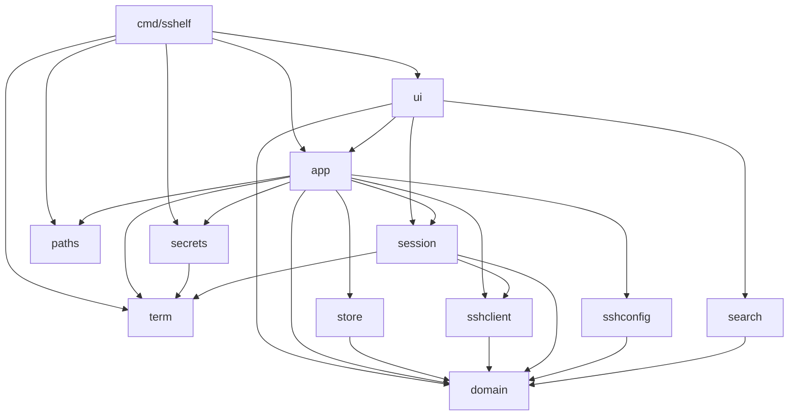
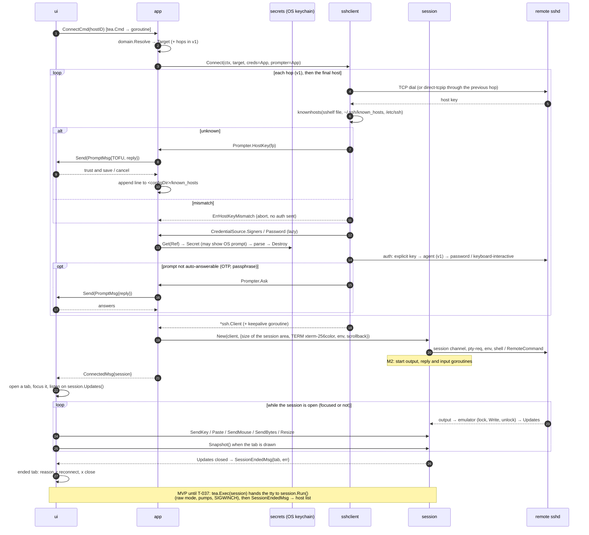
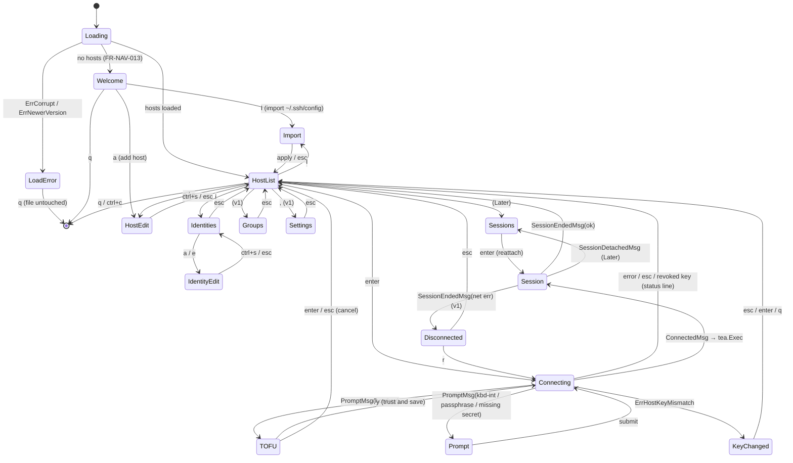
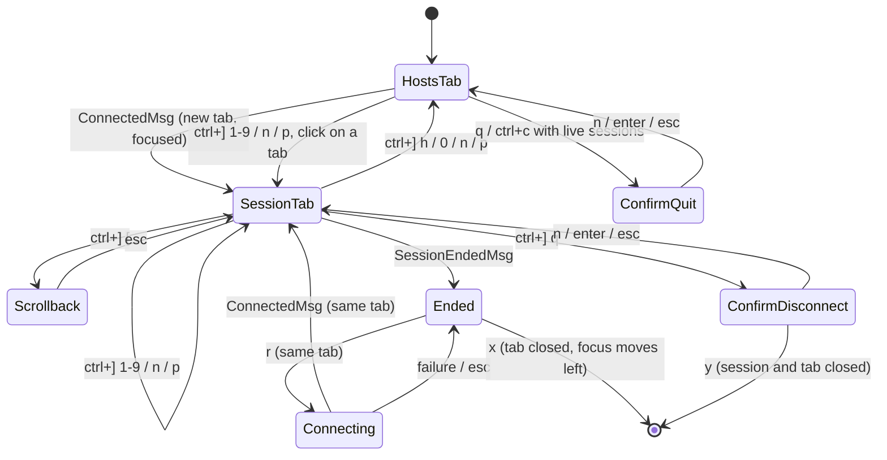

# sshelf architecture design

| | |
|---|---|
| **Owner** | Architecture |
| **Status** | Draft (revision 3: milestone M2, D-009…D-012: framed sessions, tabs, mouse; revision 2 aligned with D-001…D-008, D-101…D-109) |
| **Requirement prefix** | `ARCH-*` |
| **Depends on** | `decisions.md` (binding), `security/credential-storage.md` (keychain library, item naming), `product/requirements.md` (`FR-*`) |
| **Last updated** | 2026-10-30 |

This document says **how** sshelf is built: the package layout, the domain data
model, the UI state machine, the SSH connection and session lifecycle, and the
testing strategy. `decisions.md` overrides it wherever the two disagree.

---

## 1. Context and goals

### 1.1 Context

sshelf is a **TUI-only** SSH host manager, like Termius but in the terminal
(D-001). The user runs `sshelf`, picks a host and connects. There is **no
master password and no encrypted vault** (D-002). Data lives in two places:

- **Metadata** (hosts, groups, identities without their secrets, snippets,
  forward rules, settings): one plain JSON file with mode `0600` in the config
  directory. It never contains secrets (D-003).
- **Secrets** (passwords, private keys, key passphrases): the OS credential
  store. That is the macOS Keychain on macOS and the Secret Service (GNOME
  Keyring or KWallet) on Linux (D-003, D-004).

Accepted host keys go in sshelf's own `known_hosts` file in the config
directory (D-102). The binary is a single static Go program for macOS and
Linux. Windows comes later.

The current skeleton (`cmd/sshelf`, `internal/hosts`, `internal/ui`) is a
Bubble Tea v1 list of hard-coded hosts. This design replaces `internal/hosts`
with `internal/domain` and grows the UI into a multi-screen app.

### 1.2 Assumed feature scope

| Tier | Features |
|------|----------|
| **MVP** | CRUD for hosts and identities (including credentials entered in the host form); a Welcome screen; a fuzzy-searchable host list; connect with a password or a private key (stored in the keychain or referenced as a file); password auth that also answers keyboard-interactive password prompts; known-hosts verification with a TOFU prompt; import from `~/.ssh/config` |
| **M2** | Sessions inside sshelf's frame through an embedded terminal emulator (D-009, ADR-012, ADR-013); several sessions as tabs, background sessions, prefix key, scrollback, reconnect from an ended tab (D-010, ADR-015); mouse on sshelf's screens, and in sessions only when the remote app asks (D-011, D-012, ADR-014) |
| **v1** | groups; ssh-agent auth and agent forwarding (D-005); jump hosts (ProxyJump); local, remote and dynamic port forwarding; snippets; keepalive; themes (the `~.` escape is replaced by the M2 prefix key, and reconnect moved to M2) |
| **Later** | SFTP browser, Mosh, Windows, an opt-in plaintext secret fallback (D-101), a system `ssh` fallback (D-104). Not planned (D-007): split panes, detaching a session to the shell, sessions that survive an sshelf restart |

### 1.3 Goals

1. **Secrets never touch disk in plaintext.** Passwords, private keys and
   passphrases go from the OS keychain to the SSH layer in memory only. sshelf
   writes no temporary files, environment variables or command-line arguments
   that contain them.
2. **Terminal fidelity.** An interactive session behaves like `ssh` in the
   user's terminal: in the MVP by handing over the terminal, from M2 by
   rendering an emulated `xterm-256color` screen inside the frame, where
   `vim`, `htop`, `less` and `tmux` must render correctly (D-009).
3. **The terminal always comes back cleanly.** After sshelf exits or panics,
   the terminal is usable: no raw mode, no leftover mouse tracking, and no
   stolen keystrokes. From M2 a session ending touches the terminal not at all.
4. **Multiple sessions without rewriting the SSH layer.** M2 adds tabs on top
   of the same `sshclient` (ADR-012).
5. **Testable without a network or a real keychain.**
6. **Small (D-007).** Every package, requirement and mechanism here must earn
   its place.

### 1.4 Non-goals

- The keychain library choice and item naming belong to
  `security/credential-storage.md`.
- There is no lock, auto-lock, unlock screen or master password (D-002), and
  sshelf never closes sessions for security reasons (D-006).
- There is no non-interactive CLI (D-001) and no cloud sync.

---

## 2. Research summary: how other projects run sessions

| Project | Stack | Session approach | Notes |
|---|---|---|---|
| **lazyssh** (Adembc/lazyssh) | Go, tview/tcell | Runs the system `ssh` binary | A UI over `~/.ssh/config` that stores no secrets |
| **sshs** (quantumsheep/sshs) | Rust, ratatui | Runs the system `ssh` binary | Reads `~/.ssh/config` only |
| **wishlist** (charmbracelet/wishlist) | Go, Bubble Tea, wish | In-process `x/crypto/ssh` client that hands over the terminal | Local-mode auth tries IdentityFile, then the agent, then default keys. The README says password auth is unsupported. |
| **wish** (charmbracelet/wish) | Go, server side | SSH *server* for Bubble Tea apps | Its `testsession` package is useful for our tests |
| **termview**, **bubble-ssh**, **bubbleterm** | Go, Bubble Tea | Embedded `charmbracelet/x/vt` (or their own) emulator inside a Bubble Tea view | Proves that option (c) works, but the projects are young |

The tools that store no secrets can shell out to `ssh`. sshelf owns
credentials, as Termius does, so it runs SSH in process.

**Verified on 2026-10-29:** `go list -m -versions charm.land/bubbletea/v2`
lists stable releases up to `v2.1.1` (published 2026-10-28; `v2.1.0` came
before it). Companion releases are `charm.land/lipgloss/v2 v2.0.6` and
`charm.land/bubbles/v2 v2.2.1`. In v2, `tea.ExecCommand` is unchanged
(`Run`, `SetStdin`, `SetStdout`, `SetStderr`), as is
`tea.Exec(c ExecCommand, fn ExecCallback) Cmd`. A test program that passes a
custom struct type to `tea.Exec` compiles against v2.1.1. Its `Program.exec`
releases the terminal (restores the cooked state and cancels the input
reader), hands `p.input` and `p.output` to the command, calls `Run()`, and
then calls `RestoreTerminal()` on both the success and the error path. That is
exactly the hook ADR-002 needs. The check covered the API and source only. No
interactive tty run was done; task T-0 must cover that with the PTY test in
§10.

**Verified on 2026-10-30 (M2):** `go list -m -versions
github.com/charmbracelet/x/vt` lists a single tag, `v0.1.0` (published
2026-10-12, Go 1.24.2); before it the module had only pseudo-versions. Its
`go.mod` needs `github.com/charmbracelet/ultraviolet` at a March 2026
pseudo-version and `x/ansi v0.11.7`; sshelf already has a newer ultraviolet
pseudo-version (through bubbletea v2.1.1) and ansi v0.11.9, and a probe
program built and ran against exactly those versions. The probe measured
throughput, memory, key encoding, query replies, the alternate screen and
wide characters; the results and the limitations found are in ADR-013. The
probe was a throwaway outside the repository.

---

## 3. Architecture decisions (ADRs)

### ADR-001: In-process SSH with `golang.org/x/crypto/ssh`, not the system `ssh` binary

**Context.** Shelling out to `ssh` would mean feeding it keychain secrets
through `SSH_ASKPASS` or an ephemeral agent socket. OpenSSH would also run
TOFU itself on the raw tty, outside our UI. Jump hosts with a different
identity per hop would need a nested `ProxyCommand`, and running several
sessions or embedding them later would be impossible.

**Decision.** All SSH runs in process with `golang.org/x/crypto/ssh`,
`.../ssh/knownhosts` and, in v1, `.../ssh/agent`. sshelf never runs the system
`ssh` (D-104).

**Consequences.** Secrets stay in memory, and the TUI owns TOFU and
keyboard-interactive prompts. We implement ProxyJump, forwarding and
keepalives ourselves. (M2: unchanged. Owning the SSH client is what lets
ADR-012 run several sessions in one process and render them in a frame.) OpenSSH-only features (`ProxyCommand`, `Match`,
GSSAPI, ControlMaster, PKCS#11) are not supported, and the importer flags
them.

### ADR-002: Session model, from terminal handover (MVP) to background sessions and embedded panes (Later)

**Status:** superseded by ADR-012 in M2 (D-009). The handover below is the
MVP's shipped behaviour until task T-037 removes it; the "Later" plans for a
shadow emulator, detach and panes are replaced by ADR-012 and ADR-015.

**Context.** We weighed three options: (a) suspend the TUI and give the raw
terminal to an in-process session, (b) shell out to `ssh`, which ADR-001
rejects, and (c) an embedded VT emulator. Option (c) puts every keystroke and
frame through a young emulator and our renderer, so fidelity bugs and latency
would land in the feature users judge first.

**Decision.**
- **MVP, (a) handover.** A connected `session.Session` implements
  `tea.ExecCommand`, and the UI runs it with `tea.Exec`. `Run()` puts the tty
  into raw mode (`golang.org/x/term`), pipes stdin and stdout to the channel,
  maps SIGWINCH to `WindowChange`, and restores everything on return. Dial,
  host-key check and auth all happen **before** `tea.Exec`, so every prompt is
  a TUI modal.
- **Later, background sessions** (FR-TAB-001, D-007). `session.Manager` owns sessions independently
  of the UI. The `~d` escape detaches: `Run()` returns and the connection stays
  open. A headless `charmbracelet/x/vt` emulator per session records the screen
  and is used *only* to repaint on reattach, so a fidelity bug costs at most
  one imperfect repaint.
- **Later, (c) panes.** `Session` already exposes its streams, a resize method
  and the shadow emulator. A `ui/pane` component renders the emulator and
  encodes keys back. Panes are UI work only.

**Consequences.** MVP sessions have full fidelity with little code. While a
session is attached, the TUI is not drawn. The escape parser in the stdin pump
(v1, FR-CONN-014) is the only way back to the TUI other than the remote shell
exiting.

### ADR-003: Secrets go from the OS keychain to the SSH layer in memory, through a `secrets.Store` interface

**Context.** D-003 and D-004 put secrets in the OS credential store. The
security agent owns the keychain library and the item naming. Architecture
owns the boundary.

**Decision.**
- `internal/secrets` exposes the `Store` interface defined in
  `security/credential-storage.md` §5 (summarised in §6.2): the
  `zalando/go-keyring` adapter `NewOSStore` (D-008) and the in-memory
  `MemStore` for tests. Callers address a secret by
  `secrets.Ref{IdentityID, Field}`, and only the OS adapter maps a `Ref` to a
  keychain item name.
- `sshclient` never imports `secrets`. It depends on a `CredentialSource`
  interface that `app` implements on top of `secrets.Store`.
- Secrets load **lazily inside the auth callbacks** on the connect goroutine.
  The keychain can block on an OS prompt such as a keyring unlock dialog, so the UI goroutine never waits on it, and a rejected TOFU prompt
  never reads a secret.
- Private keys are parsed in memory with `ssh.ParsePrivateKey` or
  `ParsePrivateKeyWithPassphrase`. The caller zeroes the `[]byte` buffers right
  after use, as a best effort and without any other memory-hardening machinery
  (D-007). A key *referenced by path* is read from its file the same way and
  never copied.
- If no credential store is available, `Store.Available()` returns
  `ErrUnavailable`. sshelf still runs, hosts that use a key file (or, in v1,
  the agent) still connect, and saving a password or key is refused with an
  explanation (D-101).
- No secret appears in a log line, an error string, a `tea.Msg`, or a panic
  message.

**Consequences.** There is no password to manage, and access is gated by the
OS login. On Linux, any process running as the user can read an unlocked
keyring; D-003 accepts that. Deleting an identity also deletes its keychain
items.

### ADR-004: Known hosts go in sshelf's own OpenSSH-format file, and `~/.ssh/known_hosts` is read-only

**Decision.** Accepted host keys are appended to `<configDir>/known_hosts` in
standard OpenSSH format, using `knownhosts.Line`, with mode `0600` (D-102).
sshelf verifies host keys with `knownhosts.New(<configDir>/known_hosts,
~/.ssh/known_hosts, /etc/ssh/ssh_known_hosts)`, skipping files that do not
exist, and never writes to the OpenSSH files. Hostnames are stored unhashed so
the file stays readable and editable.

**Consequences.** Importing from OpenSSH brings its existing trust along with
no TOFU prompts. A user can inspect, `grep`, or delete lines with any editor.
Replacing a changed key means deleting the stale line whose path and line
number the block screen shows (MVP, FR-KH-002), or using the known-hosts view
(v1, FR-KH-005). Keys that come from `~/.ssh/known_hosts` must be fixed there.

### ADR-005: Directories and the metadata file

**Decision.**

| Item | Linux | macOS |
|---|---|---|
| Config dir (`config.json`, `known_hosts`) | `$XDG_CONFIG_HOME/sshelf/` (default `~/.config/sshelf/`) | `~/Library/Application Support/sshelf/`, or `$XDG_CONFIG_HOME/sshelf/` if that variable is **explicitly** set |
| Log and crash reports | `$XDG_STATE_HOME/sshelf/` (default `~/.local/state/sshelf/`) | `~/Library/Logs/sshelf/` |

`--config <dir>` overrides the config dir, and that flag is the only override
(D-007). Directories are created with mode `0700` and files with mode `0600`.
`internal/paths` is the only code that resolves these paths.

The metadata is a **single `config.json`** with a `"version"` field, read and
written with stdlib `encoding/json` (no new dependency, D-007). Saves are
atomic: write a temp file in the same directory, `fsync`, then `rename`. From v1
(FR-CFG-004), before saving, `store` checks whether the file's modification
time changed since it was loaded. If it did, for example because a second sshelf instance or a
manual edit changed it, the save is refused and the UI offers to reload. That
avoids silent lost updates without locks, lock files or backups (D-007). TOML was rejected because it
adds a dependency, and the UI is the primary editor anyway.

### ADR-006: Command-line flags use stdlib `flag` (replaces "CLI framework is kong")

**Context.** D-001 leaves only `--version`, `--help` and `--config <dir>`.

**Decision.** Use the stdlib `flag` package in `cmd/sshelf/main.go`. There is
no CLI framework, no subcommands and no shell completion.

### ADR-007: Adopt Bubble Tea v2, Bubbles v2 and Lip Gloss v2 now

**Context.** The skeleton pins `bubbletea v1.3.10` and `lipgloss v1.1.0`.
§2 verified that stable v2 releases exist and that `tea.Exec` with a custom
`ExecCommand` keeps the same contract. Migrating now costs about 70 lines of
skeleton code. Migrating after the MVP would touch every screen.

**Decision.** In task T-0, move to `charm.land/bubbletea/v2`,
`charm.land/bubbles/v2` and `charm.land/lipgloss/v2`, pinned to the latest
v2.1.x / v2.x patch available at T-0. That is currently bubbletea `v2.1.1`,
bubbles `v2.2.1` and lipgloss `v2.0.6`. If `v2.1.1` shows a regression,
`v2.1.0` is the fallback. The PTY attach test (§10) is a T-0 exit criterion.

**Consequences.** `View()` returns `tea.View`, and v2 key messages replace
`tea.KeyMsg` (`tea.KeyPressMsg`). The snippets in this document follow the v2
API in spirit, so translate any remaining v1 names.

### ADR-008: Entity IDs are UUIDv7 strings

**Decision.** IDs are lowercase UUIDv7 strings from `github.com/google/uuid`.
They are stable across renames, so a host can reference an identity safely,
and the security spec can use them as stable keychain item keys. Labels are
display names only. They may contain spaces (D-105) and must be unique,
case-insensitively (FR-HOST-003), but nothing references an entity by label.

### ADR-009: Package import rules are enforced by a test

**Decision.** `internal/archtest` runs `go list -deps` and fails on any
forbidden edge in §5.2, and on any import of `os/exec` by an sshelf package,
because sshelf's own code never starts a child process. The only child
process is `/usr/bin/security`, run by `zalando/go-keyring` on macOS, which
D-008 accepts. A single Go test is enough; there is no extra linter
configuration (D-007).

### ADR-010: `~/.ssh/config` import copies data once and references keys by path

**Decision.** Import is a one-way copy with a preview (D-103), parsed by
sshelf's own small parser in `internal/sshconfig` (stdlib only), with `Include` expanded and the
`%h`/`%p`/`%r`/`~` tokens resolved. `Match` blocks are skipped and listed in the
preview, never evaluated. Implemented as an in-house parser instead of
`github.com/kevinburke/ssh_config` (the original choice) because that library
resolves `Include` against the real home directory, which makes fixture tests
impossible, and it evaluates `Match`; the parser takes the home directory as
an option. An `IdentityFile` becomes an identity
**referencing the key file by path**. Import does not copy the key into the
keychain, because it should never silently duplicate secrets. Afterwards the
identity screen offers "Store key in keychain" (D-004), which leaves the
original file untouched. sshelf never writes to
`~/.ssh/config`.

### ADR-011: Own text input instead of Bubbles `textinput`

**Context.** Bubbles v2 `textinput` imports a clipboard package for its paste
binding. SEC-CLIP-005 forbids any clipboard package, and `archtest` fails on
one.

**Decision.** Implemented as sshelf's own `components.TextInput`
(`internal/ui/components/textinput.go`) instead of Bubbles `textinput`,
because the Bubbles component pulls in a clipboard package. Paste arrives
from the terminal as `tea.PasteMsg` and needs no clipboard access. The input
passes typed and pasted text through `domain.Sanitize`, supports plain,
masked and no-echo modes (FR-IDENT-004), zeroes its runes on `Reset` and
never leaves an unzeroed copy behind, so it can hold a secret. Every form and
modal (host form, identity form, prompt modal) uses it. Bubbles packages that
need no clipboard, such as `key`, are still used.

### ADR-012: Sessions render inside sshelf's frame through an embedded emulator (revises ADR-001 and ADR-002)

**Status:** accepted for M2 (D-009, D-010). Supersedes ADR-002.

**Context.** D-009 puts every session inside sshelf's frame, and D-010 asks for
several sessions at once with the host list one key away. With the MVP
handover (ADR-002 option a), the TUI is not drawn while a session runs, only
one session can own the terminal, and nothing can show a tab bar. ADR-002
rejected option (c), an embedded emulator, for the MVP because of fidelity
and latency risk; D-009 accepts that risk, which ADR-013, ARCH-TEST-002 and
NFR-PERF-004/005 now measure.

**Decision.**
- Each `session.Session` owns an in-process VT emulator (ADR-013) sized to the
  session area: the terminal width by its height minus the header and status
  rows. Every byte of remote output goes into that emulator; the root model
  draws the focused session's emulator screen between the header and the
  status bar (§9.4).
- Input never touches the raw terminal. Bubble Tea decodes keys, pastes and
  mouse events; the root model handles the prefix key (§8.5) and gives
  everything else to the focused session, which encodes it according to the
  emulator's modes (application cursor keys, bracketed paste, mouse modes)
  and writes it to the SSH channel.
- The emulator answers the remote's terminal queries itself (device
  attributes, cursor position, colour queries), so a remote program never
  queries or controls the user's real terminal.
- The remote PTY's `TERM` is `xterm-256color`, the terminal the emulator
  implements, not the local `TERM` (FR-CONN-001 revision).
- **One path (D-007).** The MVP `tea.Exec` handover, `session.Run()`, raw
  mode, the stdin pump with `cancelreader` and the SIGWINCH handler are
  removed in T-037; `app.Session` stops satisfying `tea.ExecCommand`. There is
  no "full-screen mode" switch.
- ADR-001 stands unchanged: all SSH stays in process with
  `golang.org/x/crypto/ssh`, which is what makes several sessions in one
  process possible.

**Consequences.**
- Sessions survive tab switches and run in the background; reconnect and
  close happen in the tab (FR-TAB-*, FR-CONN-005 revision).
- **Security win (SEC-SESSION-005, threat T-15).** In the MVP, remote output
  goes to the user's terminal unfiltered, as with `ssh`, so a hostile server
  could set the clipboard (OSC 52), change the window title, inject
  hyperlinks, query the terminal and read its replies, or exploit a bug in
  the user's terminal emulator. From M2 the remote only ever talks to
  sshelf's emulator; the real terminal receives what sshelf renders from
  emulator cells (characters and SGR styles). OSC 52, titles, hyperlinks,
  DCS, APC and terminal reports never reach it.
- **Costs.** Fidelity now depends on a young emulator (ADR-013 lists its
  gaps). Every keystroke goes through Bubble Tea's decoder and our encoder
  (NFR-PERF-004 bounds it at 5 ms p99). Output throughput is bounded by the
  emulator (NFR-PERF-005). The terminal's own scrollback no longer holds
  session output; scrollback mode (FR-TAB-010) replaces it. Programs that
  use protocols the emulator lacks (kitty graphics, sixel, the kitty keyboard
  protocol) fall back to what `xterm-256color` offers.
- Native text selection keeps working while the remote app has not asked for
  the mouse (D-012, ADR-014).

### ADR-013: The terminal emulator is `github.com/charmbracelet/x/vt` v0.1.0, pinned and wrapped

**Status:** accepted for M2, with the limitations below tracked as risks.

**Context.** ADR-012 needs an emulator that parses xterm output, keeps a
main and an alternate screen with scrollback, renders cells with styles, and
encodes keys and mouse events according to the modes the remote set. The
architect proposed `charmbracelet/x/vt`, which also underlies the projects
in §2. It was checked on 2026-10-30 (§2) with a probe program at sshelf's
exact `ultraviolet` and `x/ansi` versions on an Apple M1 Pro.

**What it offers.** `NewEmulator(w, h)`; `Write` (remote output); `Read` (an
`io.Pipe` carrying the encoded input and the emulator's own replies, to be
copied to the SSH channel); `Resize`; `Render` (styled lines), `CellAt`,
`Draw` onto an ultraviolet screen; `CursorPosition`, `CursorHidden`,
`CursorStyle`; `IsAltScreen`; `SendKey(uv.KeyEvent)` honouring application
cursor and keypad modes; `SendMouse(uv.MouseEvent)` honouring the X10, normal
(`?1000`), button (`?1002`) and any-event (`?1003`) modes with X10 or SGR
(`?1006`) encoding, and dropping events when no mode is set; `Paste`, which
adds the bracketed-paste markers when `?2004` is on; `SetScrollbackSize`,
`Scrollback`, `ScrollbackLen`, `ScrollbackCellAt` (main screen only, default
cap 10,000 lines); callbacks for title, bell, alt screen, cursor and every
mode change; default colours settable. Measured: `ESC[c` is answered with
`ESC[?62;1;6;22c`; `?1049h` switches to the alternate screen; grapheme
clusters (flags, ZWJ sequences, VS16 emoji, combining accents) get the right
width; CJK characters are two cells wide. A `SafeEmulator` wraps it with an
RW mutex.

**Maturity.** `v0.1.0` (2026-10-12) is the module's only tag, so the API is
pre-1.0 and may change. It depends on an `ultraviolet` pseudo-version, which
Bubble Tea v2.1.1 also uses (a newer one); the build is consistent today, but
a future Bubble Tea upgrade can move `ultraviolet` under `vt`.

**Limitations found (each with its mitigation).**
1. **Modified special keys are dropped.** `SendKey` sends nothing for
   Ctrl/Shift with arrows, Home, End, PgUp, PgDn, Insert, Delete and F1–F12
   (measured: Ctrl+Up, Shift+Left, Ctrl+F5, Ctrl+Delete and Shift+Enter
   produce zero bytes), and it has no kitty keyboard protocol, CSI u or
   `modifyOtherKeys` (a TODO in its source). Alt works (ESC prefix).
   *Mitigation:* sshelf's encoding shim produces the xterm forms
   (`CSI 1;<mod> A`, `CSI <n>;<mod> ~`) for those keys before falling back to
   `SendKey` (ARCH-SESS-017); upstream fix offered in T-031.
2. **Wide characters at the right margin are lost.** A double-width
   character that would occupy the last column, or the last two columns, is
   dropped and the next character overwrites the last column instead of
   wrapping (measured with `12345678日x` and `日本語ab👍x` at width 10).
   *Mitigation:* a failing replay golden (`utf8-wide`) and an upstream fix in
   T-031; open question 2 in `product/requirements.md` §22 if no release fixes
   it by the gate. *Outcome (T-031, D-015):* worked around in `emulator.go`:
   a second `x/ansi` parser finds where each printed character starts, the
   emulator is fed up to there, and `\r\n` is inserted before a wide
   character that would not fit and before the character after one that
   filled the last two columns. The `utf8-wide` golden passes and is not
   skipped. Related, not worked around: `vt` ends a grapheme cluster at the
   end of every `Write`, so a combining mark, ZWJ sequence or flag split
   across two reads is drawn as separate cells; sshelf splits its own
   writes only after control characters.
3. **Throughput is 2 to 5 MB/s.** 10 MiB of 100-column lines took 2.1–2.4 s
   at 120×40 and 4.0–4.8 s at 200×50, with or without SGR colours; a native
   terminal does well over 50 MB/s. *Mitigation:* NFR-PERF-005 sets a CI floor
   of 1 MB/s and requires flow control instead of buffering (ARCH-SESS-014);
   a fast `cat` of a large file is slower than in a native terminal, which is
   accepted for M2.
4. **Scrollback is expensive.** About 130 bytes per stored cell: 10,000 lines
   cost about 66 MB at 80×24 and 134 MB of heap at 200×50; 2,000 lines at
   120×40 cost about 31 MB. Eviction from a full buffer is
   `slices.Delete(lines, 0, 1)`, O(lines) per scrolled line. *Mitigation:*
   cap 2,000 lines (NFR-SIZE-003, open question 1); a compact scrollback is
   an upstream improvement, not sshelf code.
5. **`SafeEmulator` can freeze rendering.** Its `SendKey` holds the lock while
   writing into the unbuffered reply pipe, and `Write` can block on a reply
   (for example to `ESC[c`) while holding it; if nothing drains the pipe, the
   UI's `Render` blocks. *Mitigation:* sshelf uses the plain `Emulator` with
   its own mutex and a reply pump that never blocks on the network
   (ARCH-SESS-014).
6. **No reflow on resize**: lines are cut or padded, as in xterm. Accepted.
7. **Mouse encodings** UTF-8 (`?1005`), urxvt (`?1015`) and SGR-pixel
   (`?1016`) are not supported; apps fall back to X10 or SGR. Accepted.
8. **Widths use grapheme width** and can disagree with a remote's `wcwidth`
   for ambiguous-width characters, misaligning those lines, as in many
   terminals. Accepted.
9. **Default colours are white on black**, so a remote's OSC 10/11 colour
   query gets those answers. *Mitigation:* sshelf sets the emulator's default
   colours from the user's terminal when Bubble Tea reports them
   (ARCH-SESS-016).
10. **Hyperlinks (OSC 8) are kept in cells.** *Mitigation:* sshelf renders
    without them (ARCH-SESS-011, SEC-SESSION-005).

**Alternatives.** Other Go emulators known to us (`hinshun/vt10x`,
parser-only packages) provide no key or mouse encoders and would move more
code into sshelf; they were not benchmarked. Writing an emulator is out of
scope (D-007).

**Decision.** Use `github.com/charmbracelet/x/vt` **v0.1.0**, pinned exactly
in `go.mod`. Only `internal/session/emulator.go` imports it, behind a small
private type (`write`, `resize`, `snapshot`, `scrollback`, `sendKey`,
`sendMouse`, `paste`), so a later version or another library touches one file.
Upgrades need the replay goldens (ARCH-TEST-002) and NFR-PERF-005 green. Fixes
for limitations 1 and 2 go upstream; the shim is deleted when a release
includes them.

### ADR-014: Mouse only where it does not cost the user their terminal's selection (D-011, D-012)

**Decision.**
- The root model's `View()` sets `tea.View.MouseMode` on every frame from
  one function (ARCH-UI-006): cell motion on the Hosts tab and its screens
  and modals; for a focused live session, the mode its remote app asked for,
  or none; none in scrollback mode and on an ended session. Bubble Tea turns
  modes on and off when the value changes, and off on exit.
- Hit-testing needs no zone library: each component handles a
  `components.ClickMsg{X, Y, Double}` or `components.WheelMsg{X, Y, Delta}`
  in its own coordinates, from the same layout function its `View` uses. The
  root model subtracts the rows it placed above the component (header, blank
  line, the screen above a modal) before passing it on (ARCH-UI-007).
- A double-click is two left presses on the same row within 400 ms, measured
  with an injectable clock in the root model.
- Mouse events for a session are converted to ultraviolet events with the
  header row removed, and encoded by the emulator (ADR-013).

**Consequences.** While the user is in a plain shell, the terminal's own
selection and copy work as before; inside `vim` or `htop` with mouse
support, the app gets the mouse as it would in a native terminal. No
clipboard code is added (SEC-CLIP-005).

### ADR-015: Tabs live in the root model; there is no session manager

**Context.** ADR-002 planned a `session.Manager` for detach and reattach.
M2 has tabs but no detach and no sessions outliving the UI.

**Decision.** The root model holds `[]sessionTab` (number, host ID, label,
`user@host:port`, start time, the `app.Session`, activity and end state,
scrollback position). Each session runs its own goroutines (ARCH-SESS-010),
so "background" needs no extra machinery: an unfocused tab is simply not
drawn. The modal stack stays global: modals (Connecting, TOFU, prompts,
confirmations, help) open over whichever tab is focused, and while one is
open the prefix key is off. Only one connection attempt runs at a time, as in
the MVP.

**Consequences.** No new package or lifecycle owner (D-007). Quitting closes
the sessions through the process exit and the root model's quit path. If a
future feature needs sessions outside the UI (snippets on a live session,
tunnels without a tab), a manager can be extracted then.

---

## 4. Architecture requirements

Each `MVP` requirement shows its status next to its priority; every other
requirement is **Draft**. "The system" means the sshelf
binary. IDs are never reused, so gaps in the numbering are requirements
removed in revision 2.

### 4.1 Sessions (`ARCH-SESS`)

**ARCH-SESS-001**: The system shall open SSH sessions in process with `golang.org/x/crypto/ssh` and shall start no child process other than the `/usr/bin/security` calls made by `zalando/go-keyring` on macOS (D-008).
- Priority: MVP · Status: Implemented
- Acceptance: `archtest` finds no import of `os/exec` in any sshelf package. A connect test against the in-process server passes on a machine without OpenSSH installed.

**ARCH-SESS-002**: When the user connects to a host, the system shall finish dialling, host-key verification and authentication before it opens the session's tab.
- Priority: M2 · Status: Implemented · Source: D-009, D-010 (the MVP finished them before releasing the terminal)
- Acceptance: Prompts appear as modals over the tab the connection was started from (goldens). If auth fails or is cancelled, no tab is opened and the status line shows the error. `session.New` is never called before `sshclient.Connect` returned a client.

**ARCH-SESS-003**: While a session is open, the system shall write to its SSH channel only the encoding of the user's input and the emulator's replies, and shall feed every byte the channel delivers to that session's emulator, without changing the local terminal's mode.
- Priority: M2 · Status: Implemented · Source: D-009, ADR-012 (replaces the MVP raw-mode relay)
- Acceptance: 256 random bytes sent with `SendBytes` arrive at sshtest unchanged and in order. Binary output from sshtest reaches the emulator unchanged (a recording emulator double in `session` tests). The `session` package does not import `golang.org/x/term` and has no raw-mode code; archtest checks it.

**ARCH-SESS-004**: When the root model receives a new terminal size, the system shall resize every open session's emulator at once and send each session's server one `window-change` with the new session area within 100 ms.
- Priority: M2 · Status: Implemented · Source: FR-CONN-004
- Acceptance: With 3 sessions, a `tea.WindowSizeMsg` of 100×30 makes sshtest record `window-change 100×28` on each channel within 100 ms. A burst of 10 size messages within 50 ms produces at most 2 requests per session. An unchanged size sends nothing.

**ARCH-SESS-005**: When a session ends for any reason (remote exit, network error, disconnect, or a panic in one of its goroutines), the system shall stop every goroutine of that session and keep sshelf and every other session running, without writing anything to the local terminal.
- Priority: M2 · Status: Implemented · Source: D-009, D-010 (the MVP restored the terminal after each session)
- Acceptance: Unit tests end a session each way and pass `goleak`. With two sessions open, a panic forced in one session's output goroutine (build tag `sshelf_faultinject`) ends that session with `ErrInternal` while the other still echoes input (PTY test). sshelf's own terminal restore happens only when it exits; that path is still checked by `stty -a` before and after (PTY test).

**ARCH-SESS-006**: The system shall recognise the prefix key and its command in the UI layer, on decoded key events and before any encoding, so that no byte of a prefix command reaches a session.
- Priority: M2 · Status: Implemented · Source: FR-TAB-005, FR-CONN-014 (replaces the v1 `~` escape parser, which is dropped)
- Acceptance: A table test over the prefix state machine in `ui/keys` (idle → prefix → command or cancel) covers every command of FR-TAB-005, Esc, an unknown key and `Ctrl+]` twice. A root-model test with a recording session double shows that `Ctrl+]` `n` sends zero bytes and `Ctrl+]` `Ctrl+]` sends exactly `0x1d`.

**ARCH-SESS-007**: While a connection is open, the system shall send `keepalive@openssh.com` requests every `ServerAliveInterval` (default 30 s) and close the connection after `ServerAliveCountMax` (default 3) unanswered requests in a row.
- Priority: v1 · Source: FR-CONN-009
- Acceptance: With a server that stops replying and a fake clock, the session ends with `ErrKeepaliveTimeout`. An interval of 0 disables keepalives.

**ARCH-SESS-008**: When a session ends, the system shall report the cause to the UI exactly once, as `nil` (exit 0), `*ExitError`, `*DisconnectError` or `ErrInternal`, after its connection is closed.
- Priority: M2 · Status: Implemented · Source: FR-CONN-005 revision, FR-CONN-010 (replaces the v1 "Disconnected" modal: the ended tab shows the cause and offers `r`)
- Acceptance: Table test over sshtest's `exit 0`, `exit 3`, signal, dropped connection and a forced panic: `Err()` returns the right type, `Updates()` is closed exactly once after `Done()`, and sshtest has seen the connection close. Pressing `r` on the ended tab produces a `ConnectRequestMsg` with the same host ID and the tab's number.

**ARCH-SESS-009**: Where agent forwarding is enabled for a host, the system shall forward the local ssh-agent (`SSH_AUTH_SOCK`) to the server, and shall never forward an agent by default.
- Priority: v1
- Acceptance: In an integration test, with forwarding off no `auth-agent@openssh.com` channel opens. With it on, the server can list the local agent's keys.

**ARCH-SESS-010**: The system shall run each session's reading, writing and emulation inside its own `session.Session`, independently of which tab is focused or rendered, and shall close every session when sshelf exits.
- Priority: M2 · Status: Implemented · Source: FR-TAB-008, FR-TAB-009, ADR-015 (no `session.Manager` and no detach, D-007)
- Acceptance: Open 3 sessions and focus only the first: sshtest output sent to the other two lands in their emulators. Input sent through each tab reaches the right server. Quitting closes all three connections (sshtest records each close), and `goleak` passes.

**ARCH-SESS-011**: The system shall feed remote output only into the session's emulator and shall write to the local terminal only what sshelf's renderer draws from emulator state.
- Priority: M2 · Status: Implemented · Source: D-009, SEC-SESSION-005 (replaces the Later "repaint on reattach")
- Acceptance: Fuzz test: random bytes and a corpus of hostile sequences (OSC 52 clipboard, OSC 0/2 titles, OSC 8 links, DCS, APC, `ESC[21t` title report, DECRQSS, `ESC c`) written by sshtest end up only in the emulator. The rendered `View()` content contains no `ESC ]`, `ESC P`, `ESC _`, `ESC ^` or `ESC X`, only SGR and the characters of the screen; the session code holds no reference to `os.Stdout`.

**ARCH-SESS-012**: Where a host has a jump chain, the system shall connect hop by hop over in-process `direct-tcpip` channels, with each hop's own identity and host-key verification.
- Priority: v1
- Acceptance: An integration test uses 2 in-process servers with different identities. A TOFU prompt fires for each unknown hop.

**ARCH-SESS-013**: The system shall support local, remote and dynamic (SOCKS5) forwarding with in-process listeners that are bound to `127.0.0.1` by default and closed with the connection.
- Priority: v1
- Acceptance: One integration test per kind sends an HTTP request through the forward. The listener is closed after the disconnect.

**ARCH-SESS-014**: The system shall never block the UI goroutine on a session: input is queued in a per-session buffer of at most 1 MiB that a writer goroutine drains to the SSH channel, the emulator's replies are drained by a goroutine that never waits on the network, and output is read from the channel only as fast as the emulator processes it.
- Priority: M2 · Status: Implemented · Source: NFR-PERF-004, NFR-PERF-005, ADR-013 limitation 5
- Acceptance: With sshtest not reading its channel (window full), 10,000 `SendKey` calls return within 1 s in total and the queue stops at 1 MiB with `ErrInputFull`; the root model shows "web-prod: remote is not reading input" once. During `flood 10M`, `Snapshot()` never waits more than 20 ms for the emulator lock. A remote `ESC[c` during a stalled writer does not block `Snapshot()`.

**ARCH-SESS-015**: The system shall notify the UI of processed output through a per-session channel of capacity 1 that is written without blocking, so that notifications coalesce and the UI renders each session at most once per frame.
- Priority: M2 · Status: Implemented · Source: NFR-PERF-005, FR-TAB-004
- Acceptance: 10,000 output chunks produce at most one pending notification at any time (unit test reading `Updates()` slowly). The channel is closed exactly once, after the session's end is recorded. Each `SessionUpdateMsg` re-arms one listening command; `goleak` finds no listener left after a tab closes.

**ARCH-SESS-016**: The system shall let the emulator answer the remote's terminal queries (device attributes, cursor position reports, mode reports, colour queries) and shall set the emulator's default foreground and background colours from the user's terminal when Bubble Tea reports them.
- Priority: M2 · Status: Implemented · Source: ADR-012, ADR-013 limitation 9
- Acceptance: sshtest's `query` script sends `ESC[c`, `ESC[6n` and `ESC]11;?ESC\` and receives the emulator's answers on the channel, including the cursor position within the session area. With a `tea.BackgroundColorMsg` of `#fdf6e3`, the OSC 11 answer is `rgb:fdfd/f6f6/e3e3`. Nothing is written to the local terminal in reply to a remote query (PTY output scan).

**ARCH-SESS-017**: The system shall encode keys for the remote with the emulator's `SendKey`, except for the modified special keys the emulator drops, which sshelf encodes in xterm's `CSI 1;<mod> <final>` and `CSI <n>;<mod> ~` forms.
- Priority: M2 · Status: Implemented · Source: FR-TAB-006, ADR-013 limitation 1
- Acceptance: A table test covers every row of the key table in §9.4 against `echo-hex`, in normal and application cursor mode. Ctrl+Up sends `ESC[1;5A`, Shift+Left `ESC[1;2D`, Ctrl+F5 `ESC[15;5~`, Ctrl+Delete `ESC[3;5~`, Alt+Shift+Right `ESC[1;4C`. No key that has an xterm encoding produces zero bytes.


### 4.2 Connection and authentication (`ARCH-CONN`)

**ARCH-CONN-001**: The system shall offer only the authentication methods that the identity configures, in this order: the identity's explicit key (stored or file), then (v1) the ssh-agent if allowed, then password or keyboard-interactive, whichever the server offers.
- Priority: MVP (the agent step is v1) · Status: Implemented
- Acceptance: A table test over identity configurations checks the `[]ssh.AuthMethod` built. The test server confirms the order of attempts: key before password in the MVP, and key, agent, password in v1.

**ARCH-CONN-002**: When the server sends a keyboard-interactive challenge, the system shall answer a single no-echo prompt matching `/password/i` with the identity's stored password, and show every other prompt, such as an OTP, in a TUI modal.
- Priority: MVP · Status: Implemented · Source: FR-CONN-008
- Acceptance: A server that accepts passwords only through keyboard-interactive connects with the stored password and no modal. A test server with a password plus OTP challenge: the password is filled automatically and the OTP modal appears. Cancelling the modal aborts with `ErrAuthCancelled`.

**ARCH-CONN-003**: When the server presents a host key that no known_hosts file knows, the system shall show a TOFU modal with the key type and SHA256 fingerprint and the two choices "Trust and save" and "Cancel", and continue only after "Trust and save".
- Priority: MVP · Status: Implemented · Source: FR-KH-001 ("Trust once" is v1, FR-KH-007)
- Acceptance: Golden file of the modal. "Trust and save" appends one line to `<configDir>/known_hosts`. Enter, Esc and "Cancel" all fail with `ErrHostKeyRejected` and write nothing. Neither action changes `~/.ssh/known_hosts` (its size and mtime are unchanged).

**ARCH-CONN-004**: If a presented host key does not match a known key for that host, then the system shall abort before authenticating and show the old and new fingerprints, with no "accept" shortcut.
- Priority: MVP · Status: Implemented
- Acceptance: The test server records zero auth attempts. The modal shows the path and line number of the stale entry and how to remove it (FR-KH-002).

**ARCH-CONN-005**: The system shall pass a `context.Context` to every network and keychain operation of a connection attempt so that the user can cancel it with `esc`.
- Priority: MVP · Status: Implemented
- Acceptance: Cancelling during dial and during auth returns to the host list within 200 ms. `goleak` passes.

### 4.3 Secrets and safety (`ARCH-SEC`)

**ARCH-SEC-001**: The system shall not write any secret to the config file, known_hosts, logs, crash reports, environment variables or temporary files.
- Priority: MVP · Status: Implemented
- Acceptance: An integration test with `secrets.MemStore` holding a canary password and key does a connect, an edit and a save, then scans the config dir, the log dir, the temp dir and `os.Environ()`. The canary appears zero times.

**ARCH-SEC-002**: The system shall give the SSH layer credentials only through the `CredentialSource` interface, and `internal/sshclient` shall not import `internal/secrets` or `internal/store`.
- Priority: MVP · Status: Implemented
- Acceptance: `archtest` passes.

**ARCH-SEC-006**: If no OS credential store is available, then the system shall still start and connect hosts that use key files, and shall disable saving passwords and keys with a visible explanation.
- Priority: MVP · Status: Implemented
- Acceptance: With a `secrets.Store` that returns `ErrUnavailable`, a key-file host connects, the password field is read-only with an explanatory hint (golden file), and nothing is written anywhere.

**ARCH-SEC-004**: The system shall run a panic handler in `main` and a recovering wrapper around every goroutine it starts, each of which restores the terminal before it writes a crash report that contains no secrets.
- Priority: MVP · Status: Implemented
- Acceptance: A panic forced in a session goroutine and one forced in `Update` (behind the `sshelf_faultinject` build tag) both leave the terminal in cooked mode (PTY test). The canary scan of the crash report is clean.

### 4.4 Packages and data (`ARCH-PKG`, `ARCH-DATA`)

**ARCH-PKG-001**: The system shall follow the package layout and import rules in §5, enforced by `internal/archtest`.
- Priority: MVP · Status: Implemented
- Acceptance: A deliberately forbidden import makes the test fail.

**ARCH-PKG-002**: The system shall resolve file locations only through `internal/paths` (ADR-005), creating directories with mode 0700 and files with mode 0600.
- Priority: MVP · Status: Implemented
- Acceptance: Table tests with an injected environment cover Linux, Linux with XDG set, macOS, macOS with XDG set, and `--config`. A permission check runs after the first save.

**ARCH-DATA-001**: The system shall identify every entity by an immutable UUIDv7 and reference other entities only by ID.
- Priority: MVP · Status: Implemented
- Acceptance: Renaming an identity changes no host record. Deleting an identity that hosts still reference requires confirmation and clears those references.

**ARCH-DATA-005**: If `config.json` changed on disk since it was loaded, then the system shall refuse to save and offer to reload.
- Priority: v1 · Source: FR-CFG-004 (the atomic write itself is MVP: ADR-005, FR-CFG-002, SEC-FILE-003)
- Acceptance: An external modification between load and save produces `ErrConflict` and the reload prompt, and the file is unchanged.

**ARCH-DATA-003**: When importing `~/.ssh/config`, the system shall show a preview of the hosts and identities to create and the directives it does not support, before it saves anything.
- Priority: v1 · Source: FR-IMPORT-004
- Acceptance: Fixture configs cover `Include`, `Host *` defaults, wildcard-only patterns (skipped with a note), `ProxyJump`, `ProxyCommand` and `Match` (both flagged). Golden file of the preview.

**ARCH-DATA-004**: When an identity is deleted, or one of its secrets is cleared, the system shall delete the matching keychain items and show a warning naming any item it could not delete, without tracking it (SEC-CRED-004).
- Priority: MVP · Status: Implemented
- Acceptance: With `secrets.MemStore`, deleting an identity leaves no `Ref` with that identity's ID. With a failing `Delete`, a warning names the item and nothing is written to `config.json`.

### 4.5 UI (`ARCH-UI`)

**ARCH-UI-001**: The system shall run one root Bubble Tea model that holds the Hosts tab (one active screen and a stack of modal overlays, as in the MVP) and the session tabs, routes every message to the focused tab, the modal stack or the sessions as defined in §9, and draws the frame around them.
- Priority: M2 · Status: Implemented · Source: D-009, D-010, ADR-015
- Acceptance: An M2 walk-through (start, list, connect with a stub session, tab opens, `Ctrl+]` `h`, connect a second host, `Ctrl+]` `1`, remote `exit 3`, ended tab, `x`, list with the host selected) matches its golden files. The MVP walk-through (start, list, edit, save, connect, TOFU, stub session, back) still passes with the header line in place of the title. Both drive the root model directly, the way `tea.Program` does, without `teatest` (see the golden convention in `tasks.md`).
- Note: a modal that answers a running connection attempt (auth prompt, TOFU) is popped in the `Update` that delivers the answer, not when its `DoneMsg` arrives, so a late `DoneMsg` can never close the next prompt.

**ARCH-UI-002**: The system shall perform all I/O (config, keychain, SSH, filesystem) in `tea.Cmd` values or goroutines that report back with messages, never inside `Update`.
- Priority: MVP · Status: Implemented
- Acceptance: In UI tests, `app.Service` is a fake that panics if it is called synchronously from `Update` (it checks a goroutine marker).

**ARCH-UI-003**: The system shall filter the host list with fuzzy matching over label, hostname, user, group and tags, within 16 ms for 5,000 hosts.
- Priority: v1 (MVP search covers label, hostname and user, FR-NAV-002)
- Acceptance: `BenchmarkFilter5k` stays under 16 ms per operation on the CI runner.

**ARCH-UI-004**: The system shall define every keybinding in a single `ui/keys` keymap, and the help screen and footer shall be generated from it.
- Priority: MVP · Status: Implemented
- Acceptance: A test checks that every binding has help text and that no two bindings in the same screen share a key.

**ARCH-UI-005**: The system shall draw every frame as one header row with the tab bar, then either the Hosts tab's MVP layout (blank row, screen and modals, status line, footer) or a session tab's area of `height − 2` rows, then the session's status bar, with no line wider than the terminal.
- Priority: M2 · Status: Implemented · Source: D-009, FR-TAB-003, FR-TAB-007, NFR-UX-002
- Acceptance: Goldens at 80×24 and 120×40 of: the host list with no sessions, the host list with 3 tabs, a live session (replayed `htop`), a session with a modal open, an ended session, scrollback mode, the prefix help overlay, and 10 tabs with overflow markers. The NFR-UX-002 helper checks widths; for session tabs it checks that the last line is the status bar. The cursor reported in `tea.View.Cursor` is the remote cursor shifted down one row, or nil when the remote hides it or a modal is open.

**ARCH-UI-006**: The system shall compute `tea.View.MouseMode` in one function of (focused tab, modal open, scrollback mode, session ended, the focused session's requested mouse mode), following ADR-014.
- Priority: M2 · Status: Implemented · Source: D-011, D-012, NFR-UX-001 revision
- Acceptance: A table test covers every combination. A root-model test switches between the Hosts tab, a plain shell tab and a tab whose remote sent `?1003h`, and checks the mode of each next `View()`.

**ARCH-UI-007**: The system shall route each mouse press and wheel event to the single component under it, in that component's own coordinates computed from the same layout function as its `View`, and shall recognise a double-click as two left presses on the same row within 400 ms.
- Priority: M2 · Status: Implemented · Source: D-011, ADR-014, FR-NAV-012, FR-NAV-014 … FR-NAV-017
- Acceptance: Unit tests for each layout function compare the region reported for a target with the position of its text in `View()` (for example the column of `[ Save ]`). Double-click tests with an injected clock: 399 ms on the same row is a double-click, 401 ms is not, a different row is not, and a third press after a double-click starts over. Mouse releases and motion on sshelf screens are ignored.


### 4.6 Testing (`ARCH-TEST`)

**ARCH-TEST-001**: The system shall have an in-process SSH test server (`internal/testutil/sshtest`) that supports password, public key, keyboard-interactive, PTY, window-change and exec requests (and `direct-tcpip`, `tcpip-forward` and agent forwarding in v1), and records every request.
- Priority: MVP · Status: Implemented
- Acceptance: CI runs the integration suite with `-race` on Linux and macOS, using loopback only and no real keychain.

**ARCH-TEST-002**: The system shall have emulator golden tests that replay recorded output of `vim`, `htop` and `less` into a session's emulator and compare the resulting screen with a golden file.
- Priority: M2 · Status: Implemented · Source: D-009, FR-CONN-001 revision
- Acceptance: `internal/session/testdata/replay/` holds at least `vim-edit`, `htop`, `less-search`, `tmux-split` and `utf8-wide` recordings (`.bin` raw output with the `TERM=xterm-256color` and size they were recorded at, `.golden` the expected screen as text plus a cursor line, and `.sgr.golden` the styled lines). `TestARCH_TEST_002_Replay` feeds each recording in 1-byte, 7-byte and 4 KiB chunks and every chunking matches the golden. `go test ./internal/session -update` rewrites them; the recording procedure (`script -q` on a real host, then trimming) is documented in `testdata/replay/README`.

**ARCH-TEST-003**: The system's test SSH server shall support the M2 scripted commands `flood <size>`, `stream <rate>`, `replay <fixture>`, `modes <DECSET list>`, `query`, `hostile` and `echo-hex`, and shall record channel closes and every byte it receives.
- Priority: M2 · Status: Implemented · Source: NFR-PERF-005, NFR-PERF-006, FR-TAB-011, SEC-SESSION-005
- Acceptance: One test per command. `flood 10M` sends exactly 10 MiB; `stream 100K` paces output at 100 KB/s ± 10 %; `modes 1000,1006` enables those modes; `query` sends `ESC[c`, `ESC[6n` and an OSC 11 colour query and records the replies; `hostile` sends the corpus of ARCH-SESS-011; `echo-hex` echoes each received byte as hex so tests can assert the exact encoding of keys, pastes and mouse events.

---

## 5. Package layout

### 5.1 Packages and responsibilities

```
cmd/sshelf/                 main: process hardening first (an unexported function: RLIMIT_CORE=0,
                            PR_SET_DUMPABLE=0 on Linux, SEC-MEM-003), stdlib flag parsing (--version,
                            --help, --config), top-level panic handler, debug-log setup, wiring:
                            paths → store → secrets → app → ui.
internal/
  domain/                   Pure types: Host, Group, Identity, Snippet, ForwardRule, Settings, ID.
                            Validation and inheritance resolution. Stdlib plus github.com/google/uuid
                            (ADR-008). (Replaces internal/hosts.)
  store/                    Load/Save of config.json (atomic, 0600, mtime conflict check) ⇄ domain.Data.
  secrets/                  Store interface (Get/Set/Delete/Available by Ref), zalando/go-keyring adapter
                            (item naming per security/credential-storage.md), MemStore for tests.
                            Uses term.SafeGo for the goroutine that bounds each keyring call.
  paths/                    Resolve the config dir and log dir (ADR-005).
  app/                      Use cases: CRUD, import, connect orchestration, TOFU write-back.
                            Implements sshclient.CredentialSource and sshclient.Prompter.
                            Exposes the UI-facing Service interface.
  sshclient/                Dial, jump chain (v1), host-key callback (knownhosts), auth methods,
                            keyboard-interactive bridge, keepalive, agent (v1), forwarding (v1).
  session/                  Session (a channel with a PTY). MVP: implements tea.ExecCommand (raw mode, pumps,
                            SIGWINCH). M2 (ADR-012, ADR-013): owns an x/vt emulator; output, reply and
                            input goroutines; key-encoding shim; resize; snapshots and scrollback for
                            rendering. Imports x/vt and ultraviolet, never Bubble Tea. Only emulator.go
                            imports x/vt.
  sshconfig/                Parse ~/.ssh/config (Include, tokens) into an import plan. Own parser,
                            stdlib only (ADR-010).
  search/                   Fuzzy matching and ranking (sahilm/fuzzy).
  term/                     Terminal state save/restore, reset sequence, term.SafeGo (panic-safe
                            goroutines, ARCH-SEC-004).
  ui/                       Root model, router, modal stack.
    keys/  theme/  components/        components holds TextInput, Form (with its M2 buttons), the secret
                                      field (ADR-011), ClickMsg/WheelMsg and the double-click tracker (M2).
                                      keys holds the M2 prefix keymap and its state machine.
    tabs/                   M2: tab bar and status bar layout (one pure layout function shared by
                            View and hit-testing), the session view and the scrollback view.
    screens/welcome|hostlist|hostedit|identities|identityedit|loaderror|groups(v1)|settings|import/
    modals/connecting|tofu|prompt|keychanged|confirm|help/
  testutil/sshtest/         In-process SSH server for tests.
  archtest/                 Import rule test (ADR-009).
```

Compared with revision 1, the `vault`, `crypto`, `config`, `cli` and `logx`
packages are gone. Logging is a few lines of `log/slog` setup in `main`
(`cmd/sshelf/log.go`) and needs no package of its own (D-007). It is off unless
the environment variable `SSHELF_DEBUG` is exactly `1` (SEC-LOG-003): then
records go to `<stateDir>/` (ADR-005) in a 0600 file rotated at 5 MiB with one
`.1` backup. Otherwise every record is discarded and no file or state
directory is created.

`screens/import` is the directory; its package is named `importscreen`
because `import` is a Go keyword. `screens/settings` is an empty placeholder until
its v1 feature. M2 deletes `modals/disconnected` (an ended tab replaces it)
and fills `modals/help` with the prefix-key help overlay (FR-TAB-005).

### 5.2 Dependency rules



| Package | May import (internal) | Must NOT import |
|---|---|---|
| `domain` | none (external: stdlib and `google/uuid` only) | any other `internal/` package, `x/crypto/ssh` |
| `store` | `domain` | `ui`, `app`, `sshclient`, `session` |
| `secrets` | `domain`, `term` | `ui`, `app`, `sshclient`, `session` |
| `sshclient` | `domain` | `secrets`, `store`, `ui`, `app`, Bubble Tea |
| `session` | `sshclient`, `term`, `domain` (`Sanitize` for end reasons, SEC-SESSION-006) | `secrets`, `store`, `ui`, `app`, Bubble Tea, `golang.org/x/term`. It imports `github.com/charmbracelet/x/vt` (in `emulator.go` only) and `github.com/charmbracelet/ultraviolet` (key and mouse event types), and has no raw-mode code (ARCH-SESS-003). |
| `ui/...` | `app` (interfaces), `domain`, `search`, `session` (the handle type only), `ui/*` | `secrets`, `store`, `sshclient`, `x/crypto/ssh` |
| `app` | everything except `ui` | `ui` |
| `sshconfig`, `search` | `domain` | (no extra rule; not checked by `archtest`) |
| `paths`, `term` | none | (no extra rule; not checked by `archtest`) |
| any sshelf package | | `os/exec` (D-008's `/usr/bin/security` call happens inside `zalando/go-keyring`), any clipboard package (SEC-CLIP-005) |

Implemented with `secrets` allowed to import `term`, because the OS store
runs each keyring call in a goroutine bounded by a timeout, and every goroutine
sshelf starts must go through `term.SafeGo` (ARCH-SEC-004). `term` imports no
other `internal/` package, so the edge cannot create a cycle. `main` wires
`store` through `app`, so it no longer imports `store` directly. `ui` may
import `session` but currently does not: it receives the session handle as
an `app` type. The rows above match the `rules` table in
`internal/archtest/archtest_test.go`.

---

## 6. Storage interfaces

### 6.1 `store`: metadata

```go
package store

// Load reads config.json. A missing file returns an empty Data with FirstRun=true.
func Load(path string) (*Snapshot, error)          // ErrCorrupt (with line/col), ErrNewerVersion

type Snapshot struct {
	Data     domain.Data
	FirstRun bool
	modTime  time.Time // for the conflict check
}

// Save writes atomically (temp + fsync + rename, 0600) and fails with ErrConflict
// if the file's mtime differs from the snapshot's.
func Save(path string, s *Snapshot) error
```

`domain.Data` is `{Version int; Hosts []Host; Groups []Group; Identities
[]Identity; Snippets []Snippet; Forwards []ForwardRule; Settings Settings}`.
`app` holds the one in-memory snapshot and saves after each mutation. A
`config.json` with a newer `Version` is refused, never downgraded.

### 6.2 `secrets`: OS credential store

The `secrets` API is owned by `security/credential-storage.md` §5; this is a
summary. `Store` has `Get`, `Set`, `Delete` and `Available`, all taking a
`context.Context`. Secrets are addressed by `Ref{IdentityID, Field}`, where
`Field` is `password`, `private-key` or `key-passphrase`, and are carried as
`secrets.Secret` (a redacting `[]byte` wrapper with `Destroy()`). The sentinel
errors are `ErrNotFound`, `ErrUnavailable` (D-101), `ErrDenied` and
`ErrTooLarge` (over 2800 bytes, D-008). `NewOSStore(service)` is the
`zalando/go-keyring` adapter and `NewMemStore()` is the test fake.

`ctx` exists because a keychain call can block on an OS dialog.
go-keyring has no context support, so the adapter runs the call in a goroutine
and returns `ctx.Err()` when the context is cancelled.

---

## 7. Domain data model

### 7.1 Type sketches

```go
package domain

type ID string // UUIDv7 (ADR-008)

type Meta struct {
	ID        ID
	CreatedAt time.Time // UTC
	UpdatedAt time.Time // UTC
}

type Host struct {
	Meta
	Label       string   // display name, may contain spaces (D-105)
	Hostname    string   // OpenSSH HostName
	Port        int      // 0 = inherit (group, then 22)
	User        string   // "" = identity username, then group, then $USER
	GroupID     ID       // "" = top level
	Tags        []string
	Notes       string
	IdentityID  ID       // "" = inherit from group; the only link to credentials
	JumpHostIDs []ID     // ordered ProxyJump chain (v1)
	ForwardIDs  []ID     // ForwardRules started with this host (v1)
	Options     HostOptions
	Favorite    bool
	LastConnectedAt *time.Time
	Import      *ImportSource // nil when created in sshelf
}

type HostOptions struct { // zero value = inherit from group, then Settings
	ForwardAgent        bool           // v1; default false
	ServerAliveInterval *time.Duration
	ServerAliveCountMax *int
	ConnectTimeout      *time.Duration
	RemoteCommand       string         // "" = login shell
	SetEnv              map[string]string
	Term                string         // "" = $TERM, else xterm-256color
}

type ImportSource struct {
	File        string    // absolute path of the config file the block came from
	Alias       string    // the concrete alias imported
	Line        int
	ImportedAt  time.Time
	Unsupported []string  // e.g. "ProxyCommand", "Match", "ControlMaster"
}

type Group struct {
	Meta
	Name     string
	ParentID ID // "" = top level; max depth 4
	Defaults GroupDefaults
}

type GroupDefaults struct {
	User        string
	Port        int
	IdentityID  ID
	JumpHostIDs []ID
	Options     HostOptions
}

// Identity holds no secret material. Which secrets exist is recorded as flags,
// so the UI can render "set" / "not set" (SEC-LOG-005) without touching the keychain.
type Identity struct {
	Meta
	Label         string
	Username      string // optional; a host's User wins
	Hidden        bool   // per-host identity created from the host form (FR-HOST-010)
	HasPassword   bool   // secrets.Ref{ID, Password} exists
	HasKey        bool   // secrets.Ref{ID, PrivateKey} exists
	HasPassphrase bool   // secrets.Ref{ID, KeyPassphrase} exists
	KeyPath       string // alternative to HasKey: key file on disk, read but never copied
	PublicKey     string // authorized_keys line, for display and copying
	UseAgent      bool   // v1
}

type ForwardRule struct { // v1
	Meta
	Label     string
	Kind      string // "local" | "remote" | "dynamic"
	BindAddr  string // default "127.0.0.1"
	BindPort  int
	DestHost  string // unused for dynamic
	DestPort  int
	AutoStart bool
}

type Snippet struct { // v1
	Meta
	Label string
	Body  string // command run on one or more hosts (FR-SNIP-003/004)
	Tags  []string
}

type Settings struct {
	ServerAliveInterval time.Duration // default 30s
	ServerAliveCountMax int           // default 3
	ConnectTimeout      time.Duration // default 10s (FR-CONN-006)
	EscapeChar          string        // default "~"; "none" disables
	Theme               string        // v1
	HostListSort        string        // "label" | "recent"
}
```

The `Has*` flags can drift from the keychain if the user deletes items with
the OS tools. A missing secret then shows up at connect time as
`ErrNotFound`, and the UI says "password not found in keychain, enter it
again" and clears the flag. sshelf does not run a sync check (D-007).

### 7.2 Resolution

`domain.Resolve(host, groups, identities, settings) Target` gives each field
the first non-zero value in this order: **host → group chain (nearest first)
→ Settings → built-in default**. The username follows FR-IDENT-002 instead:
**host → identity → group chain → `$USER`**. `sshclient` receives
only the resolved `Target`.

### 7.3 `~/.ssh/config` mapping

| OpenSSH | sshelf |
|---|---|
| `Host` concrete alias | `Host.Label`; wildcard-only blocks are skipped. `Host *` values can become a group's defaults (user choice in the preview). |
| `HostName`, `Port`, `User` | `Hostname`, `Port`, `User` |
| `IdentityFile` | `Identity{KeyPath}`, deduplicated by path (ADR-010) |
| `ProxyJump` | `JumpHostIDs` (v1; aliases resolve to the imported hosts) |
| `LocalForward`, `RemoteForward`, `DynamicForward` | `ForwardRule`s (v1) |
| `ForwardAgent` | `Options.ForwardAgent` (v1) |
| `ServerAliveInterval`, `ServerAliveCountMax`, `ConnectTimeout`, `RemoteCommand`, `SetEnv` | `HostOptions` |
| `ProxyCommand`, `Match`, `ControlMaster`, `GSSAPI*`, `PKCS11Provider`, … | `ImportSource.Unsupported`, shown in the preview |

---

## 8. Connection lifecycle

### 8.1 Sequence



### 8.2 Notes on each step

1. **Resolve.** In v1, the jump chain is checked for cycles and a maximum
   depth of 8.
2. **Lazy secrets.** The auth callbacks call `CredentialSource`, which calls
   `secrets.Store.Get` with the connect context. A cancelled or rejected TOFU
   prompt never touches the keychain. `ErrDenied` (the user cancelled the OS
   prompt) aborts with a clear message, and `ErrNotFound` triggers the
   "enter it again" prompt (§7.1).
3. **Jump chain (v1).** `ssh.NewClientConn(prev.Dial("tcp", hop))`, with its
   own `Target`, identity and host-key check per hop.
4. **Dial.** `net.Dialer.DialContext` with `ConnectTimeout`. Cancelling the
   context closes the connection, which also unblocks the handshake.
5. **Host key.** `HostKeyAlgorithms` is set to the key types already known for
   that host, the same trick OpenSSH uses, so a host with a known ed25519 key
   is not reported as unknown when it offers RSA first. The list is taken from
   `ssh.SupportedAlgorithms().HostKeys` in x/crypto's preference order, so a
   known RSA key pins `rsa-sha2-256` and `rsa-sha2-512` only: SHA-1 `ssh-rsa`
   (and DSA) is never offered (SEC-SESSION-004, SEC-HOSTKEY-007). With no
   known key the list is left empty and x/crypto's defaults apply.
6. **Auth.** `ssh.PublicKeysCallback`, `ssh.KeyboardInteractive(bridge)` and
   `ssh.PasswordCallback`. If an encrypted key has no stored passphrase, the
   user gets a prompt. A "save to keychain" checkbox on that prompt is v1
   (FR-IDENT-005).
7. **PTY.** `RequestPty(term, h, w, {ECHO:1, TTY_OP_ISPEED/OSPEED:14400})`.
   `SetEnv` entries are sent as `env` requests, and rejections are ignored.

### 8.3 Bridging blocking callbacks to the TUI

The host-key, keyboard-interactive and passphrase callbacks are synchronous
and run on the connect goroutine. `app`'s `Prompter`:

```go
func (p *uiPrompter) Ask(ctx context.Context, q Prompt) (Answer, error) {
	reply := make(chan Answer, 1)
	p.send(PromptMsg{Prompt: q, Reply: reply}) // tea.Program.Send
	select {
	case a := <-reply:
		return a, nil
	case <-ctx.Done():
		return Answer{}, ctx.Err()
	}
}
```

### 8.4 Session I/O (M2)

`session.New(client, Options)` opens the channel, requests the PTY at
`Options.Size` with `TERM` `xterm-256color` (or the host's `Term` option),
starts the shell or command and four goroutines, all through `term.SafeGo`
(ARCH-SEC-004). One `sync.Mutex` guards the emulator; nothing holds it while
waiting on the network.

```
output:  channel stdout+stderr --read 32 KiB--> lock; emu.Write; seq++; unlock --> notify (non-blocking, cap 1)
replies: emu.Read (pipe: encoded keys, pastes, mouse, query answers) --> input queue (≤ 1 MiB, never blocks)
writer:  input queue --> channel stdin (may block on the SSH window; nothing else waits for it)
waiter:  session.Wait | client.Wait --> classify (exit / drop / ErrInternal) --> close done, close Updates
```

The UI-facing API (also the shape of `app.Session` in M2; `app.Snapshot` is
an alias of `session.Snapshot`):

```go
type Size struct{ Cols, Rows int }

type Options struct {
	Term       string            // "" = xterm-256color (ADR-012)
	Env        map[string]string // env requests; rejections ignored
	Command    string            // "" = login shell
	Size       Size              // PTY and emulator size: the session area
	Scrollback int               // lines kept; 0 = 2000 (NFR-SIZE-003)
}

func New(client *ssh.Client, opts Options) (*Session, error)

// Input: never blocks; ErrInputFull when the queue holds 1 MiB (ARCH-SESS-014).
func (s *Session) SendKey(k uv.KeyPressEvent) error // shim for modified keys (ARCH-SESS-017)
func (s *Session) SendMouse(m uv.MouseEvent) error  // dropped unless the remote enabled a mouse mode
func (s *Session) Paste(text string) error          // bracketed when ?2004 is on
func (s *Session) SendBytes(b []byte) error         // literal bytes, e.g. 0x1d for ctrl+] ctrl+]
func (s *Session) Resize(sz Size)                   // emulator at once; window-change debounced 30 ms
func (s *Session) SetDefaultColors(fg, bg color.Color)

// Rendering: copies under the lock, so the UI never sees a half-written screen.
func (s *Session) Snapshot() Snapshot
func (s *Session) Scrollback(top, rows int) (lines []string, total int)

type Snapshot struct {
	Lines  []string  // Size.Rows lines of Size.Cols cells, SGR styles only (no OSC, no links)
	Cursor *Cursor   // nil when the remote hides it
	Mouse  MouseMode // None, Press (?9/?1000), Drag (?1002), Any (?1003)
	Alt    bool      // alternate screen active
	Seq    uint64    // increases with every processed output chunk
}

// Lifecycle.
func (s *Session) Updates() <-chan struct{} // coalesced; closed after the end (ARCH-SESS-015)
func (s *Session) Done() <-chan struct{}
func (s *Session) Err() error   // after Done: nil, *ExitError, *DisconnectError or ErrInternal
func (s *Session) Close() error // idempotent; closes the channel and the client
```

`app.Service.Connect` gains the session area: `Connect(ctx, hostID, size)`.
The UI converts `tea.KeyPressMsg` and `tea.Mouse*Msg` to ultraviolet events
field by field; `session` imports no Bubble Tea.

Activity (FR-TAB-004) is "the snapshot's `Seq` changed while the tab was not
focused". Bytes the emulator sends to the remote do not change `Seq`.

### 8.4a The MVP attach pump (`session.Run()`, removed by T-037)

```
Run():
  st := term.GetState(fd); defer restoreAndReset(st)   // on every path, including panic (recover → restore → re-panic)
  term.MakeRaw(fd)
  in := cancelreader.NewReader(stdin); defer in.Cancel() // otherwise our reader steals the TUI's next keystroke
  go safego(winch: SIGWINCH → debounce 30ms → GetSize → WindowChange)
  go safego(remote stdout → stdout [+ shadow emulator, Later])
  go safego(remote stderr → stderr)
  go safego(stdin → escape parser → remote stdin)
  wait: session.Wait() | "~." (v1) | "~d" (Later) | keepalive failure (v1)
```

`Terminal` (raw mode, size and resize events) is an interface, so tests drive
`Run()` with pipes and a fake.

### 8.5 Prefix key (M2, replaces the v1 escape sequences)

M2 drops the planned OpenSSH-style `~` escapes: inside a frame, a prefix key is
simpler, works at any point in a line and is visible in the status bar.
`~.` is just text sent to the remote (FR-CONN-014). The prefix is
`Ctrl+]` (the byte telnet uses for its escape, rarely bound by remote apps);
`Ctrl+]` `Ctrl+]` sends it to the remote. The state machine lives in
`ui/keys` (ARCH-SESS-006):

```
idle --ctrl+]--> prefix
prefix --q|?|h|0|1..9|n|p|[--> idle (run the command)
prefix --ctrl+]--> idle (send 0x1d to the focused session)
prefix --esc | any other key--> idle (nothing sent)
```

A configurable prefix (`Settings.PrefixKey`) is v1 with the other key
bindings (FR-CFG-007).

### 8.6 Terminal restore and edge cases

From M2 the local terminal belongs to Bubble Tea for the whole run: a session
ending changes nothing but the frame, and only sshelf's exit (normal, signal or
panic) restores the terminal. The MVP rows below apply until T-037; the M2
rows replace them.

| Situation (M2) | Handling |
|---|---|
| Session ends (exit, drop, `Ctrl+]` `q`) | Its goroutines stop (ARCH-SESS-005 revision); the tab shows the ended state. Nothing is written to the terminal. |
| Panic in a session goroutine | `term.SafeGo` recovers it and ends that session with `ErrInternal`; other sessions and the UI keep running. |
| Panic in `Update` or `View` | `main`'s `recover` restores the startup `term.State`, writes `term.ResetSequence` and a crash report, and exits 70 (unchanged). Open sessions die with the process. |
| SIGTERM or SIGHUP | The program quits; Bubble Tea restores the terminal (alt screen, mouse modes, bracketed paste, cursor); the process exit closes every connection (FR-TAB-009). |
| Ctrl-C or Ctrl-Z in a focused session | Encoded as `0x03` / `0x1a` and sent to the remote (FR-TAB-006). |

| Situation (MVP) | Handling |
|---|---|
| Normal end | Restore termios, then write the reset sequence: `ESC[?1049l`, mouse off (`?1000l ?1002l ?1003l ?1006l`), `?2004l`, `?1l ESC>`, `?25h`, `ESC[0m` and `ESC[<u`. Then Bubble Tea's `RestoreTerminal` runs (§2). |
| Panic in a session goroutine | `safego` recovers it and cancels the session. `Run()` returns `ErrInternal` through the normal restore path, and the app keeps running. |
| Panic in `Run()` or `Update` | `Run`'s defer restores and re-panics, Bubble Tea's recovery restores its state, and `main`'s `recover` restores the startup `term.State`, writes the reset sequence and a crash report, and exits 70. |
| SIGTERM or SIGHUP while attached | The root context is cancelled and `Run()` unwinds through the normal restore path. |
| Ctrl-C or Ctrl-Z while attached | They are raw bytes, sent to the remote. |
| stdin is not a TTY | sshelf exits with "sshelf needs an interactive terminal" (D-001). |

### 8.7 Keepalive and reconnect

In v1, one goroutine per client sends `keepalive@openssh.com` with a timeout
of one interval (ARCH-SESS-007). Reconnect is always user-initiated (`r` on an
ended tab, M2, FR-CONN-010), because an interactive shell cannot be resumed
after a disconnect. sshelf does not auto-reconnect (D-007). Mosh (Later) is
the answer to roaming.

---

## 9. UI state machine

### 9.1 Screens and transitions



- Startup goes straight to the host list. The **Welcome** screen (FR-NAV-013)
  appears instead whenever `config.json` has no hosts, including first run,
  and offers `I` import and `a` add host.
- If the keychain is unavailable (ARCH-SEC-006), a one-line banner says so on
  the host list and in the identity editor.
- Connecting, TOFU, Prompt, KeyChanged, Disconnected, Confirm and Help are **modals**
  stacked over the current screen.
- A changed host key (`ErrHostKeyMismatch`) opens the **KeyChanged** block
  modal (FR-KH-002, ARCH-CONN-004), which only closes back to the host list.
  A revoked key (`ErrHostKeyRevoked`) is implemented as a status-bar line,
  "`<label>`: host key revoked (`<file>` line `<n>`); connection refused",
  rather than a block screen, because there are no two fingerprints to
  compare and no action to offer (SEC-HOSTKEY-003 AC2).
- **Session** is not rendered in the MVP. It is the window during which
  `tea.Exec` holds the terminal. From M2 it is a session tab; see §9.4.

### 9.2 Root model and messages

The MVP root model is below. M2 changes it as described in §9.4.

```go
type Root struct {
	app      app.Service
	screen   Screen  // Update(tea.Msg) (Screen, tea.Cmd); View() string; Keys() []key.Binding
	modals   []Modal // the top one receives input first
	toast    *Toast
	width, height int
	keychainOK bool
}
```

| Message | From | Effect |
|---|---|---|
| `LoadedMsg{noHosts, err}` | startup cmd | Welcome, HostList or LoadError |
| `SavedMsg{}` / `ConflictMsg{}` | save cmd | toast, or the reload offer (v1) |
| `ConnectRequestMsg{hostID}` | HostList, Disconnected | starts `ConnectCmd`, pushes Connecting |
| `ConnectProgressMsg{stage, hop}` | sshclient through `Send` | Connecting shows "dialling → verifying → authenticating" |
| `PromptMsg{kind, …, Reply}` | Prompter | pushes the TOFU or Prompt modal |
| `ConnectedMsg{session}` | `ConnectCmd` | `tea.Exec(session, toEndedMsg)` |
| `SessionEndedMsg{err, exit}` / `SessionDetachedMsg{id}` (Later) | Exec callback | HostList, Disconnected (v1) or Sessions (Later) |
| `ErrMsg{err}` | any cmd | toast (sanitised) |

### 9.3 Keybindings

The arrow keys always work, and `j`/`k` also work in lists. All bindings are
defined in `ui/keys`. FR-NAV-003 is authoritative for the host list.

| Context | Keys |
|---|---|
| Global (outside text inputs) | `?` help (v1) · `esc` back · `ctrl+c` quit (in a form it cancels the form instead) |
| Host list | `↑`/`↓` or `k`/`j` move · `g`/`G` first/last · `/` search · `enter` connect · `a` add · `e` edit · `d` delete (confirm) · `i` identities · `I` import · `q` quit. v1: `y` duplicate · `f` favourite · `,` settings · groups (key to be assigned; `g` is taken) |
| Forms | `tab`/`shift+tab` move between fields · `ctrl+s` save · `esc` cancel (confirm if there are unsaved changes) |
| TOFU | `y` trust and save · `enter`/`esc` cancel. Enter never trusts a key. "Trust once" is v1 (FR-KH-007). |
| Attached session (MVP) | Everything goes to the remote |
| Any tab (M2) | `ctrl+]` then: `q` disconnect (confirm) · `?` help · `h`/`0` Hosts tab · `1`–`9` tab · `n`/`p` next/previous tab · `[` scrollback mode · `ctrl+]` literal `ctrl+]` (§8.5) |
| Live session tab (M2) | Every other key and paste goes to the remote, encoded per the table in §9.4 |
| Ended session tab (M2) | `r` reconnect · `x` close tab |
| Scrollback mode (M2) | `↑`/`↓` line · `pgup`/`pgdown` page · `g`/`G` top/bottom · `esc` back |
| Forms (M2 addition) | `tab` also reaches `[ Save ]` and `[ Cancel ]`; `enter`/`space` press the focused button |

---

### 9.4 Tabs and the frame (M2)



The Hosts tab is the MVP state machine of §9.1, unchanged except that
`Connecting → Session` now opens a tab instead of `tea.Exec`.

**Root model (M2).**

```go
type Model struct {
	svc     app.Service
	hosts   hostsTab          // the MVP screen, prev screen, identities view, status line
	tabs    []*sessionTab     // in opening order
	focus   int               // 0 = Hosts tab, i = tabs[i-1]
	nextNum int               // tab numbers are never reused while sshelf runs
	modals  []components.Modal // global, drawn over the focused tab
	prefix  bool              // ctrl+] seen, waiting for the command key
	clicks  components.ClickTracker
	now     func() time.Time  // injectable clock (durations, double-clicks)
	fg, bg  color.Color       // reported by the terminal, passed to new sessions
	width, height int
	// connection attempt fields as in the MVP, plus the tab number for a reconnect
}

type sessionTab struct {
	num      int
	hostID   domain.ID
	label    string    // sanitised host label
	addr     string    // user@host:port
	sess     app.Session
	started  time.Time
	seenSeq  uint64    // Snapshot.Seq when last focused; activity = Seq > seenSeq
	ended    error     // set by SessionEndedMsg; nil and !done while live
	done     bool
	scroll   *int      // top line in scrollback mode; nil otherwise
}
```

**New messages.**

| Message | From | Effect |
|---|---|---|
| `SessionUpdateMsg{num}` | listener on `Updates()` | re-arm the listener; mark activity if the tab is not focused; redraw |
| `SessionEndedMsg{num, err}` | listener, when `Updates()` closes | tab ended (`✕`), reason in its status bar |
| `tickMsg` | `tea.Tick(1s)` while a live session tab is focused | redraw the duration |
| `tea.BackgroundColorMsg`, `tea.ForegroundColorMsg` | Bubble Tea, requested in `Init` | store; `SetDefaultColors` on every session |
| `components.ClickMsg{X, Y, Double}`, `components.WheelMsg{X, Y, Delta}` | root model, from `tea.MouseClickMsg`/`tea.MouseWheelMsg` | handled by the component under the pointer |

**Layout.** Row 0 is the header (FR-TAB-003). On the Hosts tab, rows 1 to
`height−1` are the MVP layout (blank row, body with modals, status line,
footer), so MVP goldens change only in their first line. On a session tab,
rows 1 to `height−2` are `Snapshot().Lines` (or the scrollback view), and the
last row is the status bar (FR-TAB-007). Modals open over a session tab are
drawn over the lower part of the session area, as they are drawn under the
screen on the Hosts tab. The tab bar's layout is one pure function
`tabs.Layout(width, entries, focus) []Span` used by both `View` and
hit-testing.

**Key routing (in order).** (1) `ctrl+c` on the Hosts tab: quit, confirming
if any session is live (FR-TAB-009); `ctrl+c` in a form still cancels the
form. (2) A modal is open: the top modal. (3) The prefix state machine
(§8.5). (4) The focused tab: a Hosts-tab screen; a live session (scrollback
keys in scrollback mode, otherwise encode and send); an ended session (`r`,
`x`).

**Key encoding for the remote (FR-TAB-006, ARCH-SESS-017).**

| Key | Bytes (normal cursor mode) | Application cursor mode (`?1h`) | Encoded by |
|---|---|---|---|
| printable text, including non-ASCII | its UTF-8 | same | `SendKey` |
| Enter / Tab / Backspace / Esc | `\r` / `\t` / `0x7f` / `0x1b` | same | `SendKey` |
| Shift+Tab | `ESC[Z` | same | `SendKey` |
| Ctrl+a … Ctrl+z, Ctrl+[ \ ] ^ _ , Ctrl+Space | `0x01` … `0x1a`, `0x1b`–`0x1f`, `0x00` | same | `SendKey` |
| Alt+key | `ESC` then the key's bytes | same | `SendKey` |
| ↑ ↓ → ← | `ESC[A` `ESC[B` `ESC[C` `ESC[D` | `ESC O A` … | `SendKey` |
| Home / End | `ESC[H` / `ESC[F` | `ESC O H` / `ESC O F` | `SendKey` |
| Insert / Delete / PgUp / PgDn | `ESC[2~` `ESC[3~` `ESC[5~` `ESC[6~` | same | `SendKey` |
| F1–F4 / F5–F12 | `ESC O P`…`S` / `ESC[15~` … `ESC[24~` | same | `SendKey` |
| Shift/Alt/Ctrl + arrows, Home, End | `ESC[1;<m>A` … (`m` = 1 + Shift 1 + Alt 2 + Ctrl 4) | same | shim |
| Shift/Alt/Ctrl + Insert, Delete, PgUp, PgDn, F5–F12 | `ESC[<n>;<m>~` | same | shim |
| Shift/Alt/Ctrl + F1–F4 | `ESC[1;<m>P` … `S` | same | shim |
| Paste | text, or `ESC[200~` text `ESC[201~` with `?2004h` | same | `Paste` |

### 9.5 Mouse (M2)

| Where | Press (left) | Double-click | Wheel | Other buttons, release, motion |
|---|---|---|---|---|
| Tab bar (Hosts tab, no modal) | focus the tab | same as press | ignored | ignored |
| Host list | select row; search field: focus search | connect (as Enter) | move selection ±3 | ignored |
| Welcome | run the choice under the pointer | same as press | ignored | ignored |
| Forms (host, identity, prompt modal) | focus field; `‹`/`›` change choice; `[ Save ]` / `[ Cancel ]` | same as press | ignored | ignored |
| Modals | press the bracketed button under the pointer; outside the top modal: nothing | same as press | ignored | ignored |
| Session area, remote requested mouse | forwarded (row − 1) | forwarded as two presses | forwarded | forwarded as the remote's mode allows |
| Session area, no request; scrollback mode; ended tab | tracking off: the terminal selects text | – | – | – |
| Header or status bar while a session is focused | ignored | ignored | ignored | ignored |

## 10. Testing strategy

| Layer | Tooling | What |
|---|---|---|
| Unit | `testing`, table tests | `domain.Resolve`, validation, auth method building, escape parser, `sshconfig` mapping, `paths` with an injected env and OS, fuzzy ranking, `store` round-trip and conflict detection |
| Fuzz | `go test -fuzz` | the ssh_config mapper and the escape parser |
| UI | `testing` + golden files | every screen at 80×24 and 120×40 with a fake `app.Service`. The shared helper `golden(t, name, model)` in `internal/ui/golden_test.go` sends a `tea.WindowSizeMsg`, renders `View()`, strips ANSI sequences and trailing spaces (what the ASCII colour profile renders), checks the layout (NFR-UX-002) and compares with `internal/ui/testdata/<name>.<w>x<h>.golden`, for example `hostlist.80x24.golden`. `go test ./internal/ui -update` rewrites them. Implemented without `teatest` because rendering the root model directly is enough and adds no dependency (D-007). |
| Integration | `internal/testutil/sshtest`, built directly on `golang.org/x/crypto/ssh` (no `charmbracelet/ssh` or `wish` dependency), using `secrets.MemStore` | auth methods, keyboard-interactive password and OTP, TOFU trust-and-save, cancel and mismatch, window-change, exit status. In v1: keepalive timeout, jump hosts, forwarding and agent. |
| Terminal E2E | `creack/pty` on Linux and macOS | runs the real binary with only MVP features: the config directory comes from the default location or from an `XDG_CONFIG_HOME`/`HOME` override pointing at a temp dir. It connects to sshtest, ends the session with `exit` in the remote shell, then asserts that the `stty` state is restored and the next key reaches the TUI. Panic injection behind the `sshelf_faultinject` build tag. The same steps, run by hand in a real terminal, are the T-0 exit check for ADR-007. |
| Emulator replay (M2) | `internal/session/testdata/replay`, ARCH-TEST-002 | recorded `vim`, `htop`, `less`, `tmux` and wide-character output replayed in several chunk sizes and compared with screen goldens |
| Tabs, prefix and mouse (M2) | root model driven directly, a fake `app.Session` that records what it is sent and serves canned snapshots, an injected clock for double-clicks and durations | the prefix state machine, tab switching, activity and end markers, key and paste encoding, every mouse interaction with synthetic `tea.MouseClickMsg`/`tea.MouseWheelMsg`, the mouse-mode policy, goldens of the frame at 80×24 and 120×40 |
| Multi-session E2E (M2) | `creack/pty` with the real binary and sshtest | 3 to 10 sessions: background output, switching, resize to all, ended tab, reconnect, quit confirmation, mouse-tracking output scan (NFR-UX-001 revision), NFR-PERF-006 |
| Keychain | build tag `integration_keyring` | the real `secrets.NewOSStore` Set/Get/Delete round-trip on throwaway keychains, as specified in `security/credential-storage.md` §8. Never touches the user's login keychain. |
| Architecture and hygiene | `archtest`, `-race`, `goleak`, `govulncheck`, `golangci-lint` | on every PR |

---

## 11. Resolved and remaining questions

| # | Revision 1 question | Resolution |
|---|---|---|
| 1 | Should auto-lock kill sessions? | **Moot.** D-002 and D-006: there is no lock, and sessions are never closed for security reasons. |
| 2 | Unlock friction and label completion for the CLI | **Moot.** D-001: there is no CLI. |
| 3 | `~` as the default escape character | **Decided (architecture):** keep `~` for OpenSSH muscle memory, configurable through `Settings.EscapeChar`, with `none` to disable. |
| 4 | Reference or copy imported keys | **Decided:** reference by path on import (ADR-010). D-004's "Store key in keychain" action is offered afterwards. |
| 5 | System `ssh` fallback | **Decided by D-104:** none in MVP or v1. |
| 6 | Bubble Tea v2 | **Verified and adopted** (ADR-007, §2). |

**M2 (revision 3):**

| # | Question | Resolution |
|---|---|---|
| 7 | Hand over the terminal or embed an emulator? | **Embed** (D-009, ADR-012). The MVP handover is removed so there is one path (D-007). |
| 8 | Which emulator? | **`charmbracelet/x/vt` v0.1.0**, pinned and wrapped, with a key-encoding shim (ADR-013). |
| 9 | A `session.Manager`? | **No.** The root model's tab list owns the sessions (ADR-015). |
| 10 | Keep the `~` escapes? | **No.** The prefix key replaces them (§8.5). |
| 11 | Scrollback size, wide characters at the margin, remote titles | Open with the product owner; defaults in `product/requirements.md` §22. |

**Formerly remaining, now decided:**
- Keychain re-prompts after unsigned updates: avoided by `zalando/go-keyring`,
  whose items trust `/usr/bin/security`. No cgo or code signing is needed
  (D-008).
- Metadata format: a single `config.json` (D-106, ADR-005).
