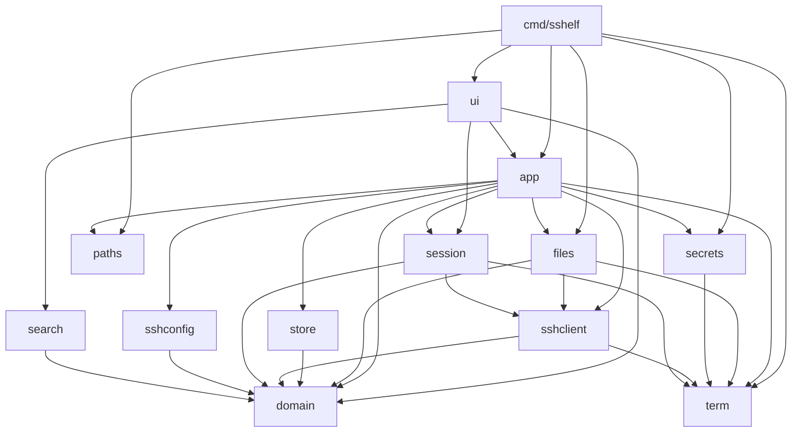
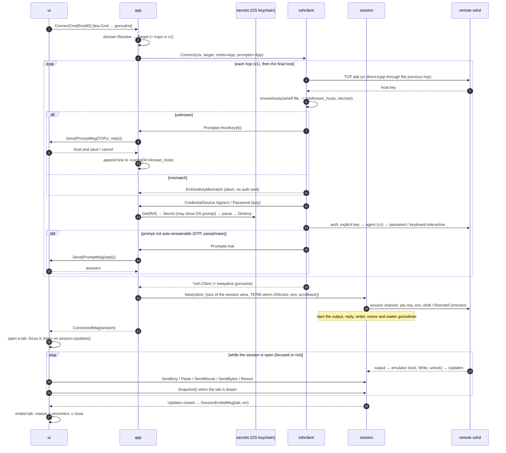
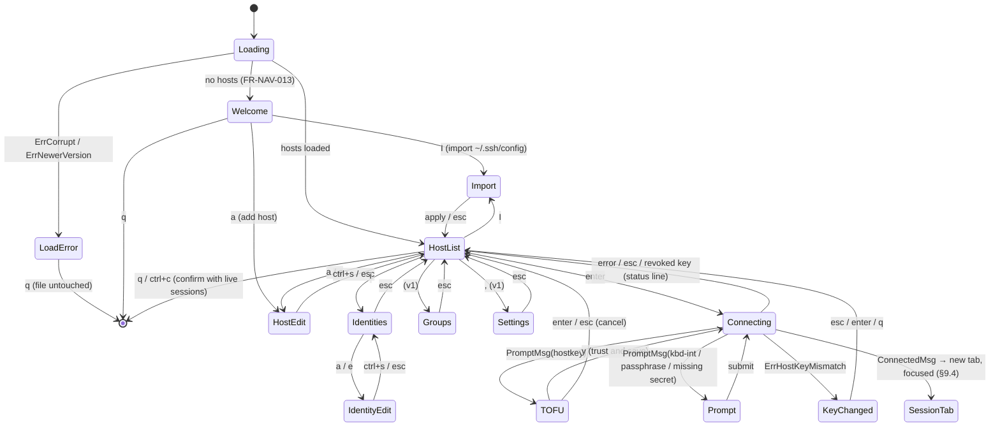
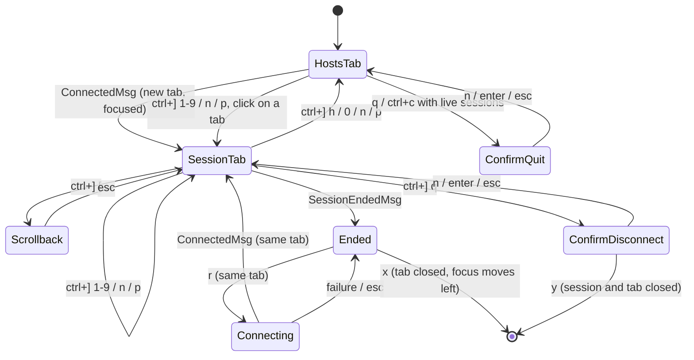

# sshelf architecture design

| | |
|---|---|
| **Owner** | Architecture |
| **Status** | Revision 5: M3 planned (D-017…D-020: SFTP tab, shared connections, transfers, edit locally; ADR-016 … ADR-020). Revision 4: M2 as built (T-031 … T-043; D-009…D-015: framed sessions, tabs, mouse). Revision 3 planned M2; revision 2 aligned with D-001…D-008, D-101…D-109 |
| **Requirement prefix** | `ARCH-*` |
| **Depends on** | `decisions.md` (binding), `security/credential-storage.md` (keychain library, item naming), `product/requirements.md` (`FR-*`) |
| **Last updated** | 2026-10-30 |

This document says **how** sshelf is built: the package layout, the domain data
model, the UI state machine, the SSH connection and session lifecycle, and the
testing strategy. `decisions.md` overrides it wherever the two disagree.

---

## 1. Context and goals

### 1.1 Context

sshelf is a **TUI-only** SSH host manager, like Termius but in the terminal
(D-001). The user runs `sshelf`, picks a host and connects. There is **no
master password and no encrypted vault** (D-002). Data lives in two places:

- **Metadata** (hosts, groups, identities without their secrets, snippets,
  forward rules, settings): one plain JSON file with mode `0600` in the config
  directory. It never contains secrets (D-003).
- **Secrets** (passwords, private keys, key passphrases): the OS credential
  store. That is the macOS Keychain on macOS and the Secret Service (GNOME
  Keyring or KWallet) on Linux (D-003, D-004).

Accepted host keys go in sshelf's own `known_hosts` file in the config
directory (D-102). The binary is a single static Go program for macOS and
Linux. Windows comes later.

The code follows the package layout in §5: a Bubble Tea v2 root model in
`internal/ui` with the Hosts tab and one tab per session, over `internal/app`,
`internal/sshclient` and the emulator-backed `internal/session`.
Milestone M3 adds SFTP tabs over `internal/files` (ADR-016 … ADR-020),
with connections shared between a session tab and its SFTP tab through a
reference-counted `sshclient.Conn`.

### 1.2 Assumed feature scope

| Tier | Features |
|------|----------|
| **MVP** | CRUD for hosts and identities (including credentials entered in the host form); a Welcome screen; a fuzzy-searchable host list; connect with a password or a private key (stored in the keychain or referenced as a file); password auth that also answers keyboard-interactive password prompts; known-hosts verification with a TOFU prompt; import from `~/.ssh/config` |
| **M2** | Sessions inside sshelf's frame through an embedded terminal emulator (D-009, ADR-012, ADR-013); several sessions as tabs, background sessions, prefix key, scrollback, reconnect from an ended tab (D-010, ADR-015); mouse on sshelf's screens, and in sessions only when the remote app asks (D-011, D-012, ADR-014) |
| **v1** | groups; ssh-agent auth and agent forwarding (D-005); jump hosts (ProxyJump); local, remote and dynamic port forwarding; snippets; keepalive; themes (the `~.` escape is replaced by the M2 prefix key, and reconnect moved to M2) |
| **M3** | An SFTP tab with local and remote panes, opened from the host list or from a session on the same connection; copy, rename, delete, mkdir; a transfer queue with resume; edit a remote file in the local `$EDITOR` (D-017 … D-020, ADR-016 … ADR-020) |
| **Later** | Mosh, Windows, an opt-in plaintext secret fallback (D-101), a system `ssh` fallback (D-104). Not planned (D-007): split panes, detaching a session to the shell, sessions that survive an sshelf restart |

### 1.3 Goals

1. **Secrets never touch disk in plaintext.** Passwords, private keys and
   passphrases go from the OS keychain to the SSH layer in memory only. sshelf
   writes no temporary files, environment variables or command-line arguments
   that contain them.
2. **Terminal fidelity.** An interactive session behaves like `ssh` in the
   user's terminal, rendered as an emulated `xterm-256color` screen inside
   the frame, where `vim`, `htop`, `less` and `tmux` must render correctly
   (D-009). (The MVP handed the whole terminal to the session instead.)
3. **The terminal always comes back cleanly.** After sshelf exits or panics,
   the terminal is usable: no raw mode, no leftover mouse tracking, and no
   stolen keystrokes. A session ending touches the terminal not at all.
4. **Multiple sessions without rewriting the SSH layer.** M2 adds tabs on top
   of the same `sshclient` (ADR-012).
5. **Testable without a network or a real keychain.**
6. **Small (D-007).** Every package, requirement and mechanism here must earn
   its place.

### 1.4 Non-goals

- The keychain library choice and item naming belong to
  `security/credential-storage.md`.
- There is no lock, auto-lock, unlock screen or master password (D-002), and
  sshelf never closes sessions for security reasons (D-006).
- There is no non-interactive CLI (D-001) and no cloud sync.

---

## 2. Research summary: how other projects run sessions

| Project | Stack | Session approach | Notes |
|---|---|---|---|
| **lazyssh** (Adembc/lazyssh) | Go, tview/tcell | Runs the system `ssh` binary | A UI over `~/.ssh/config` that stores no secrets |
| **sshs** (quantumsheep/sshs) | Rust, ratatui | Runs the system `ssh` binary | Reads `~/.ssh/config` only |
| **wishlist** (charmbracelet/wishlist) | Go, Bubble Tea, wish | In-process `x/crypto/ssh` client that hands over the terminal | Local-mode auth tries IdentityFile, then the agent, then default keys. The README says password auth is unsupported. |
| **wish** (charmbracelet/wish) | Go, server side | SSH *server* for Bubble Tea apps | Its `testsession` package is useful for our tests |
| **termview**, **bubble-ssh**, **bubbleterm** | Go, Bubble Tea | Embedded `charmbracelet/x/vt` (or their own) emulator inside a Bubble Tea view | Proves that option (c) works, but the projects are young |

The tools that store no secrets can shell out to `ssh`. sshelf owns
credentials, as Termius does, so it runs SSH in process.

**Verified on 2026-10-29:** `go list -m -versions charm.land/bubbletea/v2`
lists stable releases up to `v2.1.1` (published 2026-10-28; `v2.1.0` came
before it). Companion releases are `charm.land/lipgloss/v2 v2.0.6` and
`charm.land/bubbles/v2 v2.2.1`. The check also confirmed that v2 kept
`tea.Exec`, which the MVP's terminal handover (ADR-002) used. M2 removed
that handover in T-037, and sshelf no longer calls `tea.Exec`.

**Verified on 2026-10-30 (M2):** `go list -m -versions
github.com/charmbracelet/x/vt` lists a single tag, `v0.1.0` (published
2026-10-12, Go 1.24.2); before it the module had only pseudo-versions. Its
`go.mod` needs `github.com/charmbracelet/ultraviolet` at a March 2026
pseudo-version and `x/ansi v0.11.7`; sshelf already has a newer ultraviolet
pseudo-version (through bubbletea v2.1.1) and ansi v0.11.9, and a probe
program built and ran against exactly those versions. The probe measured
throughput, memory, key encoding, query replies, the alternate screen and
wide characters; the results and the limitations found are in ADR-013. The
probe was a throwaway outside the repository.

---

## 3. Architecture decisions (ADRs)

### ADR-001: In-process SSH with `golang.org/x/crypto/ssh`, not the system `ssh` binary

**Context.** Shelling out to `ssh` would mean feeding it keychain secrets
through `SSH_ASKPASS` or an ephemeral agent socket. OpenSSH would also run
TOFU itself on the raw tty, outside our UI. Jump hosts with a different
identity per hop would need a nested `ProxyCommand`, and running several
sessions or embedding them later would be impossible.

**Decision.** All SSH runs in process with `golang.org/x/crypto/ssh`,
`.../ssh/knownhosts` and, in v1, `.../ssh/agent`. sshelf never runs the system
`ssh` (D-104).

**Consequences.** Secrets stay in memory, and the TUI owns TOFU and
keyboard-interactive prompts. We implement ProxyJump, forwarding and
keepalives ourselves. (M2: unchanged. Owning the SSH client is what lets
ADR-012 run several sessions in one process and render them in a frame.) OpenSSH-only features (`ProxyCommand`, `Match`,
GSSAPI, ControlMaster, PKCS#11) are not supported, and the importer flags
them.

### ADR-002: Session model, from terminal handover (MVP) to background sessions and embedded panes (Later)

**Status:** superseded by ADR-012 (D-009); kept as history. T-037 removed
the handover.

**Summary.** The MVP chose (a) terminal handover over (b) shelling out to
`ssh` (rejected by ADR-001) and (c) an embedded emulator: a connected
session took the raw terminal through `tea.Exec` until the remote shell
exited, and every prompt was a TUI modal because dial, host-key check and
auth finished first. Its "Later" plans (a `session.Manager`, a `~d` detach,
a shadow emulator used only to repaint, panes) were dropped. M2 took option
(c) instead (ADR-012) with tabs in the root model (ADR-015).

### ADR-003: Secrets go from the OS keychain to the SSH layer in memory, through a `secrets.Store` interface

**Context.** D-003 and D-004 put secrets in the OS credential store. The
security agent owns the keychain library and the item naming. Architecture
owns the boundary.

**Decision.**
- `internal/secrets` exposes the `Store` interface defined in
  `security/credential-storage.md` §5 (summarised in §6.2): the
  `zalando/go-keyring` adapter `NewOSStore` (D-008) and the in-memory
  `MemStore` for tests. Callers address a secret by
  `secrets.Ref{IdentityID, Field}`, and only the OS adapter maps a `Ref` to a
  keychain item name.
- `sshclient` never imports `secrets`. It depends on a `CredentialSource`
  interface that `app` implements on top of `secrets.Store`.
- Secrets load **lazily inside the auth callbacks** on the connect goroutine.
  The keychain can block on an OS prompt such as a keyring unlock dialog, so the UI goroutine never waits on it, and a rejected TOFU prompt
  never reads a secret.
- Private keys are parsed in memory with `ssh.ParsePrivateKey` or
  `ParsePrivateKeyWithPassphrase`. The caller zeroes the `[]byte` buffers right
  after use, as a best effort and without any other memory-hardening machinery
  (D-007). A key *referenced by path* is read from its file the same way and
  never copied.
- If no credential store is available, `Store.Available()` returns
  `ErrUnavailable`. sshelf still runs, hosts that use a key file (or, in v1,
  the agent) still connect, and saving a password or key is refused with an
  explanation (D-101).
- No secret appears in a log line, an error string, a `tea.Msg`, or a panic
  message.

**Consequences.** There is no password to manage, and access is gated by the
OS login. On Linux, any process running as the user can read an unlocked
keyring; D-003 accepts that. Deleting an identity also deletes its keychain
items.

### ADR-004: Known hosts go in sshelf's own OpenSSH-format file, and `~/.ssh/known_hosts` is read-only

**Decision.** Accepted host keys are appended to `<configDir>/known_hosts` in
standard OpenSSH format, using `knownhosts.Line`, with mode `0600` (D-102).
sshelf verifies host keys with `knownhosts.New(<configDir>/known_hosts,
~/.ssh/known_hosts, /etc/ssh/ssh_known_hosts)`, skipping files that do not
exist, and never writes to the OpenSSH files. Hostnames are stored unhashed so
the file stays readable and editable.

**Consequences.** Importing from OpenSSH brings its existing trust along with
no TOFU prompts. A user can inspect, `grep`, or delete lines with any editor.
Replacing a changed key means deleting the stale line whose path and line
number the block screen shows (MVP, FR-KH-002), or using the known-hosts view
(v1, FR-KH-005). Keys that come from `~/.ssh/known_hosts` must be fixed there.

### ADR-005: Directories and the metadata file

**Decision.**

| Item | Linux | macOS |
|---|---|---|
| Config dir (`config.json`, `known_hosts`) | `$XDG_CONFIG_HOME/sshelf/` (default `~/.config/sshelf/`) | `~/Library/Application Support/sshelf/`, or `$XDG_CONFIG_HOME/sshelf/` if that variable is **explicitly** set |
| Log and crash reports | `$XDG_STATE_HOME/sshelf/` (default `~/.local/state/sshelf/`) | `~/Library/Logs/sshelf/` |

`--config <dir>` overrides the config dir, and that flag is the only override
(D-007). Directories are created with mode `0700` and files with mode `0600`.
`internal/paths` is the only code that resolves these paths.

The metadata is a **single `config.json`** with a `"version"` field, read and
written with stdlib `encoding/json` (no new dependency, D-007). Saves are
atomic: write a temp file in the same directory, `fsync`, then `rename`. From v1
(FR-CFG-004), before saving, `store` checks whether the file's modification
time changed since it was loaded. If it did, for example because a second sshelf instance or a
manual edit changed it, the save is refused and the UI offers to reload. That
avoids silent lost updates without locks, lock files or backups (D-007). TOML was rejected because it
adds a dependency, and the UI is the primary editor anyway.

### ADR-006: Command-line flags use stdlib `flag` (replaces "CLI framework is kong")

**Context.** D-001 leaves only `--version`, `--help` and `--config <dir>`.

**Decision.** Use the stdlib `flag` package in `cmd/sshelf/main.go`. There is
no CLI framework, no subcommands and no shell completion.

### ADR-007: Adopt Bubble Tea v2, Bubbles v2 and Lip Gloss v2 now

**Context.** The original skeleton pinned `bubbletea v1.3.10` and
`lipgloss v1.1.0`. §2 verified that stable v2 releases exist (and, for the
MVP handover, that `tea.Exec` kept its contract). Migrating then cost about
70 lines of skeleton code; migrating after the MVP would have touched every
screen.

**Decision.** In task T-0, move to `charm.land/bubbletea/v2`,
`charm.land/bubbles/v2` and `charm.land/lipgloss/v2`, pinned to the latest
v2.1.x / v2.x patch available at T-0. That is currently bubbletea `v2.1.1`,
bubbles `v2.2.1` and lipgloss `v2.0.6`. If `v2.1.1` shows a regression,
`v2.1.0` is the fallback. The PTY attach test (§10) is a T-0 exit criterion.

**Consequences.** `View()` returns `tea.View`, and v2 key messages replace
`tea.KeyMsg` (`tea.KeyPressMsg`). The snippets in this document follow the v2
API in spirit, so translate any remaining v1 names.

### ADR-008: Entity IDs are UUIDv7 strings

**Decision.** IDs are lowercase UUIDv7 strings from `github.com/google/uuid`.
They are stable across renames, so a host can reference an identity safely,
and the security spec can use them as stable keychain item keys. Labels are
display names only. They may contain spaces (D-105) and must be unique,
case-insensitively (FR-HOST-003), but nothing references an entity by label.

### ADR-009: Package import rules are enforced by a test

**Decision.** `internal/archtest` runs `go list -deps` and fails on any
forbidden edge in §5.2, and on any import of `os/exec` by an sshelf package,
because sshelf's own code never starts a child process. The only child
process is `/usr/bin/security`, run by `zalando/go-keyring` on macOS, which
D-008 accepts. A single Go test is enough; there is no extra linter
configuration (D-007).

*M3 revision (ADR-019):* `internal/ui/editor` is the one sshelf package
allowed to import `os/exec`, to run the user's editor for edit-locally
(D-019). archtest checks that exception by name.

### ADR-010: `~/.ssh/config` import copies data once and references keys by path

**Decision.** Import is a one-way copy with a preview (D-103), parsed by
sshelf's own small parser in `internal/sshconfig` (stdlib only), with `Include` expanded and the
`%h`/`%p`/`%r`/`~` tokens resolved. `Match` blocks are skipped and listed in the
preview, never evaluated. Implemented as an in-house parser instead of
`github.com/kevinburke/ssh_config` (the original choice) because that library
resolves `Include` against the real home directory, which makes fixture tests
impossible, and it evaluates `Match`; the parser takes the home directory as
an option. An `IdentityFile` becomes an identity
**referencing the key file by path**. Import does not copy the key into the
keychain, because it should never silently duplicate secrets. Afterwards the
identity screen offers "Store key in keychain" (D-004), which leaves the
original file untouched. sshelf never writes to
`~/.ssh/config`.

### ADR-011: Own text input instead of Bubbles `textinput`

**Context.** Bubbles v2 `textinput` imports a clipboard package for its paste
binding. SEC-CLIP-005 forbids any clipboard package, and `archtest` fails on
one.

**Decision.** Implemented as sshelf's own `components.TextInput`
(`internal/ui/components/textinput.go`) instead of Bubbles `textinput`,
because the Bubbles component pulls in a clipboard package. Paste arrives
from the terminal as `tea.PasteMsg` and needs no clipboard access. The input
passes typed and pasted text through `domain.Sanitize`, supports plain,
masked and no-echo modes (FR-IDENT-004), zeroes its runes on `Reset` and
never leaves an unzeroed copy behind, so it can hold a secret. Every form and
modal (host form, identity form, prompt modal) uses it. Bubbles packages that
need no clipboard, such as `key`, are still used.

### ADR-012: Sessions render inside sshelf's frame through an embedded emulator (revises ADR-001 and ADR-002)

**Status:** accepted and implemented in M2 (D-009, D-010; T-031 … T-037). Supersedes ADR-002.

**Context.** D-009 puts every session inside sshelf's frame, and D-010 asks for
several sessions at once with the host list one key away. With the MVP
handover (ADR-002 option a), the TUI is not drawn while a session runs, only
one session can own the terminal, and nothing can show a tab bar. ADR-002
rejected option (c), an embedded emulator, for the MVP because of fidelity
and latency risk; D-009 accepts that risk, which ADR-013, ARCH-TEST-002 and
NFR-PERF-004/005 now measure.

**Decision.**
- Each `session.Session` owns an in-process VT emulator (ADR-013) sized to the
  session area: the terminal width by its height minus the header and status
  rows. Every byte of remote output goes into that emulator; the root model
  draws the focused session's emulator screen between the header and the
  status bar (§9.4).
- Input never touches the raw terminal. Bubble Tea decodes keys, pastes and
  mouse events; the root model handles the prefix key (§8.5) and gives
  everything else to the focused session, which encodes it according to the
  emulator's modes (application cursor keys, bracketed paste, mouse modes)
  and writes it to the SSH channel.
- The emulator answers the remote's terminal queries itself (device
  attributes, cursor position, colour queries), so a remote program never
  queries or controls the user's real terminal.
- The remote PTY's `TERM` is `xterm-256color`, the terminal the emulator
  implements, not the local `TERM` (FR-CONN-001).
- **One path (D-007).** T-037 removed the MVP handover (`tea.Exec`,
  `session.Run()`, raw mode, the stdin pump with `cancelreader`, the SIGWINCH
  handler) and the `devcheck` program; archtest bans `golang.org/x/term` and
  `cancelreader` in `session`. There is no "full-screen mode" switch.
- ADR-001 stands unchanged: all SSH stays in process with
  `golang.org/x/crypto/ssh`, which is what makes several sessions in one
  process possible.

**Consequences.**
- Sessions survive tab switches and run in the background; reconnect and
  close happen in the tab (FR-TAB-*, FR-CONN-005).
- **Security win (SEC-SESSION-005, threat T-15).** In the MVP, remote output
  goes to the user's terminal unfiltered, as with `ssh`, so a hostile server
  could set the clipboard (OSC 52), change the window title, inject
  hyperlinks, query the terminal and read its replies, or exploit a bug in
  the user's terminal emulator. From M2 the remote only ever talks to
  sshelf's emulator; the real terminal receives what sshelf renders from
  emulator cells (characters and SGR styles). OSC 52, titles, hyperlinks,
  DCS, APC and terminal reports never reach it.
- **Costs.** Fidelity now depends on a young emulator (ADR-013 lists its
  gaps). Every keystroke goes through Bubble Tea's decoder and our encoder
  (NFR-PERF-004 bounds it at 5 ms p99). Output throughput is bounded by the
  emulator (NFR-PERF-005). The terminal's own scrollback no longer holds
  session output; scrollback mode (FR-TAB-010) replaces it. Programs that
  use protocols the emulator lacks (kitty graphics, sixel, the kitty keyboard
  protocol) fall back to what `xterm-256color` offers.
- Native text selection keeps working while the remote app has not asked for
  the mouse (D-012, ADR-014).

### ADR-013: The terminal emulator is `github.com/charmbracelet/x/vt` v0.1.0, pinned and wrapped

**Status:** accepted and implemented in M2 (T-031). Each limitation below
ends with its status at the M2 gate: *worked around* (in sshelf's wrapper),
*mitigated*, or *accepted*.

**Context.** ADR-012 needs an emulator that parses xterm output, keeps a
main and an alternate screen with scrollback, renders cells with styles, and
encodes keys and mouse events according to the modes the remote set. The
architect proposed `charmbracelet/x/vt`, which also underlies the projects
in §2. It was checked on 2026-10-30 (§2) with a probe program at sshelf's
exact `ultraviolet` and `x/ansi` versions on an Apple M1 Pro.

**What it offers.** `NewEmulator(w, h)`; `Write` (remote output); `Read` (an
`io.Pipe` carrying the encoded input and the emulator's own replies, to be
copied to the SSH channel); `Resize`; `Render` (styled lines), `CellAt`,
`Draw` onto an ultraviolet screen; `CursorPosition`, `CursorHidden`,
`CursorStyle`; `IsAltScreen`; `SendKey(uv.KeyEvent)` honouring application
cursor and keypad modes; `SendMouse(uv.MouseEvent)` honouring the X10, normal
(`?1000`), button (`?1002`) and any-event (`?1003`) modes with X10 or SGR
(`?1006`) encoding, and dropping events when no mode is set; `Paste`, which
adds the bracketed-paste markers when `?2004` is on; `SetScrollbackSize`,
`Scrollback`, `ScrollbackLen`, `ScrollbackCellAt` (main screen only, default
cap 10,000 lines); callbacks for title, bell, alt screen, cursor and every
mode change; default colours settable. Measured: `ESC[c` is answered with
`ESC[?62;1;6;22c`; `?1049h` switches to the alternate screen; grapheme
clusters (flags, ZWJ sequences, VS16 emoji, combining accents) get the right
width; CJK characters are two cells wide. A `SafeEmulator` wraps it with an
RW mutex.

**Maturity.** `v0.1.0` (2026-10-12) is the module's only tag, so the API is
pre-1.0 and may change. It depends on an `ultraviolet` pseudo-version, which
Bubble Tea v2.1.1 also uses (a newer one); the build is consistent today, but
a future Bubble Tea upgrade can move `ultraviolet` under `vt`.

**Limitations found (each with its mitigation).**
1. **Modified special keys are dropped.** `SendKey` sends nothing for
   Ctrl/Shift with arrows, Home, End, PgUp, PgDn, Insert, Delete and F1–F12
   (measured: Ctrl+Up, Shift+Left, Ctrl+F5, Ctrl+Delete and Shift+Enter
   produce zero bytes), and it has no kitty keyboard protocol, CSI u or
   `modifyOtherKeys` (a TODO in its source). Alt works (ESC prefix).
   *Mitigation:* sshelf's encoding shim produces the xterm forms
   (`CSI 1;<mod> A`, `CSI <n>;<mod> ~`) for those keys before falling back to
   `SendKey` (ARCH-SESS-017). *Status: worked around* by the shim in
   `internal/session/keys.go` (`encodeKey`, table test
   `TestARCH_SESS_017_KeyTable`); still open upstream in v0.1.0. Keys with no
   xterm encoding (media keys, F13 and above) are dropped on purpose.
2. **Wide characters at the right margin are lost.** A double-width
   character that would occupy the last column, or the last two columns, is
   dropped and the next character overwrites the last column instead of
   wrapping (measured with `12345678日x` and `日本語ab👍x` at width 10).
   *Mitigation:* a failing replay golden (`utf8-wide`) and an upstream fix in
   T-031; open question 2 in `product/requirements.md` §22 if no release fixes
   it by the gate. *Outcome (T-031, D-015):* worked around in `emulator.go`:
   a second `x/ansi` parser finds where each printed character starts, the
   emulator is fed up to there, and `\r\n` is inserted before a wide
   character that would not fit and before the character after one that
   filled the last two columns, which is what an xterm's pending wrap does.
   An incomplete UTF-8 character at the end of a read is held for the next
   one. The `utf8-wide` golden and `TestARCH_TEST_002_WideCharacterAtMargin`
   pass and are not skipped. *Status: worked around.* Related, *accepted*: `vt` ends a grapheme cluster at the
   end of every `Write`, so a combining mark, ZWJ sequence or flag split
   across two reads is drawn as separate cells; sshelf splits its own
   writes only after control characters.
3. **Throughput is 2 to 5 MB/s.** 10 MiB of 100-column lines took 2.1–2.4 s
   at 120×40 and 4.0–4.8 s at 200×50, with or without SGR colours; a native
   terminal does well over 50 MB/s. *Mitigation:* NFR-PERF-005 sets a CI floor
   of 1 MB/s and requires flow control instead of buffering (ARCH-SESS-014);
   a fast `cat` of a large file is slower than in a native terminal.
   *Status: accepted*, gated by the `perf-session` CI job.
4. **Scrollback is expensive.** About 130 bytes per stored cell: 10,000 lines
   cost about 66 MB at 80×24 and 134 MB of heap at 200×50; 2,000 lines at
   120×40 cost about 31 MB. Eviction from a full buffer is
   `slices.Delete(lines, 0, 1)`, O(lines) per scrolled line. *Mitigation:*
   cap 2,000 lines (D-013, NFR-SIZE-003); a compact scrollback is an
   upstream improvement, not sshelf code. *Status: mitigated.* The wrapper
   lets `vt` hold up to `writeChunk` lines over the cap during one write and
   trims back to the cap after it, counting the lines it drops (and the
   lines an `ESC[3J` clears) for `Dropped()` (§8.4), because `vt` does not
   report them.
5. **`SafeEmulator` can freeze rendering.** Its `SendKey` holds the lock while
   writing into the unbuffered reply pipe, and `Write` can block on a reply
   (for example to `ESC[c`) while holding it; if nothing drains the pipe, the
   UI's `Render` blocks. *Mitigation:* sshelf uses the plain `Emulator` with
   its own mutex and a reply pump that never blocks on the network
   (ARCH-SESS-014). *Status: worked around* (`screen` in `emulator.go`).
6. **No reflow on resize**: lines are cut or padded, as in xterm.
   *Status: accepted.*
7. **Mouse encodings** UTF-8 (`?1005`), urxvt (`?1015`) and SGR-pixel
   (`?1016`) are not supported; apps fall back to X10 or SGR. Found in
   T-041: `SendMouse` checks only that *some* mouse mode is on, and in X10
   encoding it sends a release with the pressed button instead of button
   code 3. *Status: accepted* for the missing encodings; *worked around* for
   the rest: the wrapper drops events the remote's modes do not report
   (`wantsMouse`: presses and wheel in every mode, releases in all but `?9`,
   motion with a button held under `?1002`, any motion under `?1003`), and
   sets the button to none on an X10 release so `vt` encodes code 3.
8. **Widths use grapheme width** and can disagree with a remote's `wcwidth`
   for ambiguous-width characters, misaligning those lines, as in many
   terminals. *Status: accepted.*
9. **Default colours are white on black**, so a remote's OSC 10/11 colour
   query gets those answers. *Mitigation:* sshelf sets the emulator's default
   colours from the user's terminal when Bubble Tea reports them
   (ARCH-SESS-016; the root model asks for them in `Init`). *Status: worked
   around.*
10. **Hyperlinks (OSC 8) are kept in cells.** *Mitigation:* sshelf renders
    without them (ARCH-SESS-011, SEC-SESSION-005). *Status: worked around.*

**Alternatives.** Other Go emulators known to us (`hinshun/vt10x`,
parser-only packages) provide no key or mouse encoders and would move more
code into sshelf; they were not benchmarked. Writing an emulator is out of
scope (D-007).

**Decision.** Use `github.com/charmbracelet/x/vt` **v0.1.0**, pinned exactly
in `go.mod`. Only `internal/session/emulator.go` imports it, behind a small
private type (`write`, `resize`, `snapshot`, `scrollback`, `sendKey`,
`sendMouse`, `paste`), so a later version or another library touches one file.
Upgrades need the replay goldens (ARCH-TEST-002) and NFR-PERF-005 green. Fixes
for limitations 1 and 2 go upstream; the shim is deleted when a release
includes them.

### ADR-014: Mouse only where it does not cost the user their terminal's selection (D-011, D-012)

**Decision.**
- The root model's `View()` sets `tea.View.MouseMode` on every frame from
  one function (ARCH-UI-006): cell motion on the Hosts tab and its screens
  and modals; for a focused live session, the mode its remote app asked for,
  or none; none in scrollback mode and on an ended session. Bubble Tea turns
  modes on and off when the value changes, and off on exit.
- Hit-testing needs no zone library: each component handles a
  `components.ClickMsg{X, Y, Double}` or `components.WheelMsg{X, Y, Delta}`
  in its own coordinates, from the same layout function its `View` uses. The
  root model subtracts the rows it placed above the component (header, blank
  line, the screen above a modal) before passing it on (ARCH-UI-007).
- A double-click is two left presses on the same row within 400 ms, measured
  with an injectable clock in the root model.
- Mouse events for a session are converted to ultraviolet events with the
  header row removed, and encoded by the emulator (ADR-013).
- While a session tab is focused and no modal is open, every mouse event
  belongs to that session (`forwardMouse` in `ui/mouse.go`). Events outside
  the session area, on the header row (the tab bar) and on the status bar,
  are dropped: they are neither forwarded nor acted on, so a click on the
  tab bar does not switch tabs while a session is focused. With a plain
  shell the terminal sends no mouse events at all (mode none), and while a
  remote app has mouse reporting on, the click would otherwise be ambiguous.
  Tabs are switched with the prefix key there (D-012); tab-bar clicks work
  on the Hosts tab (FR-NAV-017). With a modal open, only the top modal takes
  clicks.

**Consequences.** While the user is in a plain shell, the terminal's own
selection and copy work as before; inside `vim` or `htop` with mouse
support, the app gets the mouse as it would in a native terminal. No
clipboard code is added (SEC-CLIP-005).

### ADR-015: Tabs live in the root model; there is no session manager

**Context.** ADR-002 planned a `session.Manager` for detach and reattach.
M2 has tabs but no detach and no sessions outliving the UI.

**Decision.** The root model holds `[]sessionTab` (number, host ID, label,
`user@host:port`, start time, the `app.Session`, activity and end state,
scrollback position). Each session runs its own goroutines (ARCH-SESS-010),
so "background" needs no extra machinery: an unfocused tab is simply not
drawn. The modal stack stays global: modals (Connecting, TOFU, prompts,
confirmations, help) open over whichever tab is focused, and while one is
open the prefix key is off. Only one connection attempt runs at a time, as in
the MVP.

**Consequences.** No new package or lifecycle owner (D-007). Quitting closes
every session through the root model's quit path (`closeAllAndQuit`), and
`cmd/sshelf` calls `Model.CloseSessions` on the final model whatever ended
the program, a signal included (ARCH-SESS-010). If a
future feature needs sessions outside the UI (snippets on a live session,
tunnels without a tab), a manager can be extracted then. *M3 (ADR-017):*
a connection shared by a session tab and an SFTP tab is reference-counted in
`sshclient.Conn`; that is still not a manager.

### ADR-016: SFTP with `github.com/pkg/sftp` v1.13.12

**Status:** proposed for M3 (D-017, D-018).

**Context.** The SFTP tab needs an SFTP v3 client that runs over an existing
`x/crypto/ssh` connection, and the tests need an SFTP server that runs inside
sshtest (ARCH-TEST-004). D-007 rules out writing our own protocol code.

**Options.** (a) `github.com/pkg/sftp` v1: the de-facto Go SFTP library,
client and server, used by rclone and restic. (b) `github.com/pkg/sftp/v2`:
only `v2.0.0-alpha` and `v2.0.0-alpha2` are tagged; the API is not stable.
(c) Our own client: thousands of lines for no gain.

**Decision.** (a), pinned to **v1.13.12** (checked with `go list -m -versions`
on 2026-10-30; tagged 2026-10-23, the previous release v1.13.11 on
2026-07-12). Its `go.mod` needs Go 1.25 and `x/crypto` v0.54 or later
(sshelf has 1.26 and v0.58); its only non-test dependency is `kr/fs`. It is
imported by `internal/files/remote.go` (the only file of the product that
does) and by `internal/testutil/sshtest`. Client options: the default packet
size (32 KiB, which every server accepts), concurrent reads on (the default),
concurrent writes on, and the default 64 requests in flight per file.

**Verified API** (source of v1.13.12): `NewClient(*ssh.Client, ...)` and
`NewClientPipe(io.Reader, io.WriteCloser, ...)`; `Client.Getwd`, `RealPath`,
`ReadDirContext`, `Lstat`, `Stat`, `ReadLink`, `Mkdir`, `Remove`,
`RemoveDirectory`, `Rename`, `PosixRename`, `HasExtension`, `Chmod`,
`Chtimes`, `Truncate`, `OpenFile`, `Close`; `File.Seek`, `WriteTo`, `WriteAt`,
`Stat` (fstat), `Truncate`, `Close`. Server side: `NewServer` (serves the
whole file system; `WithServerWorkingDirectory` is not a chroot) and
`NewRequestServer(rwc, Handlers)` with the `FileReader`, `FileWriter`,
`FileCmder` and `FileLister` interfaces, plus `InMemHandler()`.

**Limitations found and how sshelf handles them.**

1. **`ReadDir` has no size limit.** `ReadDirContext` collects the whole
   directory before returning (cancelling returns what was read so far).
   sshelf opens the browse channel itself and passes it to `NewClientPipe`
   behind a counting reader, so a listing that has read more than 64 MiB is
   cancelled, then cuts the result at 100,000 entries (SEC-SFTP-004,
   ARCH-SFTP-002). An upstream issue asks for a limit or an iterator.
2. **Names are rewritten.** `ReadDirContext` drops `.` and `..` and reduces
   every name with `path.Base`, so `../x` arrives as `x` and `x/..` as `..`;
   the server's `longname` is discarded. SEC-SFTP-001 checks what the library
   returns, and again before any join.
3. **No context on bulk I/O.** `File.WriteTo` and `File.ReadFrom` take no
   context, and `WriteTo` holds the file's mutex, so `Close` cannot interrupt
   it. Downloads are cancelled by the local writer returning an error;
   uploads use sshelf's own loop of 1 MiB `WriteAt` calls and check the
   context between them; a dropped connection unblocks both (ARCH-SFTP-004).
4. **Concurrent writes can leave gaps.** With `UseConcurrentWrites`, a failed
   write may leave data past the failing offset. `WriteAt` returns the
   earliest failing offset of its buffer, so sshelf's checkpoint is always a
   contiguous, acknowledged prefix (ADR-018).
5. **`Rename` is SFTP v3 rename**, which fails when the target exists on
   OpenSSH. Replacing a file uses `PosixRename` when
   `HasExtension("posix-rename@openssh.com")`, otherwise `Remove` then
   `Rename` (a short window without the file; SEC-SFTP-003 AC3).
6. `RemoveAll` and `Walk` exist, but sshelf walks with `Lstat` itself so it can
   count, cap the depth and never follow a link (FR-SFTP-011, SEC-SFTP-004).
7. Times are SFTP v3 attributes: whole seconds. `Client.Close` closes only its
   subsystem channel, never the `*ssh.Client`, which shared connections need
   (ADR-017).
8. **Status messages are quoted, not cleaned.** `StatusError.Error()` is
   `sftp: %q (code)`: the server's message is Go-quoted, so control bytes
   arrive as escape text (`\x1b]52;…`) and a long message is not cut.
   SEC-SFTP-008 still sanitises, folds and cuts it to 80 columns.

**Test server.** sshtest serves `sftp` subsystem requests with
`NewRequestServer` and a `Handlers` implementation over an `os.Root` opened
on a temp dir (Go's `os.Root` confines every path, symlinks included, to that
dir), so tests exercise a real file system without exposing the rest of the
machine. A hostile handler and fault injection sit beside it
(ARCH-TEST-004). `NewServer` is not used because it is not confined;
`InMemHandler` is not used because it has no symlinks or modes.

### ADR-017: Shared connections are reference-counted in `sshclient.Conn`

**Status:** proposed for M3 (D-018). Revises §8.4's "the session owns the
client".

**Context.** D-018 asks for an SFTP tab on a session's connection with no
second login, and the user expects ending the shell not to stop a download,
nor closing the SFTP tab to end the shell. In M2, `session.New` owns the
`*ssh.Client` and closes it when the session ends.

**Options.** (a) The SFTP tab borrows the session's client: ending the shell
kills the SFTP tab. (b) A connection manager in `app` (ADR-015 rejected a
manager). (c) A small reference-counted handle in `sshclient`.

**Decision.** (c):

```go
// Conn is one authenticated SSH connection shared by the tabs that use it.
func NewConn(c *ssh.Client) (*Conn, *Lease) // the first lease belongs to the caller
func (c *Conn) Lease() (*Lease, error)       // ErrConnClosed once the connection ended or was released
func (c *Conn) ID() uint64                   // process-unique, for the UI to match tabs
func (c *Conn) Done() <-chan struct{}        // closed when the connection ends for any reason
func (c *Conn) Err() error                   // after Done: nil after the last Release, or the transport error

// Lease is one holder's reference.
func (l *Lease) Client() *ssh.Client
func (l *Lease) Conn() *Conn               // the connection, for Session.Conn and further leases
func (l *Lease) Release()                    // idempotent; the last release closes the client
```

One goroutine per `Conn` (through `term.SafeGo`) waits on `client.Wait()` and
closes `Done`. Constructors take ownership of a lease: `session.New(lease,
opts)` and `files.Open(lease, opts)` release it when they end, fail or are
closed. (`files.Open` builds the tab's `Browser` on `files.OpenRemote(lease)`,
the remote side with its two channels, T-046.) `app.Connect` creates the `Conn`; `app.OpenSFTPOn(session)` takes a
second lease from the session's `Conn`. `app.Session` and `app.Browser`
gain `ConnID() uint64`, so the root model can find the SFTP tab already on a
session's connection (FR-SFTP-003) without seeing `sshclient`.

**Consequences.** A session's waiter watches its channel, `Conn.Done()` and
its own close request instead of `client.Wait()`; `Session.Close` closes the
channel and releases the lease. An `exit` in the shell ends only the session.
A dropped connection ends every holder. Reconnecting a tab makes a new
`Conn` for that tab alone. ARCH-CONN-006 and the ARCH-SESS-008 revision state
the contract; goleak and sshtest's connection-close count test it.

### ADR-018: Transfers: one queue per connection, two at a time, part files and checkpoints

**Status:** proposed for M3 (D-018, D-020).

**Decision.**

- **One browser per SFTP tab, one SFTP tab per connection.**
  `files.Browser` holds the tab's two SFTP channels, the local side and the
  queue. `Ctrl+]` `s` focuses the existing SFTP tab of a connection, so the
  queue is per connection as D-018 asks.
- **Two SFTP channels.** A *browse* channel (listings, stat, rename, delete,
  mkdir, item counts) and a *transfer* channel (the queue and edit-locally).
  OpenSSH runs one `sftp-server` per channel and answers its requests in
  order, so listings stay fast while a large file is moving, and the browse
  channel's byte count is the listing's alone (ADR-016 limitation 1). If the
  server refuses the second channel (`MaxSessions`), the browser uses one
  channel for both; the listing limit is then the entry cap and a 30 s
  timeout, and listings wait behind transfer requests. Both channels share
  the tab's one lease.
- **Queue.** FIFO. A directory job, when it starts, lists its source
  (with the SEC-SFTP-004 limits), creates the target directory and inserts
  its children right after itself, so trees are copied depth-first in name
  order. Two workers take jobs. A file whose target exists is parked as
  `waiting` with its question and the worker takes the next job; the answer
  puts it back at the front. "Apply to all" is stored on the batch (one `c`
  or drag).
- **Why two at a time.** One large file already fills the pipe: pkg/sftp
  keeps 64 requests in flight per file. A second slot lets small files pass
  a large one instead of waiting behind it, and keeps memory at two
  transfers' buffers (NFR-SIZE-004). More slots would not speed up one
  `sftp-server` that answers in order. FileZilla's default is also 2. The
  number is a constant, not a setting (D-007).
- **Download.** Open the remote file and `Fstat` it (record size and mtime).
  Open the target directory as an `os.Root`; create `<name>.sshelf-part`
  with `O_CREATE|O_EXCL|O_WRONLY`, mode 0600 (or, to resume, `Lstat` it,
  require a regular file, open it `O_WRONLY|O_NOFOLLOW` and compare
  `Fstat` with the `Lstat`). `Seek` the remote file to the part's size and
  `WriteTo` a writer that counts bytes, stops at the recorded size
  (SEC-SFTP-004) and fails when the job is cancelled. Then check the size,
  `Sync`, close, `Chmod(mode & 0777)`, `Chtimes`, and `Rename` the part over
  the final name inside the root (a symlink at the final name is replaced,
  never followed; SEC-SFTP-002, SEC-SFTP-003).
- **Upload.** `Lstat` the local file (regular, or the explicitly marked
  link's target), open it and compare `Fstat`. Open the remote
  `<name>.sshelf-part` with `O_CREATE|O_TRUNC|O_WRONLY` (or, to resume,
  without `O_TRUNC`, then `Truncate` to the checkpoint). Loop: read 1 MiB at
  the offset, `WriteAt`, advance by what was acknowledged. Every 8 MiB, and
  when the job pauses or is cancelled while the connection is up, `Stat` the
  open file and record a **checkpoint** {offset, size, mtime}. At the end:
  `Chmod`, `Chtimes`, then `PosixRename` over the final name (or `Remove` and
  `Rename`, ADR-016 limitation 5).
- **Resume (FR-SFTP-017).** Each job remembers in memory what it recorded:
  the source's size and mtime, and for uploads the last checkpoint. A
  download resumes from the local part's size; an upload resumes from the
  checkpoint offset, truncating anything after it, because concurrent writes
  may have left a gap past it (ADR-016 limitation 4) and the in-flight
  writes changed the part's mtime. The exact conditions are FR-SFTP-017's;
  any mismatch restarts from 0 with the reason shown. Nothing is persisted:
  a new sshelf run never resumes (D-007).
- **Pause.** When `Conn.Done()` closes, running and queued jobs move to
  `paused`, keeping their records and part files. `app.Service.ReconnectSFTP`
  makes a new `Conn` through the normal connect flow (for the host recorded by
  `files.Open(lease, files.Options{HostID})`) and `Browser.Attach`
  reopens both channels and requeues the paused jobs in their old order.
- **Cancel.** Stops the job, deletes its part file (local; remote best
  effort) and, for a directory job, removes its queued children.
- **Progress.** Workers update counters under the browser's mutex and send a
  coalesced notification (capacity-1 channel, as ARCH-SESS-015) only on state
  changes. Byte counts and rates are read by the UI on a 250 ms tick while a
  job runs, so progress costs at most 4 redraws a second.
- **Memory.** A download keeps at most 64 × 32 KiB in flight; an upload a
  1 MiB buffer plus pkg/sftp's packet copies. Two transfers stay well under
  NFR-SIZE-004's 16 MiB whatever the file size.

**Consequences.** Big trees are not walked up front, so the total of a
directory copy is known only as it proceeds; the progress line shows the
current file. Remote permission bits are copied as `mode & 0777`; owners,
ACLs and hard links are not (out of scope, `product/requirements.md` §3.2).

### ADR-019: Edit locally suspends the UI with `tea.ExecProcess`, from one package (revises ADR-009 and ADR-012)

**Status:** proposed for M3 (D-019).

**Context.** D-019 makes editing a remote file in the user's `$EDITOR` the
one place sshelf runs a local program. ADR-009 banned `os/exec` from every
sshelf package and ADR-012 removed `tea.Exec` with the MVP handover.

**Options.** (a) `tea.ExecProcess`: Bubble Tea releases the terminal, runs
the command on it, and restores the terminal. (b) Run the editor in a local
PTY rendered in a tab, like a session: needs `creack/pty` in the product and
a second emulator path. (c) No editor: the user downloads, edits, uploads by
hand. (a) is the least code (D-007).

**Decision.**

- `internal/ui/editor` is the only sshelf package that imports `os/exec`
  (archtest names it). It has three functions: `Words(getenv)` returns the
  words of the first non-empty of `$VISUAL`, `$EDITOR` and `vi`
  (`strings.Fields`, no shell, no quoting); `Command(words, path)` returns
  `exec.Command(words[0], words[1:]..., path)` with `Env` left nil, so the
  editor inherits sshelf's environment, which never holds a secret
  (SEC-MEM-008); `Run(path, done)` returns `tea.ExecProcess(Command(...),
  done)`. It imports Bubble Tea, `os/exec` and the standard
  library, and no `internal/` package.
- The temp copy, its comparison and the upload belong to `internal/files`
  (`EditCopy`: `Fetch`, `Changed`, `RemoteChanged`, `Upload`, `SaveAs`,
  `Remove`), behind `app.Browser`. Active edit directories are kept in a
  registry that `cmd/sshelf`'s crash handler empties (SEC-SFTP-005).
- **What happens during the suspend** (checked in Bubble Tea v2.1.1
  `exec.go` and `tea.go`). The program's event loop handles the exec message
  itself and blocks in `cmd.Run()`; `ReleaseTerminal` stops the renderer and
  the input reader and restores the terminal (alt screen off, mouse modes
  off, bracketed paste off); `Program.Send` blocks until the loop runs
  again, because its channel is unbuffered. So no `Update` or `View` runs
  while the editor is open. Sessions do not depend on the loop: their output,
  reply, writer and waiter goroutines keep reading the channel into the
  emulator (ARCH-SESS-010, ARCH-SESS-014), and their `Updates()` hold one
  coalesced notification; the listener command simply waits to deliver it.
  Transfers keep running the same way (ADR-018). No sshelf goroutine calls
  `Program.Send` except the connect prompter, and `e` is refused while a
  connection attempt is in progress, so nothing can deadlock.
- **On return**, Bubble Tea restores the terminal and delivers the callback
  message; the root model returns `tea.RequestWindowSize` with the next step
  of the edit, resizes every session if the terminal changed while the editor
  ran, sets activity markers for tabs that received output, and redraws.

**Consequences.** One child process besides `/usr/bin/security`, documented in
SEC-MEM-008's M3 revision and ARCH-SESS-001's. While the editor runs the user
sees only the editor; sshelf's tabs are not visible until it exits.

### ADR-020: The SFTP tab lives in the root model; its view is `ui/sftpview` (extends ADR-014 and ADR-015)

**Status:** proposed for M3 (D-017).

**Decision.**

- The root model's tab list holds session tabs and SFTP tabs in one opening
  order with one numbering (FR-TAB-003 M3 revision). An SFTP tab entry holds
  its number, host ID and label, the `app.Browser`, its `sftpview.Model`, and
  its connection state.
- `internal/ui/sftpview` is the SFTP tab's view: the two panes, the progress
  line, the footer, the transfers view, the filter field and the drag state.
  It is a plain model with `Update` and `View`; all I/O happens in commands
  that call `app.Browser` (ARCH-UI-002). One pure function,
  `sftpview.Layout(width, height)`, gives the regions (pane boxes, rows,
  progress line, footer) used by both `View` and hit-testing (ARCH-UI-007).
- **Side by side at every size** (FR-SFTP-023): each pane gets half the width
  (the remote pane the odd column); the mtime column appears from 50 inner
  columns. Below 80×24 the frame's general too-small rule applies (FR-NAV-007,
  v1).
- **Mouse.** The SFTP tab is an sshelf screen: mouse mode is cell motion
  (ARCH-UI-006 M3 revision). Unlike the other sshelf screens it also uses
  motion with the left button held and the release, for dragging
  (ARCH-UI-007 M3 revision). Tab-bar clicks work on it as on the Hosts tab.
- **Keys.** The routing order of §9.4 holds, with the SFTP tab in step 4:
  the filter field takes text while it is focused, then the transfers view's
  keys while it is shown, then the panes' keys (§9.6).

**Consequences.** No new lifecycle owner; quitting closes SFTP tabs through
the same path as sessions (`CloseSessions` becomes `CloseTabs`).

---

## 4. Architecture requirements

Each `MVP` requirement shows its status next to its priority; every other
requirement is **Draft**. "The system" means the sshelf
binary. IDs are never reused, so gaps in the numbering are requirements
removed in revision 2.

### 4.1 Sessions (`ARCH-SESS`)

**ARCH-SESS-001**: The system shall open SSH sessions in process with `golang.org/x/crypto/ssh` and shall start no child process other than the `/usr/bin/security` calls made by `zalando/go-keyring` on macOS (D-008).
- Priority: MVP · Status: Implemented
- Acceptance: `archtest` finds no import of `os/exec` in any sshelf package. A connect test against the in-process server passes on a machine without OpenSSH installed.
- **M3 revision** · Priority: M3 · Status: Draft · Source: D-019, ADR-019
  - *Revised:* The system shall open SSH sessions and SFTP channels in process with `golang.org/x/crypto/ssh` and `github.com/pkg/sftp`, and shall start no child process other than the `/usr/bin/security` calls made by `zalando/go-keyring` on macOS (D-008) and the user's editor, started by `internal/ui/editor` for edit-locally (D-019).
  - *Acceptance:* `archtest` finds `os/exec` imported by `internal/ui/editor` and by no other sshelf package (a fixture module with `os/exec` in another package fails). A connect test and an SFTP listing against the in-process server pass on a machine without OpenSSH installed.

**ARCH-SESS-002**: When the user connects to a host, the system shall finish dialling, host-key verification and authentication before it opens the session's tab.
- Priority: M2 · Status: Implemented · Source: D-009, D-010 (the MVP finished them before releasing the terminal)
- Acceptance: Prompts appear as modals over the tab the connection was started from (goldens). If auth fails or is cancelled, no tab is opened and the status line shows the error. `session.New` is never called before `sshclient.Connect` returned a client.

**ARCH-SESS-003**: While a session is open, the system shall write to its SSH channel only the encoding of the user's input and the emulator's replies, and shall feed every byte the channel delivers to that session's emulator, without changing the local terminal's mode.
- Priority: M2 · Status: Implemented · Source: D-009, ADR-012 (replaces the MVP raw-mode relay)
- Acceptance: 256 random bytes sent with `SendBytes` arrive at sshtest unchanged and in order. Binary output from sshtest reaches the emulator unchanged (a recording emulator double in `session` tests). The `session` package does not import `golang.org/x/term` and has no raw-mode code; archtest checks it.

**ARCH-SESS-004**: When the root model receives a new terminal size, the system shall resize every open session's emulator at once and send each session's server one `window-change` with the new session area within 100 ms.
- Priority: M2 · Status: Implemented · Source: FR-CONN-004
- Acceptance: With 3 sessions, a `tea.WindowSizeMsg` of 100×30 makes sshtest record `window-change 100×28` on each channel within 100 ms. A burst of 10 size messages within 50 ms produces at most 2 requests per session. An unchanged size sends nothing.

**ARCH-SESS-005**: When a session ends for any reason (remote exit, network error, disconnect, or a panic in one of its goroutines), the system shall stop every goroutine of that session and keep sshelf and every other session running, without writing anything to the local terminal.
- Priority: M2 · Status: Implemented · Source: D-009, D-010 (the MVP restored the terminal after each session)
- Acceptance: Unit tests end a session each way and pass `goleak`. With two sessions open, a panic forced in one session's output goroutine (build tag `sshelf_faultinject`) ends that session with `ErrInternal` while the other still echoes input (PTY test). sshelf's own terminal restore happens only when it exits; that path is still checked by `stty -a` before and after (PTY test).

**ARCH-SESS-006**: The system shall recognise the prefix key and its command in the UI layer, on decoded key events and before any encoding, so that no byte of a prefix command reaches a session.
- Priority: M2 · Status: Implemented · Source: FR-TAB-005, FR-CONN-014 (replaces the v1 `~` escape parser, which is dropped)
- Acceptance: A table test over the prefix state machine in `ui/keys` (idle → prefix → command or cancel) covers every command of FR-TAB-005, Esc, an unknown key and `Ctrl+]` twice. A root-model test with a recording session double shows that `Ctrl+]` `n` sends zero bytes and `Ctrl+]` `Ctrl+]` sends exactly `0x1d`.

**ARCH-SESS-007**: While a connection is open, the system shall send `keepalive@openssh.com` requests every `ServerAliveInterval` (default 30 s) and close the connection after `ServerAliveCountMax` (default 3) unanswered requests in a row.
- Priority: v1 · Source: FR-CONN-009
- Acceptance: With a server that stops replying and a fake clock, the session ends with `ErrKeepaliveTimeout`. An interval of 0 disables keepalives.

**ARCH-SESS-008**: When a session ends, the system shall report the cause to the UI exactly once, as `nil` (exit 0), `*ExitError`, `*DisconnectError` or `ErrInternal`, after its connection is closed.
- Priority: M2 · Status: Implemented · Source: FR-CONN-005 revision, FR-CONN-010 (replaces the v1 "Disconnected" modal: the ended tab shows the cause and offers `r`)
- Acceptance: Table test over sshtest's `exit 0`, `exit 3`, signal, dropped connection and a forced panic: `Err()` returns the right type, `Updates()` is closed exactly once after `Done()`, and sshtest has seen the connection close. Pressing `r` on the ended tab produces a `ConnectRequestMsg` with the same host ID and the tab's number.
- **M3 revision** · Priority: M3 · Status: Implemented · Source: D-018, ADR-017
  - *Revised:* When a session ends, the system shall report the cause to the UI exactly once, as `nil` (exit 0), `*ExitError`, `*DisconnectError` or `ErrInternal`, after its channel is closed and its connection lease is released.
  - *Acceptance:* The M2 table test, with "sshtest has seen the connection close" replaced by: sshtest has seen the session channel close, and the connection close too when the session held the only lease. With a second lease held by an SFTP browser, `exit 0` ends the session with `nil` and sshtest records no connection close; a dropped connection ends it with `*DisconnectError`. Pressing `r` on the ended tab produces a `ConnectRequestMsg` with the same host ID and the tab's number.

**ARCH-SESS-009**: Where agent forwarding is enabled for a host, the system shall forward the local ssh-agent (`SSH_AUTH_SOCK`) to the server, and shall never forward an agent by default.
- Priority: v1
- Acceptance: In an integration test, with forwarding off no `auth-agent@openssh.com` channel opens. With it on, the server can list the local agent's keys.

**ARCH-SESS-010**: The system shall run each session's reading, writing and emulation inside its own `session.Session`, independently of which tab is focused or rendered, and shall close every session when sshelf exits.
- Priority: M2 · Status: Implemented · Source: FR-TAB-008, FR-TAB-009, ADR-015 (no `session.Manager` and no detach, D-007)
- Acceptance: Open 3 sessions and focus only the first: sshtest output sent to the other two lands in their emulators. Input sent through each tab reaches the right server. Quitting closes all three connections (sshtest records each close), and `goleak` passes.

**ARCH-SESS-011**: The system shall feed remote output only into the session's emulator and shall write to the local terminal only what sshelf's renderer draws from emulator state.
- Priority: M2 · Status: Implemented · Source: D-009, SEC-SESSION-005 (replaces the Later "repaint on reattach")
- Acceptance: Fuzz test: random bytes and a corpus of hostile sequences (OSC 52 clipboard, OSC 0/2 titles, OSC 8 links, DCS, APC, `ESC[21t` title report, DECRQSS, `ESC c`) written by sshtest end up only in the emulator. The rendered `View()` content contains no `ESC ]`, `ESC P`, `ESC _`, `ESC ^` or `ESC X`, only SGR and the characters of the screen; the session code holds no reference to `os.Stdout`.

**ARCH-SESS-012**: Where a host has a jump chain, the system shall connect hop by hop over in-process `direct-tcpip` channels, with each hop's own identity and host-key verification.
- Priority: v1
- Acceptance: An integration test uses 2 in-process servers with different identities. A TOFU prompt fires for each unknown hop.

**ARCH-SESS-013**: The system shall support local, remote and dynamic (SOCKS5) forwarding with in-process listeners that are bound to `127.0.0.1` by default and closed with the connection.
- Priority: v1
- Acceptance: One integration test per kind sends an HTTP request through the forward. The listener is closed after the disconnect.

**ARCH-SESS-014**: The system shall never block the UI goroutine on a session: input is queued in a per-session buffer of at most 1 MiB that a writer goroutine drains to the SSH channel, the emulator's replies are drained by a goroutine that never waits on the network, and output is read from the channel only as fast as the emulator processes it.
- Priority: M2 · Status: Implemented · Source: NFR-PERF-004, NFR-PERF-005, ADR-013 limitation 5
- Acceptance: With sshtest not reading its channel (window full), 10,000 `SendKey` calls return within 1 s in total and the queue stops at 1 MiB with `ErrInputFull`; the root model shows "web-prod: remote is not reading input" once. During `flood 10M`, `Snapshot()` never waits more than 20 ms for the emulator lock. A remote `ESC[c` during a stalled writer does not block `Snapshot()`.

**ARCH-SESS-015**: The system shall notify the UI of processed output through a per-session channel of capacity 1 that is written without blocking, so that notifications coalesce and the UI renders each session at most once per frame.
- Priority: M2 · Status: Implemented · Source: NFR-PERF-005, FR-TAB-004
- Acceptance: 10,000 output chunks produce at most one pending notification at any time (unit test reading `Updates()` slowly). The channel is closed exactly once, after the session's end is recorded. Each `SessionUpdateMsg` re-arms one listening command; `goleak` finds no listener left after a tab closes.

**ARCH-SESS-016**: The system shall let the emulator answer the remote's terminal queries (device attributes, cursor position reports, mode reports, colour queries) and shall set the emulator's default foreground and background colours from the user's terminal when Bubble Tea reports them.
- Priority: M2 · Status: Implemented · Source: ADR-012, ADR-013 limitation 9
- Acceptance: sshtest's `query` script sends `ESC[c`, `ESC[6n` and `ESC]11;?ESC\` and receives the emulator's answers on the channel, including the cursor position within the session area. With a `tea.BackgroundColorMsg` of `#fdf6e3`, the OSC 11 answer is `rgb:fdfd/f6f6/e3e3`. Nothing is written to the local terminal in reply to a remote query (PTY output scan).

**ARCH-SESS-017**: The system shall encode keys for the remote with the emulator's `SendKey`, except for the modified special keys the emulator drops, which sshelf encodes in xterm's `CSI 1;<mod> <final>` and `CSI <n>;<mod> ~` forms.
- Priority: M2 · Status: Implemented · Source: FR-TAB-006, ADR-013 limitation 1
- Acceptance: A table test covers every row of the key table in §9.4 against `echo-hex`, in normal and application cursor mode. Ctrl+Up sends `ESC[1;5A`, Shift+Left `ESC[1;2D`, Ctrl+F5 `ESC[15;5~`, Ctrl+Delete `ESC[3;5~`, Alt+Shift+Right `ESC[1;4C`. No key that has an xterm encoding produces zero bytes.


### 4.2 Connection and authentication (`ARCH-CONN`)

**ARCH-CONN-001**: The system shall offer only the authentication methods that the identity configures, in this order: the identity's explicit key (stored or file), then (v1) the ssh-agent if allowed, then password or keyboard-interactive, whichever the server offers.
- Priority: MVP (the agent step is v1) · Status: Implemented
- Acceptance: A table test over identity configurations checks the `[]ssh.AuthMethod` built. The test server confirms the order of attempts: key before password in the MVP, and key, agent, password in v1.

**ARCH-CONN-002**: When the server sends a keyboard-interactive challenge, the system shall answer a single no-echo prompt matching `/password/i` with the identity's stored password, and show every other prompt, such as an OTP, in a TUI modal.
- Priority: MVP · Status: Implemented · Source: FR-CONN-008
- Acceptance: A server that accepts passwords only through keyboard-interactive connects with the stored password and no modal. A test server with a password plus OTP challenge: the password is filled automatically and the OTP modal appears. Cancelling the modal aborts with `ErrAuthCancelled`.

**ARCH-CONN-003**: When the server presents a host key that no known_hosts file knows, the system shall show a TOFU modal with the key type and SHA256 fingerprint and the two choices "Trust and save" and "Cancel", and continue only after "Trust and save".
- Priority: MVP · Status: Implemented · Source: FR-KH-001 ("Trust once" is v1, FR-KH-007)
- Acceptance: Golden file of the modal. "Trust and save" appends one line to `<configDir>/known_hosts`. Enter, Esc and "Cancel" all fail with `ErrHostKeyRejected` and write nothing. Neither action changes `~/.ssh/known_hosts` (its size and mtime are unchanged).

**ARCH-CONN-004**: If a presented host key does not match a known key for that host, then the system shall abort before authenticating and show the old and new fingerprints, with no "accept" shortcut.
- Priority: MVP · Status: Implemented
- Acceptance: The test server records zero auth attempts. The modal shows the path and line number of the stale entry and how to remove it (FR-KH-002).

**ARCH-CONN-005**: The system shall pass a `context.Context` to every network and keychain operation of a connection attempt so that the user can cancel it with `esc`.
- Priority: MVP · Status: Implemented
- Acceptance: Cancelling during dial and during auth returns to the host list within 200 ms. `goleak` passes.

**ARCH-CONN-006**: The system shall share an authenticated connection between the tabs that use it through `sshclient.Conn` leases, and shall close the `*ssh.Client` exactly once, when the last lease is released or the connection fails.
- Priority: M3 · Status: Implemented · Source: D-018, ADR-017
- Acceptance: Unit tests over sshtest: two leases, release in either order, the client closes after the second only (sshtest counts one connection close); `Release` twice on one lease is a no-op; `Lease()` after the last release or after a drop returns `ErrConnClosed`; `Done()` closes once on a drop and after the last release, and `Err()` tells them apart. A session and a browser on one `Conn`: closing either leaves the other working. `goleak` passes, including the `Conn` waiter goroutine.

### 4.3 Secrets and safety (`ARCH-SEC`)

**ARCH-SEC-001**: The system shall not write any secret to the config file, known_hosts, logs, crash reports, environment variables or temporary files.
- Priority: MVP · Status: Implemented
- Acceptance: An integration test with `secrets.MemStore` holding a canary password and key does a connect, an edit and a save, then scans the config dir, the log dir, the temp dir and `os.Environ()`. The canary appears zero times.

**ARCH-SEC-002**: The system shall give the SSH layer credentials only through the `CredentialSource` interface, and `internal/sshclient` shall not import `internal/secrets` or `internal/store`.
- Priority: MVP · Status: Implemented
- Acceptance: `archtest` passes.

**ARCH-SEC-006**: If no OS credential store is available, then the system shall still start and connect hosts that use key files, and shall disable saving passwords and keys with a visible explanation.
- Priority: MVP · Status: Implemented
- Acceptance: With a `secrets.Store` that returns `ErrUnavailable`, a key-file host connects, the password field is read-only with an explanatory hint (golden file), and nothing is written anywhere.

**ARCH-SEC-004**: The system shall run a panic handler in `main` and a recovering wrapper around every goroutine it starts, each of which restores the terminal before it writes a crash report that contains no secrets.
- Priority: MVP · Status: Implemented
- Acceptance: A panic forced in a session goroutine and one forced in `Update` (behind the `sshelf_faultinject` build tag) both leave the terminal in cooked mode (PTY test). The canary scan of the crash report is clean.

### 4.4 Packages and data (`ARCH-PKG`, `ARCH-DATA`)

**ARCH-PKG-001**: The system shall follow the package layout and import rules in §5, enforced by `internal/archtest`.
- Priority: MVP · Status: Implemented
- Acceptance: A deliberately forbidden import makes the test fail.

**ARCH-PKG-002**: The system shall resolve file locations only through `internal/paths` (ADR-005), creating directories with mode 0700 and files with mode 0600.
- Priority: MVP · Status: Implemented
- Acceptance: Table tests with an injected environment cover Linux, Linux with XDG set, macOS, macOS with XDG set, and `--config`. A permission check runs after the first save.

**ARCH-DATA-001**: The system shall identify every entity by an immutable UUIDv7 and reference other entities only by ID.
- Priority: MVP · Status: Implemented
- Acceptance: Renaming an identity changes no host record. Deleting an identity that hosts still reference requires confirmation and clears those references.

**ARCH-DATA-005**: If `config.json` changed on disk since it was loaded, then the system shall refuse to save and offer to reload.
- Priority: v1 · Source: FR-CFG-004 (the atomic write itself is MVP: ADR-005, FR-CFG-002, SEC-FILE-003)
- Acceptance: An external modification between load and save produces `ErrConflict` and the reload prompt, and the file is unchanged.

**ARCH-DATA-003**: When importing `~/.ssh/config`, the system shall show a preview of the hosts and identities to create and the directives it does not support, before it saves anything.
- Priority: v1 · Source: FR-IMPORT-004
- Acceptance: Fixture configs cover `Include`, `Host *` defaults, wildcard-only patterns (skipped with a note), `ProxyJump`, `ProxyCommand` and `Match` (both flagged). Golden file of the preview.

**ARCH-DATA-004**: When an identity is deleted, or one of its secrets is cleared, the system shall delete the matching keychain items and show a warning naming any item it could not delete, without tracking it (SEC-CRED-004).
- Priority: MVP · Status: Implemented
- Acceptance: With `secrets.MemStore`, deleting an identity leaves no `Ref` with that identity's ID. With a failing `Delete`, a warning names the item and nothing is written to `config.json`.

### 4.5 UI (`ARCH-UI`)

**ARCH-UI-001**: The system shall run one root Bubble Tea model that holds the Hosts tab (one active screen and a stack of modal overlays, as in the MVP) and the session tabs, routes every message to the focused tab, the modal stack or the sessions as defined in §9, and draws the frame around them.
- Priority: M2 · Status: Implemented · Source: D-009, D-010, ADR-015
- Acceptance: An M2 walk-through (start, list, connect with a stub session, tab opens, `Ctrl+]` `h`, connect a second host, `Ctrl+]` `1`, remote `exit 3`, ended tab, `x`, list with the host selected) matches its golden files. The MVP walk-through (start, list, edit, save, connect, TOFU, stub session, back) still passes with the header line in place of the title. Both drive the root model directly, the way `tea.Program` does, without `teatest` (see the golden convention in `tasks.md`).
- Note: a modal that answers a running connection attempt (auth prompt, TOFU) is popped in the `Update` that delivers the answer, not when its `DoneMsg` arrives, so a late `DoneMsg` can never close the next prompt.
- **M3 revision** · Priority: M3 · Status: Draft · Source: D-017, ADR-020
  - *Revised:* The system shall run one root Bubble Tea model that holds the Hosts tab (one active screen and a stack of modal overlays, as in the MVP), the session tabs and the SFTP tabs, routes every message to the focused tab, the modal stack, the sessions or the SFTP browsers as defined in §9, and draws the frame around them.
  - *Acceptance:* The M2 walk-through still passes. An M3 walk-through (host list, `s` on a host, TOFU, SFTP tab opens, `tab`, `enter` into a directory, `c`, progress line, `t`, Esc, `Ctrl+]` `h`, `enter` on another host, `Ctrl+]` `s`, the existing SFTP tab is not reused because the connection differs, `Ctrl+]` `q` on the SFTP tab, confirm) matches its golden files, driven through the root model with a fake `app.Browser`.

**ARCH-UI-002**: The system shall perform all I/O (config, keychain, SSH, filesystem) in `tea.Cmd` values or goroutines that report back with messages, never inside `Update`.
- Priority: MVP · Status: Implemented
- Acceptance: In UI tests, `app.Service` is a fake that panics if it is called synchronously from `Update` (it checks a goroutine marker).

**ARCH-UI-003**: The system shall filter the host list with fuzzy matching over label, hostname, user, group and tags, within 16 ms for 5,000 hosts.
- Priority: v1 (MVP search covers label, hostname and user, FR-NAV-002)
- Acceptance: `BenchmarkFilter5k` stays under 16 ms per operation on the CI runner.

**ARCH-UI-004**: The system shall define every keybinding in a single `ui/keys` keymap, and the help screen and footer shall be generated from it.
- Priority: MVP · Status: Implemented
- Acceptance: A test checks that every binding has help text and that no two bindings in the same screen share a key.

**ARCH-UI-005**: The system shall draw every frame as one header row with the tab bar, then either the Hosts tab's MVP layout (blank row, screen and modals, status line, footer) or a session tab's area of `height − 2` rows, then the session's status bar, with no line wider than the terminal.
- Priority: M2 · Status: Implemented · Source: D-009, FR-TAB-003, FR-TAB-007, NFR-UX-002
- Acceptance: Goldens at 80×24 and 120×40 of: the host list with no sessions, the host list with 3 tabs, a live session (replayed `htop`), a session with a modal open, an ended session, scrollback mode, the prefix help overlay, and 10 tabs with overflow markers. The NFR-UX-002 helper checks widths; for session tabs it checks that the last line is the status bar. The cursor reported in `tea.View.Cursor` is the remote cursor shifted down one row, or nil when the remote hides it or a modal is open.
- **M3 revision** · Priority: M3 · Status: Implemented · Source: D-017, FR-SFTP-023
  - *Revised:* The system shall draw every frame as one header row with the tab bar, then either the Hosts tab's MVP layout (blank row, screen and modals, status line, footer), a session tab's area of `height − 2` rows and its status bar, or an SFTP tab's two panes side by side, its progress line and its footer, with no line wider than the terminal.
  - *Acceptance:* The M2 goldens, plus at 80×24 and 120×40: the approved SFTP layout, the SFTP tab with a modal (rename, delete confirmation, conflict), the transfers view, the drag hint and a disconnected SFTP tab. The NFR-UX-002 helper checks widths and that the last line is the footer. `tea.View.Cursor` is nil on an SFTP tab except while the filter or a text modal is focused.

**ARCH-UI-006**: The system shall compute `tea.View.MouseMode` in one function of (focused tab, modal open, scrollback mode, session ended, the focused session's requested mouse mode), following ADR-014.
- Priority: M2 · Status: Implemented · Source: D-011, D-012, NFR-UX-001 revision
- Acceptance: A table test covers every combination. A root-model test switches between the Hosts tab, a plain shell tab and a tab whose remote sent `?1003h`, and checks the mode of each next `View()`.
- **M3 revision** · Priority: M3 · Status: Implemented · Source: D-011, ADR-020
  - *Revised:* The system shall compute `tea.View.MouseMode` in one function of (focused tab kind, modal open, scrollback mode, session ended, the focused session's requested mouse mode), with cell motion on the Hosts tab and on SFTP tabs, following ADR-014.
  - *Acceptance:* The table test gains the SFTP rows (live, disconnected, transfers view, modal open: all cell motion). A root-model test switches from a plain shell tab to an SFTP tab and back and checks the mode of each next `View()`.

**ARCH-UI-007**: The system shall route each mouse press and wheel event to the single component under it, in that component's own coordinates computed from the same layout function as its `View`, and shall recognise a double-click as two left presses on the same row within 400 ms.
- Priority: M2 · Status: Implemented · Source: D-011, ADR-014, FR-NAV-012, FR-NAV-014 … FR-NAV-017
- Acceptance: Unit tests for each layout function compare the region reported for a target with the position of its text in `View()` (for example the column of `[ Save ]`). Double-click tests with an injected clock: 399 ms on the same row is a double-click, 401 ms is not, a different row is not, and a third press after a double-click starts over. Mouse releases and motion on sshelf screens are ignored.
- **M3 revision** · Priority: M3 · Status: Implemented · Source: D-017, FR-SFTP-021, FR-SFTP-022
  - *Revised:* The system shall route each mouse press and wheel event to the single component under it, in that component's own coordinates computed from the same layout function as its `View`, shall recognise a double-click as two left presses on the same row within 400 ms, and, on an SFTP tab only, shall route motion with the left button held and the release to the SFTP view for dragging.
  - *Acceptance:* The M2 tests, plus: `sftpview.Layout` regions match the text positions in `View()` at 80×24, 120×40 and an odd width; a press on a local row, motion over the remote pane and a release there queue one copy; motion and release on every other sshelf screen are still ignored (table test).


### 4.6 Testing (`ARCH-TEST`)

**ARCH-TEST-001**: The system shall have an in-process SSH test server (`internal/testutil/sshtest`) that supports password, public key, keyboard-interactive, PTY, window-change and exec requests (and `direct-tcpip`, `tcpip-forward` and agent forwarding in v1), and records every request.
- Priority: MVP · Status: Implemented
- Acceptance: CI runs the integration suite with `-race` on Linux and macOS, using loopback only and no real keychain.

**ARCH-TEST-002**: The system shall have emulator golden tests that replay recorded output of `vim`, `htop` and `less` into a session's emulator and compare the resulting screen with a golden file.
- Priority: M2 · Status: Implemented · Source: D-009, FR-CONN-001 revision
- Acceptance: `internal/session/testdata/replay/` holds at least `vim-edit`, `htop`, `less-search`, `tmux-split` and `utf8-wide` recordings (`.bin` raw output with the `TERM=xterm-256color` and size they were recorded at, `.golden` the expected screen as text plus a cursor line, and `.sgr.golden` the styled lines). `TestARCH_TEST_002_Replay` feeds each recording in 1-byte, 7-byte and 4 KiB chunks and every chunking matches the golden. `go test ./internal/session -update` rewrites them; the recording procedure (`script -q` on a real host, then trimming) is documented in `testdata/replay/README`.

**ARCH-TEST-003**: The system's test SSH server shall support the M2 scripted commands `flood <size>`, `stream <rate>`, `replay <fixture>`, `modes <DECSET list>`, `query`, `hostile` and `echo-hex`, and shall record channel closes and every byte it receives.
- Priority: M2 · Status: Implemented · Source: NFR-PERF-005, NFR-PERF-006, FR-TAB-011, SEC-SESSION-005
- Acceptance: One test per command. `flood 10M` sends exactly 10 MiB; `stream 100K` paces output at 100 KB/s ± 10 %; `modes 1000,1006` enables those modes; `query` sends `ESC[c`, `ESC[6n` and an OSC 11 colour query and records the replies; `hostile` sends the corpus of ARCH-SESS-011; `echo-hex` echoes each received byte as hex so tests can assert the exact encoding of keys, pastes and mouse events.

**ARCH-TEST-004**: The system's test SSH server shall serve the `sftp` subsystem from a temp directory through `sftp.NewRequestServer` with handlers confined by `os.Root`, and shall offer a hostile mode and fault injection for SFTP.
- Priority: M3 · Status: Implemented · Source: ADR-016, FR-SFTP-017, SEC-SFTP-001, SEC-SFTP-004
- Acceptance: One test per option. `WithSFTP(dir)` serves `dir` as the remote `/`, with the home `/home/pi` at `dir/home/pi` (the start directory), records each `subsystem` request and counts bytes read and written per file; a client cannot `Lstat` or open anything outside `dir`, through `..` or a symlink. `WithSFTPHostile(...)` lists the SEC-SFTP-001 names, a 150,000-entry directory, a 70-level chain, a file that returns data past its size, and status messages with escapes. `WithSFTPFault(after N bytes: drop the connection | fail the request)` fires once per configured file. `WithoutSFTP()` refuses the subsystem, and `WithMaxSessions(n)` refuses channels past `n`. `WithSFTPZeroFile(name, size)` serves a virtual file of zeros for memory tests. `sshtestd` gains `-sftp DIR`.

### 4.7 SFTP and transfers (`ARCH-SFTP`)

**ARCH-SFTP-001**: The system shall use `github.com/pkg/sftp` v1.13.12 only in `internal/files/remote.go` (and in the test server), and shall open for each SFTP tab one browse channel through `NewClientPipe` behind a byte-counting reader and one transfer channel, both on the tab's connection lease.
- Priority: M3 · Status: Implemented · Source: ADR-016, ADR-018
- Acceptance: archtest: no other sshelf package imports `github.com/pkg/sftp`. sshtest records two `subsystem sftp` requests per SFTP tab. With `WithMaxSessions` allowing only one more channel, the tab still opens and transfers and listings work over one channel. Closing the browser closes both channels (sshtest records their closes) and releases the lease once.

**ARCH-SFTP-002**: The system shall list, stat and change remote and local directories only in commands off the UI goroutine, applying the name check of SEC-SFTP-001 and the limits of SEC-SFTP-004 inside `internal/files`, so that the UI receives only safe, capped listings.
- Priority: M3 · Status: Draft · Source: ARCH-UI-002, SEC-SFTP-001, SEC-SFTP-004
- Acceptance: In UI tests the fake `app.Browser` panics when called from `Update` (the ARCH-UI-002 goroutine marker). `files` unit tests: a listing returns `Entries`, `Skipped` (unsafe names) and `Truncated`; the 64 MiB browse-channel budget cancels a listing (sshtest serving long names); the result never holds an unsafe name.

**ARCH-SFTP-003**: The system shall run each SFTP tab's transfers in its own goroutines, at most 2 at a time, report state changes through a capacity-1 channel written without blocking, and let the UI read progress through a snapshot, so that no transfer ever blocks the UI goroutine or waits for it.
- Priority: M3 · Status: Implemented · Source: ADR-018, NFR-PERF-008
- Acceptance: With 10 queued files, never more than 2 are `running` (sshtest counts concurrent open write handles). 10,000 state changes leave at most one pending notification. A stalled sshtest (not answering) blocks no call made from `Update` for more than 1 ms. Workers start through `term.SafeGo`; a panic forced in one (`sshelf_faultinject`) fails that job with `internal error` and leaves the tab and other sessions running. No worker calls `Program.Send`. `goleak` passes after the tab closes.

**ARCH-SFTP-004**: The system shall stream every transfer through fixed-size buffers, writing downloads to a local `<name>.sshelf-part` through `File.WriteTo` with a cancelling, size-limiting writer and uploads to a remote part file through 1 MiB `WriteAt` calls, and shall cancel a transfer within 1 s.
- Priority: M3 · Status: Implemented · Source: ADR-016 limitation 3, ADR-018, NFR-SIZE-004
- Acceptance: A 64 MiB transfer in each direction is cancelled at about 50 %: the job is `cancelled` within 1 s and its part file is gone. The download writer stops at the size from `Fstat` (SEC-SFTP-004 AC3). The heap check of NFR-SIZE-004 passes.

**ARCH-SFTP-005**: The system shall record, for each transfer, the source's size and modification time when it starts and, for uploads, a checkpoint {acknowledged offset, part size, part mtime} every 8 MiB and on every clean pause or cancel, and shall resume only under the conditions of FR-SFTP-017.
- Priority: M3 · Status: Implemented · Source: ADR-018, FR-SFTP-017
- Acceptance: Table test over the resume decision: each condition of FR-SFTP-017 false in turn gives "restart" with its reason, all true gives "resume at N". Fault-injection tests (ARCH-TEST-004) drop the connection after 20 MiB of a 64 MiB upload and of a download; after reconnecting, the upload truncates the remote part to its last checkpoint, both finish with the right SHA-256, and sshtest's byte counts show at most 48 MiB sent the second time (the upload resumes from its 16 MiB checkpoint, so exactly 48 MiB; a restart would send 64).

**ARCH-SFTP-006**: The system shall start the editor only through `tea.ExecProcess` in `internal/ui/editor`, shall keep sessions and transfers running while the editor holds the terminal, and when the editor exits, shall request the window size, resize every session if it changed, and redraw.
- Priority: M3 · Status: Draft · Source: D-019, ADR-019
- Acceptance: Unit tests of `editor.Words` (`VISUAL` before `EDITOR` before `vi`; spaces split; empty values skipped) and `editor.Command` (args are the words plus the path; `Env` nil). PTY E2E with a fake `$EDITOR` script that sleeps 1 s while sshtest streams 100 KB/s into a session in another tab and a 64 MiB download runs: after the editor exits, the session's emulator holds all streamed output, the download finished or kept progressing, and the terminal size change made during the edit (PTY resize) reached the session as one `window-change`. `e` while a Connecting modal is open does nothing.

**ARCH-SFTP-007**: The system shall keep SFTP tabs in the root model's tab list with session tabs, draw and hit-test them from `sftpview.Layout`, and close every SFTP browser when sshelf exits.
- Priority: M3 · Status: Draft · Source: ADR-020, ARCH-SESS-010
- Acceptance: Root-model tests with a fake browser: numbering shared with session tabs, `ConnID` matching for `Ctrl+]` `s`, focus moves left on close. Quitting with two SFTP tabs and a session closes every channel and connection (sshtest), removes every local part file of running downloads, and `goleak` passes.

---

## 5. Package layout

### 5.1 Packages and responsibilities

```
cmd/sshelf/                 main: process hardening first (an unexported function: RLIMIT_CORE=0,
                            PR_SET_DUMPABLE=0 on Linux, SEC-MEM-003), stdlib flag parsing (--version,
                            --help, --config), top-level panic handler, debug-log setup, wiring:
                            paths → store → secrets → app → ui.
internal/
  domain/                   Pure types: Host, Group, Identity, Snippet, ForwardRule, Settings, ID.
                            Validation and inheritance resolution. Stdlib plus github.com/google/uuid
                            (ADR-008). (Replaces internal/hosts.)
  store/                    Load/Save of config.json (atomic, 0600, mtime conflict check) ⇄ domain.Data.
  secrets/                  Store interface (Get/Set/Delete/Available by Ref), zalando/go-keyring adapter
                            (item naming per security/credential-storage.md), MemStore for tests.
                            Uses term.SafeGo for the goroutine that bounds each keyring call.
  paths/                    Resolve the config dir and log dir (ADR-005).
  app/                      Use cases: CRUD, import, connect orchestration, TOFU write-back.
                            Implements sshclient.CredentialSource and sshclient.Prompter.
                            Exposes the UI-facing Service interface.
  sshclient/                Dial, jump chain (v1), host-key callback (knownhosts), auth methods,
                            keyboard-interactive bridge, keepalive, agent (v1), forwarding (v1).
                            M3: Conn and Lease, the reference-counted shared connection (ADR-017).
  session/                  Session (a channel with a PTY, ADR-012, ADR-013): owns an x/vt emulator behind
                            sshelf's own mutex (emulator.go, with the wide-character, scrollback and mouse
                            workarounds); output, reply, writer and resize goroutines; the key-encoding shim
                            (keys.go); snapshots and scrollback for rendering; end reasons (ExitError,
                            DisconnectError, ErrInternal; SEC-SESSION-006). Imports x/vt and ultraviolet,
                            never Bubble Tea or golang.org/x/term. Only emulator.go imports x/vt.
  files/                    M3 (ADR-016, ADR-018): the SFTP tab's back end. remote.go (the only file that
                            imports github.com/pkg/sftp: browse and transfer channels, listings with the
                            name check and limits), local.go (local listings and os.Root-confined writes),
                            names.go (SEC-SFTP-001), queue.go and transfer.go (the queue, part files,
                            checkpoints, resume, pause), edit.go (EditCopy: temp dir, change and conflict
                            checks, the crash-cleanup registry). Imports sshclient, domain and term; never
                            Bubble Tea, ui, app, secrets, store or os/exec.
  sshconfig/                Parse ~/.ssh/config (Include, tokens) into an import plan. Own parser,
                            stdlib only (ADR-010).
  search/                   Fuzzy matching and ranking (sahilm/fuzzy).
  term/                     sshelf's own terminal state save/restore at start and exit (main only), the
                            reset sequence for the crash path, term.SafeGo (panic-safe goroutines,
                            ARCH-SEC-004), fault injection behind the sshelf_faultinject tag.
  ui/                       Root model, router, modal stack; session tabs (sessions.go) and mouse
                            routing and the mouse-mode policy (mouse.go).
    keys/  theme/  components/        components holds TextInput, Form (with its M2 buttons), the secret
                                      field (ADR-011), ClickMsg/WheelMsg and the double-click tracker (M2).
                                      keys holds the M2 prefix keymap and its state machine.
    sftpview/               M3: the SFTP tab's panes, progress line, footer, transfers view, filter and drag
                            state, and Layout, shared by View and hit-testing (ADR-020).
    editor/                 M3: the only package that imports os/exec: $VISUAL/$EDITOR/vi words, the
                            command, tea.ExecProcess (ADR-019).
    tabs/                   M2: header and tab bar layout (`Layout`, shared by View and `TabAt`
                            hit-testing), the live and ended status bars, and `Area`, which fits
                            session lines to the session area.
    screens/welcome|hostlist|hostedit|identities|identityedit|loaderror|groups(v1)|settings|import/
    modals/connecting|tofu|prompt|keychanged|confirm|help/   M3 adds input (rename, mkdir), conflict and
                            editconflict.
  testutil/sshtest/         In-process SSH server for tests. M3: the sftp subsystem over os.Root, hostile
                            mode and fault injection (ARCH-TEST-004).
  archtest/                 Import rule test (ADR-009).
```

Compared with revision 1, the `vault`, `crypto`, `config`, `cli` and `logx`
packages are gone. Logging is a few lines of `log/slog` setup in `main`
(`cmd/sshelf/log.go`) and needs no package of its own (D-007). It is off unless
the environment variable `SSHELF_DEBUG` is exactly `1` (SEC-LOG-003): then
records go to `<stateDir>/` (ADR-005) in a 0600 file rotated at 5 MiB with one
`.1` backup. Otherwise every record is discarded and no file or state
directory is created.

`screens/import` is the directory; its package is named `importscreen`
because `import` is a Go keyword. `screens/settings` is an empty placeholder until
its v1 feature. M2 deleted `modals/disconnected` (an ended tab replaces it)
and filled `modals/help` with the prefix-key help overlay (FR-TAB-005).

### 5.2 Dependency rules



| Package | May import (internal) | Must NOT import |
|---|---|---|
| `domain` | none (external: stdlib and `google/uuid` only) | any other `internal/` package, `x/crypto/ssh` |
| `store` | `domain` | `ui`, `app`, `sshclient`, `session` |
| `secrets` | `domain`, `term` | `ui`, `app`, `sshclient`, `session` |
| `sshclient` | `domain`, `term` (the `Conn` waiter, ADR-017) | `secrets`, `store`, `ui`, `app`, Bubble Tea |
| `session` | `sshclient`, `term`, `domain` (`Sanitize` for end reasons, SEC-SESSION-006) | `secrets`, `store`, `ui`, `app`, Bubble Tea, `golang.org/x/term`. It imports `github.com/charmbracelet/x/vt` (in `emulator.go` only) and `github.com/charmbracelet/ultraviolet` (key and mouse event types), and has no raw-mode code (ARCH-SESS-003). |
| `files` (M3) | `sshclient`, `domain`, `term` | `secrets`, `store`, `ui`, `app`, `session`, Bubble Tea, `os/exec`. Only `remote.go` imports `github.com/pkg/sftp`. |
| `ui/...` | `app` (interfaces), `domain`, `search`, `session` (the handle type only), `ui/*` | `secrets`, `store`, `sshclient`, `files`, `x/crypto/ssh`, `github.com/pkg/sftp` |
| `ui/editor` (M3) | none (stdlib, Bubble Tea) | every `internal/` package |
| `app` | everything except `ui` | `ui` |
| `sshconfig`, `search` | `domain` | (no extra rule; not checked by `archtest`) |
| `paths`, `term` | none | (no extra rule; not checked by `archtest`) |
| any sshelf package | | `os/exec` (D-008's `/usr/bin/security` call happens inside `zalando/go-keyring`), except `internal/ui/editor` (M3, ADR-019); any clipboard package (SEC-CLIP-005); `github.com/pkg/sftp` outside `internal/files` and `internal/testutil` |

Implemented with `secrets` allowed to import `term`, because the OS store
runs each keyring call in a goroutine bounded by a timeout, and every goroutine
sshelf starts must go through `term.SafeGo` (ARCH-SEC-004). M3 gives
`sshclient` the same edge for the `Conn` waiter goroutine (ADR-017). `term` imports no
other `internal/` package, so the edge cannot create a cycle. `main` wires
`store` through `app`, so it no longer imports `store` directly. `ui` may
import `session` but currently does not: it receives the session handle as
an `app` type. The rows above match the `rules` table in
`internal/archtest/archtest_test.go`. M3 adds the `files` and `ui/editor`
rows, the `os/exec` exception for `ui/editor` and the `pkg/sftp` rule
(T-046, T-055); `cmd/sshelf` imports `files` only for the crash handler's
edit-copy cleanup (SEC-SFTP-005).

---

## 6. Storage interfaces

### 6.1 `store`: metadata

```go
package store

// Load reads config.json. A missing file returns an empty Data with FirstRun=true.
func Load(path string) (*Snapshot, error)          // ErrCorrupt (with line/col), ErrNewerVersion

type Snapshot struct {
	Data     domain.Data
	FirstRun bool
	modTime  time.Time // for the conflict check
}

// Save writes atomically (temp + fsync + rename, 0600) and fails with ErrConflict
// if the file's mtime differs from the snapshot's.
func Save(path string, s *Snapshot) error
```

`domain.Data` is `{Version int; Hosts []Host; Groups []Group; Identities
[]Identity; Snippets []Snippet; Forwards []ForwardRule; Settings Settings}`.
`app` holds the one in-memory snapshot and saves after each mutation. A
`config.json` with a newer `Version` is refused, never downgraded.

The host list order (FR-NAV-018, D-016) is one function,
`domain.CompareLastUse`: `LastConnectedAt` newest first, then the hosts
without it A–Z by label, case-insensitively. `app` returns hosts in that
order, the host list sorts with it, and `search` breaks equal scores with
the same recency. `app.Connect` sets `LastConnectedAt` from its clock
(`Config.Now`, `time.Now` by default) only after `session.New` returned a
session, that is after authentication and the shell request succeeded, and
saves; a failed save is logged and does not fail the connect. The UI marks
the same host on `ConnectedMsg` with its own clock, so that the list is
re-sorted without another call into `app`.

### 6.2 `secrets`: OS credential store

The `secrets` API is owned by `security/credential-storage.md` §5; this is a
summary. `Store` has `Get`, `Set`, `Delete` and `Available`, all taking a
`context.Context`. Secrets are addressed by `Ref{IdentityID, Field}`, where
`Field` is `password`, `private-key` or `key-passphrase`, and are carried as
`secrets.Secret` (a redacting `[]byte` wrapper with `Destroy()`). The sentinel
errors are `ErrNotFound`, `ErrUnavailable` (D-101), `ErrDenied` and
`ErrTooLarge` (over 2800 bytes, D-008). `NewOSStore(service)` is the
`zalando/go-keyring` adapter and `NewMemStore()` is the test fake.

`ctx` exists because a keychain call can block on an OS dialog.
go-keyring has no context support, so the adapter runs the call in a goroutine
and returns `ctx.Err()` when the context is cancelled.

---

## 7. Domain data model

### 7.1 Type sketches

```go
package domain

type ID string // UUIDv7 (ADR-008)

type Meta struct {
	ID        ID
	CreatedAt time.Time // UTC
	UpdatedAt time.Time // UTC
}

type Host struct {
	Meta
	Label       string   // display name, may contain spaces (D-105)
	Hostname    string   // OpenSSH HostName
	Port        int      // 0 = inherit (group, then 22)
	User        string   // "" = identity username, then group, then $USER
	GroupID     ID       // "" = top level
	Tags        []string
	Notes       string
	IdentityID  ID       // "" = inherit from group; the only link to credentials
	JumpHostIDs []ID     // ordered ProxyJump chain (v1)
	ForwardIDs  []ID     // ForwardRules started with this host (v1)
	Options     HostOptions
	Favorite    bool
	LastConnectedAt *time.Time // last established session, UTC (FR-NAV-018); nil = never
	Import      *ImportSource // nil when created in sshelf
}

type HostOptions struct { // zero value = inherit from group, then Settings
	ForwardAgent        bool           // v1; default false
	ServerAliveInterval *time.Duration
	ServerAliveCountMax *int
	ConnectTimeout      *time.Duration
	RemoteCommand       string         // "" = login shell
	SetEnv              map[string]string
	Term                string         // "" = $TERM, else xterm-256color
}

type ImportSource struct {
	File        string    // absolute path of the config file the block came from
	Alias       string    // the concrete alias imported
	Line        int
	ImportedAt  time.Time
	Unsupported []string  // e.g. "ProxyCommand", "Match", "ControlMaster"
}

type Group struct {
	Meta
	Name     string
	ParentID ID // "" = top level; max depth 4
	Defaults GroupDefaults
}

type GroupDefaults struct {
	User        string
	Port        int
	IdentityID  ID
	JumpHostIDs []ID
	Options     HostOptions
}

// Identity holds no secret material. Which secrets exist is recorded as flags,
// so the UI can render "set" / "not set" (SEC-LOG-005) without touching the keychain.
type Identity struct {
	Meta
	Label         string
	Username      string // optional; a host's User wins
	Hidden        bool   // per-host identity created from the host form (FR-HOST-010)
	HasPassword   bool   // secrets.Ref{ID, Password} exists
	HasKey        bool   // secrets.Ref{ID, PrivateKey} exists
	HasPassphrase bool   // secrets.Ref{ID, KeyPassphrase} exists
	KeyPath       string // alternative to HasKey: key file on disk, read but never copied
	PublicKey     string // authorized_keys line, for display and copying
	UseAgent      bool   // v1
}

type ForwardRule struct { // v1
	Meta
	Label     string
	Kind      string // "local" | "remote" | "dynamic"
	BindAddr  string // default "127.0.0.1"
	BindPort  int
	DestHost  string // unused for dynamic
	DestPort  int
	AutoStart bool
}

type Snippet struct { // v1
	Meta
	Label string
	Body  string // command run on one or more hosts (FR-SNIP-003/004)
	Tags  []string
}

type Settings struct {
	ServerAliveInterval time.Duration // default 30s
	ServerAliveCountMax int           // default 3
	ConnectTimeout      time.Duration // default 10s (FR-CONN-006)
	EscapeChar          string        // default "~"; "none" disables
	Theme               string        // v1
	HostListSort        string        // "label" | "recent"
}
```

The `Has*` flags can drift from the keychain if the user deletes items with
the OS tools. A missing secret then shows up at connect time as
`ErrNotFound`, and the UI says "password not found in keychain, enter it
again" and clears the flag. sshelf does not run a sync check (D-007).

### 7.2 Resolution

`domain.Resolve(host, groups, identities, settings) Target` gives each field
the first non-zero value in this order: **host → group chain (nearest first)
→ Settings → built-in default**. The username follows FR-IDENT-002 instead:
**host → identity → group chain → `$USER`**. `sshclient` receives
only the resolved `Target`.

### 7.3 `~/.ssh/config` mapping

| OpenSSH | sshelf |
|---|---|
| `Host` concrete alias | `Host.Label`; wildcard-only blocks are skipped. `Host *` values can become a group's defaults (user choice in the preview). |
| `HostName`, `Port`, `User` | `Hostname`, `Port`, `User` |
| `IdentityFile` | `Identity{KeyPath}`, deduplicated by path (ADR-010) |
| `ProxyJump` | `JumpHostIDs` (v1; aliases resolve to the imported hosts) |
| `LocalForward`, `RemoteForward`, `DynamicForward` | `ForwardRule`s (v1) |
| `ForwardAgent` | `Options.ForwardAgent` (v1) |
| `ServerAliveInterval`, `ServerAliveCountMax`, `ConnectTimeout`, `RemoteCommand`, `SetEnv` | `HostOptions` |
| `ProxyCommand`, `Match`, `ControlMaster`, `GSSAPI*`, `PKCS11Provider`, … | `ImportSource.Unsupported`, shown in the preview |

---

## 8. Connection lifecycle

### 8.1 Sequence



### 8.2 Notes on each step

1. **Resolve.** In v1, the jump chain is checked for cycles and a maximum
   depth of 8.
2. **Lazy secrets.** The auth callbacks call `CredentialSource`, which calls
   `secrets.Store.Get` with the connect context. A cancelled or rejected TOFU
   prompt never touches the keychain. `ErrDenied` (the user cancelled the OS
   prompt) aborts with a clear message, and `ErrNotFound` triggers the
   "enter it again" prompt (§7.1).
3. **Jump chain (v1).** `ssh.NewClientConn(prev.Dial("tcp", hop))`, with its
   own `Target`, identity and host-key check per hop.
4. **Dial.** `net.Dialer.DialContext` with `ConnectTimeout`. Cancelling the
   context closes the connection, which also unblocks the handshake.
5. **Host key.** `HostKeyAlgorithms` is set to the key types already known for
   that host, the same trick OpenSSH uses, so a host with a known ed25519 key
   is not reported as unknown when it offers RSA first. The list is taken from
   `ssh.SupportedAlgorithms().HostKeys` in x/crypto's preference order, so a
   known RSA key pins `rsa-sha2-256` and `rsa-sha2-512` only: SHA-1 `ssh-rsa`
   (and DSA) is never offered (SEC-SESSION-004, SEC-HOSTKEY-007). With no
   known key the list is left empty and x/crypto's defaults apply.
6. **Auth.** `ssh.PublicKeysCallback`, `ssh.KeyboardInteractive(bridge)` and
   `ssh.PasswordCallback`. If an encrypted key has no stored passphrase, the
   user gets a prompt. A "save to keychain" checkbox on that prompt is v1
   (FR-IDENT-005).
7. **PTY.** `RequestPty(term, h, w, {ECHO:1, TTY_OP_ISPEED/OSPEED:14400})`.
   `SetEnv` entries are sent as `env` requests, and rejections are ignored.

### 8.3 Bridging blocking callbacks to the TUI

The host-key, keyboard-interactive and passphrase callbacks are synchronous
and run on the connect goroutine. `app`'s `Prompter`:

```go
func (p *uiPrompter) Ask(ctx context.Context, q Prompt) (Answer, error) {
	reply := make(chan Answer, 1)
	p.send(PromptMsg{Prompt: q, Reply: reply}) // tea.Program.Send
	select {
	case a := <-reply:
		return a, nil
	case <-ctx.Done():
		return Answer{}, ctx.Err()
	}
}
```

### 8.4 Session I/O (M2)

`session.New(client, Options)` opens the channel, requests the PTY at
`Options.Size` with `TERM` `xterm-256color` (or the host's `Term` option),
starts the shell or command and its goroutines, all through `term.SafeGo`
(ARCH-SEC-004). A panic in any of them ends that session with `ErrInternal`.
One `sync.Mutex` in the emulator wrapper (`screen`, ADR-013 limitation 5)
guards the emulator; nothing holds it while waiting on the network.

```
output:  stdout and stderr (one goroutine each) --read 32 KiB--> lock; emu.Write ≤ 4 KiB at a time; seq++; unlock --> notify (non-blocking, cap 1)
replies: emu.Read (pipe: encoded keys, pastes, mouse, query answers) --> input queue (≤ 1 MiB, never blocks)
writer:  input queue --> channel stdin (may block on the SSH window; nothing else waits for it)
resize:  latest size (cap-1 channel) --> one window-change per 30 ms burst (ARCH-SESS-004)
waiter:  session.Wait | Conn.Done | panic | Close --> classify (exit / drop / ErrInternal) --> close channel, release lease, stop goroutines, close done, close Updates
```

**The emulator wrapper** (`internal/session/emulator.go`, the only file that
imports `x/vt`) adds, on top of `vt.Emulator` v0.1.0:

- **Wide characters at the margin** (D-015, ADR-013 limitation 2). A shadow
  `x/ansi` parser sees each write first; before a double-width character that
  would not fit in the line, and before the character after one that filled
  the last two columns, the emulator gets `\r\n` (xterm's pending wrap). An
  incomplete UTF-8 sequence at the end of a read is held for the next one.
- **Scrollback cap and drop count** (D-013, limitation 4). After every write
  the wrapper trims the history back to the cap and adds the lines it removed,
  and the lines a remote `ESC[3J` cleared, to a counter that `Dropped()`
  returns.
- **Modified-key shim** (ARCH-SESS-017, limitation 1). `sendKey` first asks
  `encodeKey` (`keys.go`) for the xterm form of a modified special key
  (`CSI 1;<mod> <final>`, `CSI <n>;<mod> ~`, honouring application cursor
  mode); only keys the shim does not handle go to `vt.SendKey`.
- **Mouse filter and X10 release** (FR-TAB-011, limitation 7). `sendMouse`
  drops events the remote's modes do not report (`vt` checks only that some
  mode is on), and in X10 encoding sends a release as button code 3 instead
  of the pressed button.
- Mode tracking through `vt`'s callbacks (mouse modes, SGR mouse, application
  cursor), the default colours for OSC 10/11 answers (ARCH-SESS-016), and
  rendering of cells to SGR-only lines with no OSC 8 links (ARCH-SESS-011).

**End reasons** (ARCH-SESS-008, SEC-SESSION-006). `Err()` reports `nil` for
exit 0 or `Close`, `*ExitError{Status, Signal}`, `*DisconnectError{Err}` or
`ErrInternal`. The signal name and the connection's error can carry server
text, so `ExitError.Error()` and `DisconnectError.Error()` pass their text
through `reason()`: `domain.Sanitize`, every run of whitespace (newlines
included) folded to one space, and a cut at `session.MaxReasonWidth` (80)
columns with `…`. That one string is what the ended tab's status bar shows
and what the `session: ended` debug-log record holds.

The UI-facing API. `app.Session` (`internal/app/session.go`) is an interface
with exactly these methods but `New`, `ScrollbackLen` and the types; `app.Size`,
`app.Cursor`, `app.MouseMode` and `app.Snapshot` are aliases of the `session`
types, and `*session.Session` satisfies it. The UI holds only `app.Session`,
so its tests use a fake (`app/apptest.FakeSession`):

```go
type Size struct{ Cols, Rows int }

type Options struct {
	Term       string            // "" = xterm-256color (ADR-012)
	Env        map[string]string // env requests; rejections ignored
	Command    string            // "" = login shell
	Size       Size              // PTY and emulator size: the session area
	Scrollback int               // lines kept; 0 = DefaultScrollback, 2000 (D-013, NFR-SIZE-003)
}

func New(lease *sshclient.Lease, opts Options) (*Session, error) // M3: owns the lease (ADR-017)

// Input: never blocks; ErrInputFull when the queue holds 1 MiB (ARCH-SESS-014).
func (s *Session) SendKey(k uv.KeyPressEvent) error // shim for modified keys (ARCH-SESS-017)
func (s *Session) SendMouse(m uv.MouseEvent) error  // dropped unless the remote enabled a mouse mode
func (s *Session) Paste(text string) error          // bracketed when ?2004 is on
func (s *Session) SendBytes(b []byte) error         // literal bytes, e.g. 0x1d for ctrl+] ctrl+]
func (s *Session) Resize(sz Size)                   // emulator at once; window-change debounced 30 ms
func (s *Session) SetDefaultColors(fg, bg color.Color)

// Rendering: copies under the lock, so the UI never sees a half-written screen.
func (s *Session) Snapshot() Snapshot
func (s *Session) Scrollback(top, rows int) (lines []string, total int) // scrollback then screen, from line top
func (s *Session) Dropped() int // lines dropped from the front of that history since the start

type Snapshot struct {
	Lines  []string  // Size.Rows lines of Size.Cols cells, SGR styles only (no OSC, no links)
	Cursor *Cursor   // nil when the remote hides it
	Mouse  MouseMode // None, Press (?9/?1000), Drag (?1002), Any (?1003)
	Alt    bool      // alternate screen active
	Seq    uint64    // increases with every processed output chunk
}

// Lifecycle.
func (s *Session) Updates() <-chan struct{} // coalesced; closed after the end (ARCH-SESS-015)
func (s *Session) Done() <-chan struct{}
func (s *Session) Err() error   // after Done: nil, *ExitError, *DisconnectError or ErrInternal
func (s *Session) Close() error // idempotent; closes the channel and the client
```

`app.Service.Connect` takes the session area: `Connect(ctx, hostID, size)`.
The UI converts `tea.KeyPressMsg` and `tea.Mouse*Msg` to ultraviolet events
field by field; `session` imports no Bubble Tea.

Activity (FR-TAB-004) is "the snapshot's `Seq` changed while the tab was not
focused". Bytes the emulator sends to the remote do not change `Seq`.

**Scrollback anchoring** (FR-TAB-010). Scrollback mode keeps its position as
an absolute line number, `top + Dropped()` at the time it was set
(`sessionTab.setScrollTop`); each frame reads it back as
`stored − Dropped()` (`scrollTop`, never below 0). New output therefore does
not move the view, and when the cap drops old lines the view stays on the
same text until that text itself is dropped. The view is clamped to the
last full page of `Scrollback`'s `total`.

The MVP attach pump (`session.Run()`: raw mode, `cancelreader` stdin pump,
SIGWINCH handler) was removed in T-037 together with `tea.Exec`.

### 8.5 Prefix key (M2, replaces the v1 escape sequences)

M2 drops the planned OpenSSH-style `~` escapes: inside a frame, a prefix key is
simpler, works at any point in a line and is visible in the status bar.
`~.` is just text sent to the remote (FR-CONN-014). The prefix is
`Ctrl+]` (the byte telnet uses for its escape, rarely bound by remote apps);
`Ctrl+]` `Ctrl+]` sends it to the remote. The state machine lives in
`ui/keys` (ARCH-SESS-006):

```
idle --ctrl+]--> prefix
prefix --q|?|h|0|1..9|n|p|[--> idle (run the command)
prefix --ctrl+]--> idle (send 0x1d to the focused session)
prefix --esc | any other key--> idle (nothing sent)
```

A configurable prefix (`Settings.PrefixKey`) is v1 with the other key
bindings (FR-CFG-007).

### 8.6 Terminal restore and edge cases

The local terminal belongs to Bubble Tea for the whole run: a session ending
changes nothing but the frame, and only sshelf's exit (normal, signal or
panic) restores the terminal: Bubble Tea on a normal exit or signal, and
`main`'s panic handler, from the state it saved at start (`term.SaveState`),
on a crash.

| Situation | Handling |
|---|---|
| Session ends (exit, drop, `Ctrl+]` `q`) | Its goroutines stop (ARCH-SESS-005); the tab shows the ended state with its reason (SEC-SESSION-006). Nothing is written to the terminal. |
| Panic in a session goroutine | `term.SafeGo` recovers it and ends that session with `ErrInternal`; other sessions and the UI keep running. |
| Panic in `Update` or `View` | `main`'s `recover` restores the startup terminal state, writes `term.ResetSequence` (`ESC[?1049l`, mouse modes off, `?2004l`, `?1l ESC>`, `?25h`, `ESC[0m`, `ESC[<u`) and a crash report, and exits 70. Open sessions die with the process. |
| Quit, SIGTERM or SIGHUP | The program quits (SIGHUP is turned into a quit); Bubble Tea restores the terminal (alt screen, mouse modes, bracketed paste, cursor); `main` then calls `CloseSessions` on the final model, so every connection is closed (ARCH-SESS-010). |
| Ctrl-C or Ctrl-Z in a focused session | Encoded as `0x03` / `0x1a` and sent to the remote (FR-TAB-006). |
| stdin is not a TTY | sshelf exits with "sshelf needs an interactive terminal" (D-001). |

### 8.7 Keepalive and reconnect

In v1, one goroutine per client sends `keepalive@openssh.com` with a timeout
of one interval (ARCH-SESS-007). Reconnect is always user-initiated (`r` on an
ended tab, M2, FR-CONN-010), because an interactive shell cannot be resumed
after a disconnect. sshelf does not auto-reconnect (D-007). Mosh (Later) is
the answer to roaming.

### 8.8 Shared connections (M3)

ADR-017 in sequence form:

```
host list `enter`:  app.Connect → sshclient.Connect → NewConn(client) → (conn, lease1) → session.New(lease1)
host list `s`:      app.OpenSFTP → sshclient.Connect → NewConn(client) → (conn, lease1) → files.Open(lease1)
ctrl+] s:           app.OpenSFTPOn(session) → session.Conn().Lease() → lease2 → files.Open(lease2)
shell exits:        session releases lease1 → conn stays (lease2 held) → SFTP tab keeps working
SFTP tab closed:    browser closes its channels, releases lease2 → last lease → client.Close()
connection drops:   conn.Done() closes → session ends (*DisconnectError), browser pauses its transfers
```

The UI never sees `sshclient`: `app.Session.ConnID()` and
`app.Browser.ConnID()` let the root model find the SFTP tab of a session's
connection.

### 8.9 SFTP browsing and transfers (M3)

`app.Browser` is the UI-facing handle of one SFTP tab, implemented by
`*files.Browser`; UI tests use `apptest.FakeBrowser`. Every method may block
on I/O and is called from commands only (ARCH-UI-002).

```go
type Side int // Local, Remote

type Entry struct {
	Name    string      // checked by SEC-SFTP-001; the exact bytes used for operations
	Display string      // sanitised for the screen; invalid UTF-8 as U+FFFD
	Kind    Kind        // Dir, File, Symlink, Other
	Size    int64
	Mode    fs.FileMode // permission bits
	ModTime time.Time
}

type Listing struct {
	Side      Side
	Dir       string  // as used for operations
	Title     string  // sanitised, ~ for the local home
	Entries   []Entry // unsorted; the view sorts
	Skipped   int     // unsafe names left out (FR-SFTP-024)
	Truncated bool    // stopped at 100,000 entries or 64 MiB (SEC-SFTP-004)
}

type Browser interface {
	ConnID() uint64
	Start(side Side) string                                   // FR-SFTP-005
	List(ctx context.Context, side Side, dir string) (Listing, error)
	Count(ctx context.Context, side Side, dir string, deep bool) (int, error) // deep false: direct children, stops at 10,001 (the view); deep true: every entry below (links not followed, 64 levels), stops at 100,001 (delete)
	Stat(ctx context.Context, side Side, path string) (Entry, error) // follows a link (enter, e)
	Rename(ctx context.Context, side Side, dir, from, to string) error
	Mkdir(ctx context.Context, side Side, dir, name string) error
	Delete(ctx context.Context, side Side, dir string, names []string) (deleted int, err error)

	Copy(from Side, srcDir string, names []string, dstDir string) BatchID // queues; returns at once
	Transfers() []Transfer                 // snapshot: id, batch, direction (From), name, state, done, total, rate, ETA, reason, target dir, conflict
	Answer(id TransferID, a Answer, all bool)
	Cancel(id TransferID)
	Retry(id TransferID)
	Clear()                                 // drops the finished rows (C in the transfers view)
	Updates() <-chan struct{}               // state changes, coalesced (ARCH-SFTP-003)

	EditFetch(ctx context.Context, dir, name string) (*EditCopy, error)
	EditFinish(ctx context.Context, c *EditCopy) (EditResult, error) // Unchanged, Uploaded, RemoteChanged, RemoteGone
	EditResolve(ctx context.Context, c *EditCopy, choice EditChoice, localDir string) error // and removes the copy

	State() ConnState // Connected, Disconnected
	Done() <-chan struct{} // the connection dropped
	Close() error          // cancels every transfer, closes both channels, releases the lease
}
```

**As built for the UI (T-049, T-050, T-053).** The UI lanes were built
against `apptest.FakeBrowser` before `internal/files` existed, so the types
above (`Side`, `Kind`, `Entry`, `Listing`, `Transfer`, `TransferState`,
`Conflict`, `Answer`, `ConnState`, `ErrNoSFTP`, `ErrNotConnected`) are
defined in `internal/app/browser.go`; T-054 turns each into an alias of
the `internal/files` type of the same name and fields. `Transfer.From` is
the source side (Remote = download, ↓); `Transfer.DstDir` is the target
directory, so a finished transfer refreshes the pane showing it;
`Transfer.Conflict` holds both sides' size and mtime while `Waiting`
(FR-SFTP-016). The edit-locally methods arrive with T-055. The three
service methods below are `app.SFTPService`, which the root model finds on
its `Service` with a type assertion until T-054 adds them to `Service`
(T-048's `App.OpenSFTPOn` returns the lease that `files.Open` will wrap).

`app.Service` gains `OpenSFTP(ctx, hostID) (Browser, error)`,
`OpenSFTPOn(s Session) (Browser, error)` and `ReconnectSFTP(ctx, b
Browser) error`; all three report `ErrNoSFTP` when the server refuses the
subsystem. Connect progress and prompts reuse the M2 messages.

**Listing.** `List` on the remote side runs `ReadDirContext` on the browse
channel with a 30 s timeout; the counting reader cancels it past 64 MiB of
replies; the result is cut at 100,000 entries, unsafe names are counted and
dropped, and each entry gets its `Display`. Local listings use
`os.ReadDir` and `Lstat` and apply the same cap. Item counts for visible
directories (FR-SFTP-006) are `Count` calls the view issues one at a time per
pane and cancels on a directory change.

**Transfers** follow ADR-018. The job states and transitions:

```
queued → running → done
running → waiting (target exists) → queued (answered) | skipped (skip / esc)
running → failed (error) → queued (r retry)
queued | running | waiting → cancelled (x) → queued (r retry)
queued | running → paused (Conn.Done) → queued (Attach after r reconnect)
directory job running → its children inserted after it → done when listed
```

**Local writes** (SEC-SFTP-002) all go through `os.Root` opened on the target
directory: `OpenFile` with `O_CREATE|O_EXCL|O_WRONLY` (`O_NOFOLLOW` to reopen
a part), `Mkdir`, `Rename`, `Remove`, `Chmod` and `Chtimes` on paths that are
single checked names. `os.Root` refuses `..` and symlinks that leave the
root; `O_EXCL` and `O_NOFOLLOW` refuse a symlink in the last element; a
final-name symlink is replaced by `Rename`, never written through. A
recursive download opens a new `os.Root` for each directory it creates,
from its parent root, so a directory swapped for a link fails the open.

**Sizes and times** are whole seconds (SFTP v3). Downloads set the local
mtime with `Chtimes`; uploads set the remote one with `Client.Chtimes` before
the rename.

### 8.10 Edit locally (M3)

```
e on a remote file  → Cmd: Browser.EditFetch     → MkdirTemp("", "sshelf-edit-") 0700, file 0600 with the
                                                    checked name, download via the transfer channel (outside
                                                    the queue), record remote size and mtime, SHA-256 of the copy
EditFetchedMsg      → editor.Run(copy.Path, done) → tea.ExecProcess: UI suspended (ADR-019)
editorDoneMsg{err}  → tea.RequestWindowSize + Cmd: exit status ≠ 0 → EditResolve(Discard)
                                                    else Browser.EditFinish
EditResult          → Unchanged: remove, "no changes"
                      Uploaded: part + rename, keep the remote mode, remove, "saved"
                      RemoteChanged / RemoteGone: editconflict modal → EditResolve(Overwrite | KeepRemote | SaveAs)
upload error        → modal: r retry · l save to <local dir>/<name>.local-edit · x discard → EditResolve
```

`EditCopy.Remove` deletes the file and the directory and drops them from the
crash-cleanup registry; every path above ends in it (SEC-SFTP-005). A
symlink is resolved with the server's `realpath` first, so the upload
replaces the link's target, not the link. Files over 64 MiB are refused
before any download.

---

## 9. UI state machine

### 9.1 Screens and transitions



- Startup goes straight to the host list. The **Welcome** screen (FR-NAV-013)
  appears instead whenever `config.json` has no hosts, including first run,
  and offers `I` import and `a` add host.
- If the keychain is unavailable (ARCH-SEC-006), a one-line banner says so on
  the host list and in the identity editor.
- Connecting, TOFU, Prompt, KeyChanged, Confirm and Help are **modals**
  stacked over the current screen or tab.
- A changed host key (`ErrHostKeyMismatch`) opens the **KeyChanged** block
  modal (FR-KH-002, ARCH-CONN-004), which only closes back to the host list.
  A revoked key (`ErrHostKeyRevoked`) is implemented as a status-bar line,
  "`<label>`: host key revoked (`<file>` line `<n>`); connection refused",
  rather than a block screen, because there are no two fingerprints to
  compare and no action to offer (SEC-HOSTKEY-003 AC2).
- A connection opens a **session tab** (§9.4); the Hosts tab keeps its
  screen. A session's end is shown in its tab, not on the host list (the
  MVP's return to the list and the planned v1 Disconnected modal are gone).

### 9.2 Root model and messages

The root model is `ui.Model` (§9.4): the Hosts tab's screen, the global modal
stack and the session tabs.

| Message | From | Effect |
|---|---|---|
| `LoadedMsg{noHosts, err}` | startup cmd | Welcome, HostList or LoadError |
| `SavedMsg{}` / `ConflictMsg{}` | save cmd | toast, or the reload offer (v1) |
| `ConnectRequestMsg{hostID}` | HostList, an ended tab's `r` | starts `ConnectCmd`, pushes Connecting |
| `ConnectProgressMsg{stage, hop}` | sshclient through `Send` | Connecting shows "dialling → verifying → authenticating" |
| `PromptMsg{kind, …, Reply}` | Prompter | pushes the TOFU or Prompt modal |
| `ConnectedMsg{session}` | `ConnectCmd` | opens and focuses a session tab, or reuses the ended tab being reconnected |
| `SessionUpdateMsg`, `SessionEndedMsg` | the session's listener | see §9.4 |
| `ErrMsg{err}` | any cmd | toast (sanitised) |

### 9.3 Keybindings

The arrow keys always work, and `j`/`k` also work in lists. All bindings are
defined in `ui/keys`. FR-NAV-003 is authoritative for the host list.

| Context | Keys |
|---|---|
| Global (outside text inputs) | `?` help (v1) · `esc` back · `ctrl+c` quit (in a form it cancels the form instead) |
| Host list | `↑`/`↓` or `k`/`j` move · `g`/`G` first/last · `/` search · `enter` connect · `a` add · `e` edit · `d` delete (confirm) · `i` identities · `I` import · `q` quit. v1: `y` duplicate · `f` favourite · `,` settings · groups (key to be assigned; `g` is taken) |
| Forms | `tab`/`shift+tab` move between fields · `ctrl+s` save · `esc` cancel (confirm if there are unsaved changes) |
| TOFU | `y` trust and save · `enter`/`esc` cancel. Enter never trusts a key. "Trust once" is v1 (FR-KH-007). |
| Any tab (M2) | `ctrl+]` then: `q` disconnect (confirm) · `?` help · `h`/`0` Hosts tab · `1`–`9` tab · `n`/`p` next/previous tab · `[` scrollback mode · `ctrl+]` literal `ctrl+]` (§8.5) |
| Live session tab (M2) | Every other key and paste goes to the remote, encoded per the table in §9.4 |
| Ended session tab (M2) | `r` reconnect · `x` close tab |
| Scrollback mode (M2) | `↑`/`↓` line · `pgup`/`pgdown` page · `g`/`G` top/bottom · `esc` back |
| Forms (M2 addition) | `tab` also reaches `[ Save ]` and `[ Cancel ]`; `enter`/`space` press the focused button |
| Host list (M3 addition) | `s` open an SFTP tab for the selected host (FR-SFTP-002) |
| Any tab (M3 addition) | `ctrl+]` `s` SFTP tab on this session's connection (FR-SFTP-003); on an SFTP tab `ctrl+]` `q` closes it |
| SFTP tab (M3) | `↑`/`↓` or `k`/`j` · `pgup`/`pgdown` · `g`/`G` · `tab` switch pane · `enter` open · `backspace`/`h` parent · `~` home · `space` mark · `c` copy · `r` rename · `d` delete · `m` mkdir · `e` edit locally · `t` transfers · `R` refresh · `.` hidden files · `/` filter · `?` help. Disconnected: `r` reconnect · `x` close (§9.6) |
| Transfers view (M3) | `↑`/`↓` · `x` cancel · `r` retry · `enter` answer a waiting question · `C` clear finished · `t`/`esc` back |
| Conflict modal (M3) | `o` overwrite · `s` skip · `n` keep both · `a` apply to all · `esc` skip |

---

### 9.4 Tabs and the frame (M2)



The Hosts tab is the state machine of §9.1; `Connecting → SessionTab` opens
a tab.

**Root model (M2),** abridged from `internal/ui/model.go` and `sessions.go`.

```go
type Model struct {
	svc     app.Service
	screen  components.Screen  // the Hosts tab's screen (plus prev, idView, status, noStore as in the MVP)
	modals  []components.Modal // global, drawn over the focused tab
	tabs    []*sessionTab      // in opening order
	focus   int                // 0 = Hosts tab, i = tabs[i-1]
	nextNum int                // tab numbers are never reused while sshelf runs
	prefix  bool               // ctrl+] seen, waiting for the command key
	attemptTab int             // the ended tab a reconnect reuses; 0 for a new tab
	quitAsked  bool            // the quit confirmation is open
	fg, bg  color.Color        // reported by the terminal, passed to every session
	clicks  components.ClickTracker
	now     func() time.Time   // injectable clock (durations, double-clicks)
	width, height int
	// the connection attempt fields, the tick and listen commands (replaced in tests)
}

type sessionTab struct {
	num      int
	hostID   domain.ID
	label    string    // the host label as typed; sanitised when drawn
	addr     string    // user@host:port
	sess     app.Session
	started  time.Time
	seq      uint64    // Snapshot.Seq when last seen
	seenSeq  uint64    // Snapshot.Seq when last focused; activity = seq > seenSeq
	ended    error     // the end cause, once done
	done     bool
	failure  string    // a failed or cancelled reconnect, shown instead of the end cause
	scroll   *int      // scrollback mode: top + Dropped() (§8.4); nil otherwise
}
```

**New messages.**

| Message | From | Effect |
|---|---|---|
| `SessionUpdateMsg{num}` | listener on `Updates()` | re-arm the listener; mark activity if the tab is not focused; redraw |
| `SessionEndedMsg{num, err}` | listener, when `Updates()` closes | tab ended (`✕`), reason in its status bar |
| `tickMsg` | `tea.Tick(1s)` while a live session tab is focused | redraw the duration |
| `tea.BackgroundColorMsg`, `tea.ForegroundColorMsg` | Bubble Tea, requested in `Init` | store; `SetDefaultColors` on every session |
| `components.ClickMsg{X, Y, Double}`, `components.WheelMsg{X, Y, Delta}` | root model, from `tea.MouseClickMsg`/`tea.MouseWheelMsg` | handled by the component under the pointer |

**Layout.** Row 0 is the header (FR-TAB-003). On the Hosts tab, rows 1 to
`height−1` are the MVP layout (blank row, body with modals, status line,
footer), so MVP goldens change only in their first line. On a session tab,
rows 1 to `height−2` are `Snapshot().Lines` (or the scrollback view), and the
last row is the status bar (FR-TAB-007). Modals open over a session tab are
drawn over the lower part of the session area, as they are drawn under the
screen on the Hosts tab. The tab bar's layout is one pure function
`tabs.Layout(width, entries, focus) []Span` used by both `View` and
hit-testing (`tabs.TabAt`). The ended tab's status bar is
`✕ <reason> · r reconnect · x close`, cut to the width with the hints
dropped first; the reason is already safe and at most 80 columns
(SEC-SESSION-006, §8.4).

**Key routing (in order).** (1) `ctrl+c` on the Hosts tab: quit, confirming
if any session is live (FR-TAB-009); `ctrl+c` in a form still cancels the
form. (2) A modal is open: the top modal. (3) The prefix state machine
(§8.5). (4) The focused tab: a Hosts-tab screen; a live session (scrollback
keys in scrollback mode, otherwise encode and send); an ended session (`r`,
`x`).

**Key encoding for the remote (FR-TAB-006, ARCH-SESS-017).**

| Key | Bytes (normal cursor mode) | Application cursor mode (`?1h`) | Encoded by |
|---|---|---|---|
| printable text, including non-ASCII | its UTF-8 | same | `SendKey` |
| Enter / Tab / Backspace / Esc | `\r` / `\t` / `0x7f` / `0x1b` | same | `SendKey` |
| Shift+Tab | `ESC[Z` | same | `SendKey` |
| Ctrl+a … Ctrl+z, Ctrl+[ \ ] ^ _ , Ctrl+Space | `0x01` … `0x1a`, `0x1b`–`0x1f`, `0x00` | same | `SendKey` |
| Alt+key | `ESC` then the key's bytes | same | `SendKey` |
| ↑ ↓ → ← | `ESC[A` `ESC[B` `ESC[C` `ESC[D` | `ESC O A` … | `SendKey` |
| Home / End | `ESC[H` / `ESC[F` | `ESC O H` / `ESC O F` | `SendKey` |
| Insert / Delete / PgUp / PgDn | `ESC[2~` `ESC[3~` `ESC[5~` `ESC[6~` | same | `SendKey` |
| F1–F4 / F5–F12 | `ESC O P`…`S` / `ESC[15~` … `ESC[24~` | same | `SendKey` |
| Shift/Alt/Ctrl + arrows, Home, End | `ESC[1;<m>A` … (`m` = 1 + Shift 1 + Alt 2 + Ctrl 4) | same | shim |
| Shift/Alt/Ctrl + Insert, Delete, PgUp, PgDn, F5–F12 | `ESC[<n>;<m>~` | same | shim |
| Shift/Alt/Ctrl + F1–F4 | `ESC[1;<m>P` … `S` | same | shim |
| Paste | text, or `ESC[200~` text `ESC[201~` with `?2004h` | same | `Paste` |

### 9.5 Mouse (M2)

**Mouse mode** (ARCH-UI-006). `View()` sets `tea.View.MouseMode` on every
frame from `mouseModeFor` in `ui/mouse.go`, a pure function of (session tab
focused, modal open, scrollback mode, session ended, the mode the focused
session's remote asked for, taken from the same snapshot the frame is drawn
from):

| State | Mode |
|---|---|
| Hosts tab, an SFTP tab (M3), or any modal open | cell motion |
| Session tab in scrollback mode, or ended | none |
| Live session tab, remote asked for nothing | none (the terminal's own selection works, D-012) |
| Remote asked for `?9`, `?1000` or `?1002` | cell motion (Bubble Tea has no press-only mode; the session drops motion the remote did not ask for) |
| Remote asked for `?1003` | all motion |

Bubble Tea writes the enable or disable sequences when the value changes,
so switching tabs, opening a modal or entering scrollback switches tracking
on the next frame (`TestARCH_UI_006_SwitchAppliesNextFrame`).

**Routing.** While a session tab is focused and no modal is open, every
mouse event belongs to the session (`forwardMouse`): inside the session area
it is moved up one row and sent to `SendMouse`; on the header row (tab bar)
and the status bar it is dropped, neither forwarded nor acted on, and in
scrollback mode or on an ended tab nothing is forwarded. So tab-bar clicks
switch tabs only on the Hosts tab; on a session tab the prefix keys switch
(D-012). Otherwise clicks go to the top modal if one is open (anywhere else
does nothing), then the tab bar, then the screen, each in its own
coordinates; releases and motion are ignored on sshelf's screens.

| Where | Press (left) | Double-click | Wheel | Other buttons, release, motion |
|---|---|---|---|---|
| Tab bar (Hosts tab, no modal) | focus the tab | same as press | ignored | ignored |
| Host list | select row; search field: focus search | connect (as Enter) | move selection ±3 | ignored |
| Welcome | run the choice under the pointer | same as press | ignored | ignored |
| Forms (host, identity, prompt modal) | focus field; `‹`/`›` change choice; `[ Save ]` / `[ Cancel ]` | same as press | ignored | ignored |
| Modals | press the bracketed button under the pointer; outside the top modal: nothing | same as press | ignored | ignored |
| Session area, remote requested mouse | forwarded (row − 1) | forwarded as two presses | forwarded | forwarded as the remote's mode allows |
| Session area, no request; scrollback mode; ended tab | tracking off: the terminal selects text | – | – | – |
| Header or status bar while a session is focused | ignored | ignored | ignored | ignored |
| SFTP tab rows (M3) | focus the pane, move the cursor | `enter` on a directory | scroll the pane under the pointer 3 rows | left-button motion and release: drag to copy (§9.6) |
| SFTP tab: tab bar, progress line, footer (M3) | tab bar: focus the tab; progress line: transfers view; footer: nothing | same as press | ignored | release ends a drag without copying |

### 9.6 SFTP tab (M3)

```mermaid
stateDiagram-v2
    [*] --> Connecting : s on a host (normal connect flow, modals over the Hosts tab)
    [*] --> Panes : ctrl+] s on a live session (no connect)
    Connecting --> Panes : ConnectedSFTPMsg (new tab, focused)
    Panes --> Filter : /
    Filter --> Panes : enter (keep) / esc (clear)
    Panes --> Transfers : t / click on the progress line
    Transfers --> Panes : t / esc
    Panes --> Modal : r rename / m mkdir / d delete / conflict / edit conflict
    Modal --> Panes : answer / esc
    Panes --> Editor : e (after EditFetchedMsg; UI suspended)
    Editor --> Panes : editor exits (upload, ask, or nothing)
    Panes --> Disconnected : Browser.Done (transfers paused, ✕)
    Disconnected --> Reconnecting : r
    Reconnecting --> Panes : ConnectedSFTPMsg (same tab; resume paused)
    Reconnecting --> Disconnected : failure / esc
    Panes --> ConfirmClose : ctrl+] q
    Disconnected --> ConfirmClose : x (when transfers are paused)
    ConfirmClose --> Panes : n / enter / esc
    ConfirmClose --> [*] : y (cancel transfers, close, release)
```



**Model** (added to §9.4's root model):

```go
type sftpTab struct {
	num      int
	hostID   domain.ID
	label    string
	browser  app.Browser
	view     sftpview.Model // panes, cursor and marks per pane, filter, transfers view, drag
	disconnected bool
	failure  string         // a failed reconnect
	seenDone int            // finished transfers when last focused; activity = more since
}
```

The root model's `tabs` holds `*sessionTab` and `*sftpTab` entries in one
slice with one numbering (ADR-020).

**Messages.**

| Message | From | Effect |
|---|---|---|
| `ConnectedSFTPMsg{browser}` | `OpenSFTP` / `ReconnectSFTP` cmd | open and focus an SFTP tab, or reattach the disconnected one; list both start directories |
| `ListedMsg{tab, side, listing, err}` | `List` cmd | replace that pane's listing; keep the cursor on the same name; show `Skipped` / `Truncated` warnings |
| `CountedMsg{tab, side, dir, name, n}` | `Count` cmd | fill an item count if that directory is still shown |
| `TransfersMsg{tab}` | listener on `Updates()` | re-arm; refresh the transfers snapshot; refresh a pane whose directory received a finished file; activity if unfocused |
| `progressTickMsg` | `tea.Tick(250ms)` while any transfer runs in the focused tab | redraw the progress line and transfers view |
| `SFTPDoneMsg{tab}` | listener on `Browser.Done()` | disconnected state, `✕` |
| `EditFetchedMsg`, `editorDoneMsg`, `EditResultMsg` | edit commands (§8.10) | next step of edit-locally |
| `tea.MouseMotionMsg`, `tea.MouseReleaseMsg` | Bubble Tea | drag, on an SFTP tab only (ARCH-UI-007 M3 revision) |

**Layout** (`sftpview.Layout(width, height)`). Row 0 is the header. Rows 1 to
`height − 3` hold the two pane boxes side by side: the left box is
`width / 2` columns, the right box the rest. Each box's top border carries
`Local: <path>` or `Remote: <path>` (cut from the left with `…`) and
`(hidden off)` when hidden files are hidden; the bottom border carries the
filter (`/ text`) and the mark count. Inside, each row is: cursor column
(`>` on the focused pane's cursor row), mark column (`*` marked, `▸`
directory, space), the name (cut with `…`), the size or item count
right-aligned in 11 columns (`10000 items`), and from 50 inner columns the mtime in 12. Row
`height − 2` is the progress line (FR-SFTP-014); row `height − 1` is the
footer, generated from `ui/keys`, dropping hints from the right to fit. The
transfers view replaces the two boxes with one full-width box. At 80×24 each
box shows 18 entry rows.

**Progress line, in order** (FR-SFTP-014, FR-SFTP-024): a delete's count
("Counting photos/… esc cancel"); the oldest running transfer; a message
set less than 10 s ago (an error, a warning, a finished copy's summary, a
failed reconnect); paused transfers; a waiting question; the last message.
The view reads snapshots only: the listener command takes
`Browser.Transfers()` on each `Updates()` notification and the 250 ms tick
takes one when it fires, so `Update` never calls the browser.

**Key routing on an SFTP tab** (step 4 of §9.4's order): the filter field
while it is focused (text, `enter`, `esc`); otherwise the transfers view's
keys while it is shown; otherwise the panes' keys of §9.3. A disconnected
tab accepts `r`, `x`, `t`, the local pane's movement keys and the prefix.

**Drag** (FR-SFTP-022). A left press on a row records `{pane, row, entry}`;
the first motion event with the button held that leaves that row starts a
drag: the view shows the hint on the progress line and highlights the pane
under the pointer. A release over the other pane's box queues the copy
exactly as `c` with the dragged set (the marks if the pressed entry is
marked, otherwise that entry); any other release cancels, and so does a
modal opening during the drag. A press and release on the same row
without leaving it is a click. A double-click counts only when both
presses hit the same row of the same pane. The wheel moves the pane's
scroll position and pulls its cursor along to stay on screen; a click on
the progress line opens the transfers view (it does not close it), and
other clicks inside the transfers view do nothing.

## 10. Testing strategy

| Layer | Tooling | What |
|---|---|---|
| Unit | `testing`, table tests | `domain.Resolve`, validation, auth method building, the key shim and end reasons, `sshconfig` mapping, `paths` with an injected env and OS, fuzzy ranking, `store` round-trip and conflict detection |
| Fuzz | `go test -fuzz` | the ssh_config mapper, `domain.Sanitize`, and random output into a session's emulator (SEC-SESSION-005) |
| UI | `testing` + golden files | every screen at 80×24 and 120×40 with a fake `app.Service`. The shared helper `golden(t, name, model)` in `internal/ui/golden_test.go` sends a `tea.WindowSizeMsg`, renders `View()`, strips ANSI sequences and trailing spaces (what the ASCII colour profile renders), checks the layout (NFR-UX-002) and compares with `internal/ui/testdata/<name>.<w>x<h>.golden`, for example `hostlist.80x24.golden`. `go test ./internal/ui -update` rewrites them. Implemented without `teatest` because rendering the root model directly is enough and adds no dependency (D-007). |
| Integration | `internal/testutil/sshtest`, built directly on `golang.org/x/crypto/ssh` (no `charmbracelet/ssh` or `wish` dependency), using `secrets.MemStore` | auth methods, keyboard-interactive password and OTP, TOFU trust-and-save, cancel and mismatch, window-change, exit status. In v1: keepalive timeout, jump hosts, forwarding and agent. |
| Terminal E2E | `creack/pty` on Linux and macOS | runs the real binary with only MVP features: the config directory comes from the default location or from an `XDG_CONFIG_HOME`/`HOME` override pointing at a temp dir. It connects to sshtest in a tab, ends the session, quits (normally, by signal or by an injected panic behind the `sshelf_faultinject` build tag) and asserts that `stty -a` is unchanged. The binary is built with `secrets.MemStore` through a test-only build tag. |
| Emulator replay (M2) | `internal/session/testdata/replay`, ARCH-TEST-002 | recorded `vim`, `htop`, `less`, `tmux` and wide-character output replayed in several chunk sizes and compared with screen goldens |
| Tabs, prefix and mouse (M2) | root model driven directly, a fake `app.Session` that records what it is sent and serves canned snapshots, an injected clock for double-clicks and durations | the prefix state machine, tab switching, activity and end markers, key and paste encoding, every mouse interaction with synthetic `tea.MouseClickMsg`/`tea.MouseWheelMsg`, the mouse-mode policy, goldens of the frame at 80×24 and 120×40 |
| Multi-session E2E (M2) | `creack/pty` with the real binary and sshtest | 3 to 10 sessions: background output, switching, resize to all, ended tab, reconnect, quit confirmation, mouse-tracking output scan (NFR-UX-001), the hostile-output scan (SEC-SESSION-005), the M2 canary flows (SEC-LOG-001), NFR-PERF-006 |
| SFTP back end (M3) | `internal/files` against sshtest's SFTP subsystem (ARCH-TEST-004) and temp dirs | listings, the name check (fuzz), limits, the queue, part files, checkpoints and the resume decision table, pause and attach, cancel, conflicts, `EditCopy`, the shared `Conn`; a hostile-server suite (unsafe names, symlink tricks in the local target, huge and deep listings, oversize files, escape sequences in status messages) |
| SFTP tab UI (M3) | root model with a fake `app.Browser` (`apptest.FakeBrowser`: canned listings, a scripted queue) and the injected clock | goldens at 80×24 and 120×40 (approved layout, modals, transfers view, drag hint, disconnected), every key, mouse clicks, wheel and drag with synthetic `tea.MouseClickMsg`/`MouseMotionMsg`/`MouseReleaseMsg`, NFR-PERF-008/009 |
| SFTP E2E (M3) | `creack/pty` with the real binary and sshtest | open from the host list and with `Ctrl+]` `s`, upload and download with checksums, a dropped connection and `r`, edit-locally with a fake `$EDITOR` script that appends a line (and one that exits 1), the M3 canary flows (SEC-SFTP-007), the hostile status-message scan (SEC-SFTP-008), NFR-PERF-007 and NFR-SIZE-004 in the perf job |
| Keychain | build tag `integration_keyring` | the real `secrets.NewOSStore` Set/Get/Delete round-trip on throwaway keychains, as specified in `security/credential-storage.md` §8. Never touches the user's login keychain. |
| Architecture and hygiene | `archtest`, `-race`, `goleak`, `govulncheck`, `golangci-lint` | on every PR |

---

## 11. Resolved and remaining questions

| # | Revision 1 question | Resolution |
|---|---|---|
| 1 | Should auto-lock kill sessions? | **Moot.** D-002 and D-006: there is no lock, and sessions are never closed for security reasons. |
| 2 | Unlock friction and label completion for the CLI | **Moot.** D-001: there is no CLI. |
| 3 | `~` as the default escape character | **Superseded in M2:** no `~` escapes; the `Ctrl+]` prefix key replaces them (§8.5, question 10). |
| 4 | Reference or copy imported keys | **Decided:** reference by path on import (ADR-010). D-004's "Store key in keychain" action is offered afterwards. |
| 5 | System `ssh` fallback | **Decided by D-104:** none in MVP or v1. |
| 6 | Bubble Tea v2 | **Verified and adopted** (ADR-007, §2). |

**M2 (revisions 3 and 4):**

| # | Question | Resolution |
|---|---|---|
| 7 | Hand over the terminal or embed an emulator? | **Embed** (D-009, ADR-012). The MVP handover was removed in T-037 so there is one path (D-007). |
| 8 | Which emulator? | **`charmbracelet/x/vt` v0.1.0**, pinned and wrapped, with a key-encoding shim (ADR-013). |
| 9 | A `session.Manager`? | **No.** The root model's tab list owns the sessions (ADR-015). |
| 10 | Keep the `~` escapes? | **No.** The prefix key replaces them (§8.5). |
| 11 | Scrollback size, wide characters at the margin, remote titles | **Decided** as orchestrator defaults the product owner may still change: 2,000 lines (D-013); worked around in the wrapper, so it is not a known limitation (D-015, ADR-013 limitation 2); OSC 0/2 ignored, a tab always shows the host label (D-014). |
| 12 | Tab-bar clicks while a session is focused? | **Dropped.** Every mouse event on a focused session tab belongs to the session; header and status-bar events are ignored, and tabs are switched with the prefix key (D-012, §9.5). |
| 13 | Server text in the end reason | Sanitised, folded to one line and cut to 80 columns in `session` before it is shown or logged (SEC-SESSION-006). |

**M3 (revision 5):**

| # | Question | Resolution |
|---|---|---|
| 14 | Which SFTP library? | **`github.com/pkg/sftp` v1.13.12** (ADR-016); v2 is alpha. Seven limitations are handled in sshelf. |
| 15 | Who owns a connection shared by a session and an SFTP tab? | **Nobody alone:** `sshclient.Conn` counts leases and closes on the last release (ADR-017). |
| 16 | How many transfers at once, and how is memory bounded? | **Two**, streamed through fixed buffers; one queue per connection (ADR-018). |
| 17 | How is an upload resumed safely after a drop? | From the last 8 MiB checkpoint, after size and mtime checks, truncating anything after it (ADR-018, FR-SFTP-017; product question 1 in `product/requirements.md` §22). |
| 18 | How does the editor run without breaking sessions? | `tea.ExecProcess` from `ui/editor`; sessions and transfers do not depend on the event loop (ADR-019). |
| 19 | Panes at 80×24: stacked or side by side? | **Side by side** at every size (ADR-020, FR-SFTP-023). |
| 20 | Local pane start: working directory or `$HOME`? | **Working directory**, falling back to `$HOME` (FR-SFTP-005). |

**Formerly remaining, now decided:**
- Keychain re-prompts after unsigned updates: avoided by `zalando/go-keyring`,
  whose items trust `/usr/bin/security`. No cgo or code signing is needed
  (D-008).
- Metadata format: a single `config.json` (D-106, ADR-005).
